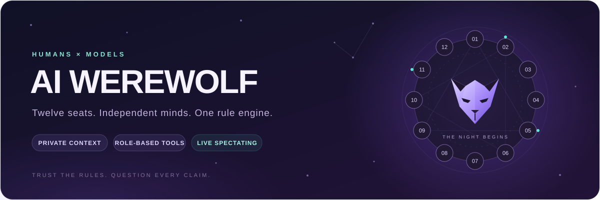
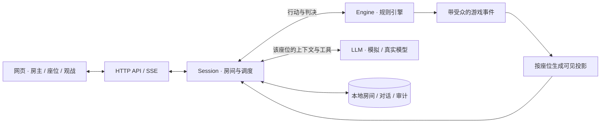

<div align="center">



# 🌘 AI 狼人杀

**让不同的大模型坐上同一张圆桌，让规则引擎主持这一夜。**

真人与 AI 混坐 · 每席独立上下文 · 身份技能工具 · 实时观战与复盘


[快速开始](#-快速开始) · [开一局](#-从建房到天黑) · [配置模型](#-把模型请上桌) · [项目架构](#-引擎与座位如何配合) · [开发与扩展](#-开发与扩展)

指南语言：**简体中文**（本页） · [English quick start](docs/Quick-start.en.md) · [日本語クイックスタート](docs/Quick-start.ja.md)

</div>

---

## ✨ 这张桌上有什么

十二个座位，可以坐真人，也可以接入不同模型。狼人密谈、预言家查验、女巫用药、守卫守护、猎人开枪，以及上警、退水、PK、警徽流转，都由规则引擎推进和裁决。

| 能力 | 你能做什么 |
| :--- | :--- |
| 🧠 **多模型同局** | 为每个 AI 座位选择模型、扮演风格、温度和思考强度，观察它们如何站边、悍跳与归票。 |
| 👥 **真人与 AI 混坐** | 给朋友分配座位链接，其余位置交给模型；也可以让全部模型自行对局。 |
| 🔐 **座位信息隔离** | 每个座位保存自己的对话。查验、刀口、狼队密谈按受众送达；网页与模型基于同一座位投影。 |
| ⚖️ **规则引擎当法官** | 技能效果、投票权重、死亡连锁和胜负由代码判定，模型通过工具提交行动。 |
| 🛠️ **明确的动作工具** | 救人与毒人、移交与撕徽、开枪与放弃分开提交；本轮菜单直接列出合法动作和座位。 |
| 🎛️ **思考强度按钮** | 跟随模型、关闭、轻度、标准、深度；按模型与入口能力启用对应档位。 |
| 🔌 **三种模型协议** | Chat Completions、Responses、Anthropic Messages；独立座位历史、原生工具续接与缓存统计。 |
| 👁️ **实时观战** | 座位环、发言记录、票型和模型输出随对局更新；房主可查看上帝视角与调用审计。 |
| ⏯️ **掌控节奏** | 暂停、单步、继续、终结，结束后用同配置再来一局。 |
| 📦 **本地保存** | 房间、座位对话和审计写入本地文件，可导出公开记录或上帝记录。 |
| 🎬 **离线制作素材** | 导出按昼夜分章的上帝剪辑稿与画面事实，固定每席配音标识，供后续配音、字幕与离线渲染。 |

> [!TIP]
> **没有 API Key 也能体验。** 所有座位保留为「模拟玩家」，即可运行完整流程。模拟玩家用于验证规则与调度，不代表真实模型的推理水平。

## 🚀 快速开始

准备 **Node.js 22.12 或更新版本**、**pnpm** 和 Git。当前网页依赖 Vite 8，使用较早的 Node 22 小版本时请先升级。

```bash
git clone https://github.com/ZhiqiangBao/ai-werewolf.git
cd ai-werewolf
pnpm install
pnpm dev
```

启动后打开 **[http://127.0.0.1:5173/](http://127.0.0.1:5173/)**。开发模式下，网页和 API 共用这个端口。默认支持局域网连接；房主从本机地址打开也能在邀请区自动生成使用局域网地址的邀请，无需手动替换房主链接。

Windows 上可在项目目录用 `pnpm restart` 在后台启动或重启服务，`pnpm status` 查看状态，`pnpm stop` 保存并停止服务。首次启动使用开发模式；`pnpm start` 用于后台启动生产模式（先运行 `pnpm build`），`pnpm dev` 保留前台开发方式。

<details>
<summary><b>🔧 还没有 pnpm？展开安装方式</b></summary>

可以通过 npm 安装：

```bash
npm install -g pnpm
```

如果 Node 环境已经提供 Corepack，也可以使用：

```bash
corepack enable
```

Windows 上 `corepack enable` 遇到权限问题时，使用上面的 npm 安装方式即可。

</details>

<details>
<summary><b>📦 使用生产模式启动</b></summary>

先构建网页，再启动服务：

```bash
pnpm build
pnpm start
```

修改网页源码后需要重新构建。服务端代码更新后需要重启服务。

</details>

## 🎲 从建房到天黑

1. **创建房间**：首页点击「创建房间」，进入房主配置页。
2. **挑选版型**：九人经典、十二人预女猎守、预女猎白或镜隐迷踪，并按需要调整规则选项。
3. **安排座位**：选择真人、模拟玩家或已配置的模型。模型选好后，可逐席点击「测通」。
4. **调整风格与思考**：展开座位「设置」，配置扮演风格、思考强度等选项。
5. **分发邀请**：房主链接留给自己；座位链接发给对应玩家；观战链接交给旁观者。「邀请链接」会自动选择其他设备可访问的局域网地址；多网卡时可切换「分享地址」，也可手动填写反向代理网址。复制和二维码使用同一个分享地址，二维码在网页本地生成。
6. **真人准备**：玩家打开自己的座位链接，确认昵称并准备。所有真人准备后，房主开始游戏；身份随机发放，引擎主持全部流程。

真人页面支持轮次提示、提交回执和刷新恢复草稿。房主本人参加时也应使用座位链接。详见 [真人玩家接入](docs/真人玩家接入.md)。

**界面语言**（简体中文、English、日本語）可由每个浏览器单独选择。**对局语言**在创建房间时选择，开局后固定；它决定规则卡和法官消息的语言，也会作为模型的语言要求。模型不一定遵守该要求；玩家已经提交的发言不会翻译。

对局记录支持当前视角已提交发言的自动朗读、单条重听、暂停和语速调整，可选择浏览器原生、Qwen、小米 MiMo 及其他 TTS 提供方。在首页「模型与语音」统一管理模型和 TTS；语音服务填写名称、完整 URL 和 Key，选择协议模板并补齐模型／音色后可手动试听，各房间直接选用。密钥加密保存，现有环境配置保持兼容，详见 [发言朗读](docs/发言朗读.md)。

| 视角 | 能看到什么 | 能操作什么 |
| :--- | :--- | :--- |
| **房主／上帝** | 全部身份、公开与私密记录、各模型输出、调用审计 | 配置房间、开始、暂停、单步、继续、终结、导出上帝记录 |
| **座位玩家** | 公开记录、自己的身份与私密信息、自己的模型输出 | 按当前任务发言、投票或使用技能 |
| **旁观者** | 公开发言、法官公告、公开票型与结果 | 观看对局 |

出局图标遵循同一信息边界：房主可看到狼刀、毒药、同守同救等具体夜间死因；座位玩家和旁观者只看到「夜晚出局」这一公开类别。放逐、猎枪和自爆使用各自的公开图标。

> [!IMPORTANT]
> 邀请链接中的凭证就是对应身份的访问权限，请按座位分发。关闭网页不会停止服务端的模型调用；需要结束对局时，请使用房主页面的「终结」。

**暂停**会停止继续推进，之后可以单步或继续。**终结**会取消正在进行的模型请求，将本局记为无胜负的流局，不公开身份，也不生成正常结束时的复盘。

正常结束后可查看身份与夜间行动复盘，也可以点击「同配置再来一局」，沿用座位配置并生成新的房间与凭证。

## 🃏 版型与规则

| 版型 | ID | 狼人阵营 | 好人阵营 |
| :--- | :--- | :--- | :--- |
| **九人经典（预女猎）** | `classic9` | 狼人 ×3 | 平民 ×3、预言家、女巫、猎人 |
| **十二人预女猎守** · 默认 | `standard12` | 狼人 ×4 | 平民 ×4、预言家、女巫、猎人、守卫 |
| **十二人预女猎白** · 扩展示例 | `idiot12` | 狼人 ×4 | 平民 ×4、预言家、女巫、猎人、白痴 |
| **十二人镜隐迷踪** · 进阶 | `mirror12` | 狼人 ×3、觉醒隐狼 | 平民 ×4、魔镜少女、女巫、猎人、守卫 |

镜隐迷踪支持具体身份查验、整局一次模仿、延迟启用复制技能及隐狼继承刀权。真实阵营与查验表现独立；完整判例见 [镜隐迷踪规则](docs/镜隐迷踪规则.md)。

默认采用**闭眼局、屠边、竞选警长**。出局时不公开身份，正常结束后统一复盘。

对局记录显示发言、狼队密谈、上警名单、票型、出局、警徽、实际技能与结果；不同视角只显示获准查看的信息。

房主可以调整界面中开放的规则，例如屠边／屠城、是否竞选警长、竞选时机、退水者是否投票、是否允许弃票，以及角色相关的用药和守护选项。具体可调项随版型变化，页面规则卡显示本局采用的规则。

<details>
<summary><b>⚖️ 展开常用规则速览</b></summary>

| 环节 | 默认行为 |
| :--- | :--- |
| 基础版型夜间顺序 | 守卫 → 狼人 → 预言家 → 女巫，缺少的角色跳过；镜隐迷踪见专项规则。 |
| 狼人落刀 | 存活狼人提交刀口；可空刀、可刀队友，空刀不计票。 |
| 预言家 | 查验结果区分好人或狼人，私密发送给查验者。 |
| 女巫 | 默认不可自救、同夜不可既救又毒；解药耗尽后不再获知刀口。 |
| 守卫 | 可空守、可自守，不能连续两晚守护同一人。 |
| 同守同救 | 同一刀口同时被守护、被解药救起时仍会出局。 |
| 猎人 | 出局后是否开枪由死因决定；含毒的死因不能开枪。 |
| 放逐投票 | 同时秘密提交，收齐后公开谁投了谁；警长记 1.5 票。 |
| 平票 | 放逐平票先 PK 一次，再平为平安日；警长竞选平票则无警长。 |

实际对局采用的规则以房间页面规则卡为准；历史房间按开局时保存的规则继续运行。

</details>

## 🧠 把模型请上桌

### 统一模型名单

在运行服务的电脑上，通过本机地址（默认 `http://127.0.0.1:5173/`）打开首页「模型与语音」。在「模型库」选择接口协议，填写模型名称和 `baseURL`，再选择密钥来源：直接填写 API Key，或从「环境变量」下拉菜单选择变量名。点「添加」后，看到添加成功提示即可；之后可在房间座位中选择该模型并点「测通」。

| 配置项 | 说明 |
| :--- | :--- |
| 模型名称 | 服务商接受的模型 ID，例如你账户已开通的模型名称。 |
| 接口协议 | Chat Completions / Responses / Anthropic Messages；旧条目缺省为 Chat Completions。 |
| baseURL | 填写服务商提供的 API 根地址；系统按所选协议补全请求路径。也兼容已经包含完整请求路径的地址；百炼 Anthropic 通常使用 `/apps/anthropic` 根，勿沿用 Chat 的路径。 |
| 密钥来源 | 直接填写的 API Key 会加密保存在项目数据中。使用环境变量前，先在项目 `data/model-key-envs.json` 登记变量名（若设置了 `WEREWOLF_DATA`，则写入该数据目录）；模型库只保存所选变量名，不保存变量值。 |
| 输出方式 | 优先使用「工具调用」；不支持工具调用的模型可使用「JSON 文本」，仍由引擎校验行动。 |
| 扮演风格 | 调整措辞和冒险倾向；不会赋予额外信息或改变规则。 |

要使用环境变量密钥，请按顺序操作：

1. 在项目 `data/model-key-envs.json` 新建或编辑文件登记变量名；若设置了 `WEREWOLF_DATA`，则在该数据目录中创建或编辑 `model-key-envs.json`。例如：

   ```json
   {"variables":["EXAMPLE_API_KEY"]}
   ```

   文件只存变量名，不要写入 API Key。
2. 在运行服务的电脑上设置同名环境变量及其密钥值。Windows 用户可打开「系统属性 → 高级 → 环境变量」，在「用户变量」中选择「新建」，填写变量名和值。保存后打开**新的终端**再重启服务；原终端不一定能读取新值。
3. 重启服务，并刷新模型库页面。macOS 或 Linux 用户也可以在启动服务的终端设置环境变量；项目不会自动从 `.env` 文件读取该值。
4. 在「密钥来源」中选择「环境变量」，然后从下拉菜单选择 `EXAMPLE_API_KEY`。点「添加」或「保存修改」。

macOS 或 Linux 使用 Bash／Zsh 时，也可以在启动服务的终端依次执行下面的命令。第一行等待输入密钥，输入时不会显示字符，输完按回车：

```bash
read -rs EXAMPLE_API_KEY
export EXAMPLE_API_KEY
pnpm restart
```

环境变量的值必须由服务进程继承。若模型列表显示「环境变量未设置」，请核对操作系统环境变量的名称和值，再重启服务并刷新页面。**三种协议均已接入。** 测通按所选协议发出请求；不会在失败时自动换协议。新增接口的输出 token 上限可在座位设置中调整，依供应商计数。实现与地址示例见[多协议实现文档](docs/模块化与多协议设计.md)。

<details>
<summary><b>📥 将 Qwen Code 的旧模型一次性迁入项目</b></summary>

模型统一保存在忽略的 `data/models.json`，密钥使用项目主密钥加密。**日常运行不再读取全局 settings。** 旧安装可在仓库根目录显式运行一次：

```powershell
pnpm models:migrate
```

迁移只读 `~/.qwen/settings.json` 的 `openai`、`responses`、`anthropic` 模型分组，通过对应环境变量或文件内的 `env` 解析密钥；可用 `WEREWOLF_QWEN_SETTINGS` 指定一次性来源。保留旧模型 ID、实际模型名、协议和项目已有条目；写入前备份已有模型文件，原全局文件与 `data/secret.key` 保持不变。迁移结果与网页新增模型进入同一库，删除后不会自动重新导入。

迁移主机或备份时同时保留 `models.json` 与原主密钥（`data/secret.key` 或原 `WEREWOLF_SECRET`）。项目文件缺少主密钥时不能通过重新生成主密钥解开已有凭据。没有 pnpm 时可用 `node node_modules/tsx/dist/cli.mjs scripts/migrate-models.ts`。成功导入后会记录迁移完成标记，无需重复执行。

</details>

### 修改或删除模型

在运行服务的电脑上打开首页「模型与语音」，展开「模型库」，找到要处理的模型：

- **修改模型**：点击「编辑」，修改名称、地址、协议或密钥来源，再点「保存修改」。直接密钥输入框留空会保留原密钥；环境变量来源可保留原选择，或从下拉菜单改选已登记的变量名。切换到直接密钥时，输入要使用的 API Key。
- **删除模型**：点击「删除」，模型会从列表移除，不再供新房间选择。历史记录保留；直接密钥仍加密保存在项目数据中，环境变量来源只保留变量名，变量值仍由服务进程提供。

编辑模型库条目不会改写任何已有房间中保存的模型配置；这些房间继续使用原配置。删除时，如果有未结束房间中的 AI 座位实际使用该模型，页面会拒绝删除并显示房间编号；先在这些房间换用其他模型或结束对局，再回来删除。新增、编辑和删除只能在运行服务的电脑上通过 `http://127.0.0.1:5173/` 操作，端口以实际设置为准。

停用、恢复和别名归并等内部维护交给 AI 助手或维护者处理，操作流程见[模型库内部维护](docs/模型库内部维护.md)。

### 思考强度：给推理留出合适的空间

在 AI 座位「设置」中切换档位：

| 按钮 | 行为 |
| :---: | :--- |
| **跟随模型** | 明确采用接口自身默认的思考设置。 |
| **关闭** | 对支持关闭思考的模型发送关闭参数。 |
| **轻度** | 使用较低的原生推理力度，或较小的独立思考预算。 |
| **标准** | 使用中间档的力度或预算。 |
| **深度** | 使用较高的力度或预算，通常需要更多生成时间。 |

可选档位取决于模型与接口能力；不支持的档位会禁用。更换模型后，设置会保留兼容选项，不兼容时改用新模型支持的默认策略。

未手动选择时，支持轻度思考的模型默认使用轻度；没有轻度档时跟随模型。较深的思考可能需要更多时间，同一档位在不同模型上的效果也不相同。

### 行动由规则引擎校验

每名玩家只能使用当前阶段和身份允许的行动；模型提交的行动也由规则引擎检查，不会根据模型的思考文字擅自更改目标。

### 时限与超时

| 行动类型 | 默认时限 | 默认推进间隔 |
| :--- | :---: | :--- |
| 发言、遗言、狼队密谈 | **180 秒** | **1200 毫秒** |
| 放逐投票、警长投票 | **90 秒** | **1200 毫秒** |
| 其他技能行动 | **90 秒** | **1200 毫秒** |

房主可在房间配置中调整各类行动时限和行动间隔。真人与模型采用相同的行动分类；暂停后可以继续或单步推进。

如果模型未及时行动，房主可以查看审计中的错误原因并调整行动时限；旁听超时可在 AI 座位「设置」中单独调整。更多排查方法见[消息与超时诊断](docs/消息与超时诊断.md)。

### 从记录到成片

房主可在「链接与导出」中点击 **导出视频剪辑稿**，获得用于后续离线制作的对局内容。单玩家视角导出只包含该玩家有权查看的事件。

## 🏗️ 引擎与座位如何配合



**事实由引擎产生，信息按受众分发，行动由引擎校验。** 发言可以真假难辨，工具调用必须满足本局规则。

每个座位拥有独立、持续追加的对话。其他玩家的公开发言以座位标签送达；模型自己的回复和工具反馈留在自己的上下文中。私密消息不会因为另一个座位使用相同模型或密钥而共享。

座位历史采用 **v2 语义格式＋该座位的原生协议数据**。Responses 完整回传 output items；Anthropic 原样保留 thinking/signature，并把工具结果放在正确位置。模型绑定改变后只转换可移植语义，不把旧签名、加密推理或其他座位的续接数据带过去。

缓存行为由服务商决定，项目不会主动要求写入显式缓存；是否命中及实际折扣以服务商为准。详见[缓存与价格](docs/模块化与多协议设计.md#缓存与价格)。

规则卡、身份说明和固定工具定义构成稳定的开局部分。当前阶段、存活状态和技能资源由引擎校验，通过后续消息告知座位，避免每轮重新改写工具集合。实时思考展示单独保存并按视角显示，不作为公共游戏事件广播。

### 仓库地图

```text
ai-werewolf/
├─ apps/
│  ├─ server/             HTTP API、SSE 与网页托管
│  └─ web/                React 房间配置、上帝页、座位页与观战页
├─ packages/
│  ├─ protocol/           规则、行动、事件、投影及共享配置
│  ├─ engine/             角色、流程、技能结算与胜负判定
│  ├─ llm/                提示词、模拟玩家与模型适配器
│  └─ session/            房间、座位对话、调度、存储与密钥处理
└─ docs/                  规则基线、诊断记录与架构设计
```

| 技术 | 用途 |
| :--- | :--- |
| TypeScript + pnpm workspace | 单仓库共享类型与模块依赖。 |
| React 19 + Vite 8 | 页面交互、开发与构建。 |
| Node.js HTTP + SSE | API 服务、网页托管、实时更新通知。 |
| Vitest | 规则、可见性、模型适配与会话回归验证。 |
| 本地 JSON / JSONL | 保存房间、每席历史与追加审计。 |

## 🛠️ 开发与扩展

### 常用命令

| 命令 | 用途 |
| :--- | :--- |
| `pnpm dev` | 开发模式，网页与接口共用端口。 |
| `pnpm build` | 构建生产网页。 |
| `pnpm start` | 启动生产服务，需先构建网页。 |
| `pnpm test` | 运行规则、可见性、会话与模型适配测试。 |
| `pnpm typecheck` | 检查整个工作区的 TypeScript 类型。 |
| `pnpm simulate` | 用随机合法行动运行一局引擎模拟，不调用真实模型。 |

引擎模拟可以指定版型与种子：

```bash
pnpm simulate classic9 demo
pnpm simulate standard12 night-001
```

自动化回归覆盖核心对局、座位信息隔离、旧存档恢复、模型协议及视频制作；各流程的具体范围见测试文件。

### 新增版型与角色

- **组合已有角色**：在 `packages/engine/src/presets.ts` 添加版型配置，再补充对应规则与对局测试。
- **增加新角色**：新增 `RoleModule`，通过 `tools` 声明固定工具，在 `builtin.ts` 注册，补充提示、模拟策略和可见性测试；无需再修改公共目录的身份分支。
- **动态复制技能**：镜隐迷踪已分离真实身份、查验表现、独立资源与启用时点，使用多夜间步骤和生命周期钩子。新角色复制效果仍须单独定义并验证。
- **扩展模型协议**：在 `llm/src/adapters` 注册编码与解析器，复用语义历史、工具 Schema、共享网络层和规则引擎。

角色工具注册、语义历史、三协议适配器、真人候场和镜隐迷踪已落地。扩展点见 [模块化与多协议实现](docs/模块化与多协议设计.md)，本次开发的优缺点与后续优先级见 [架构评估与后续演进](docs/架构评估与后续演进.md)。

<details>
<summary><b>🧪 使用已配置模型做诊断</b></summary>

下面的命令需要已有模型配置，并会产生真实 API 请求。统计保存到 `data/diagnostics/`，不会修改作为样本的已有房间。

```bash
# 真实座位上下文：默认四个入口，每个各做旁听与投票
node --import tsx packages/session/scripts/diagnose-models.ts --live --room=ROOM_ID

# 仅测试轻度投票
node --import tsx packages/session/scripts/diagnose-models.ts --live --room=ROOM_ID --thinking=low --purpose=action --models=qwen3.8-flash,qwen3.8-max-preview

# 对照关闭思考
node --import tsx packages/session/scripts/diagnose-models.ts --live --room=ROOM_ID --thinking=off --models=deepseek-v4-pro,qwen3.8-max-preview

# 独立内存对局：少量真实请求，其余由模拟玩家完成
node --import tsx packages/session/scripts/smoke-models.ts --live

# 注入错误工具调用，验证真实模型收到反馈后修正
node --import tsx packages/session/scripts/smoke-models.ts --live --retry-only

# 只读统计指定房间的旁听/行动超时，不发请求
node --import tsx packages/session/scripts/diagnose-timeouts.ts --room=ROOM_ID

# 对指定座位的真实超时输入做轻度重试，不提交对局行动
node --import tsx packages/session/scripts/diagnose-timeouts.ts --room=ROOM_ID --live --thinking=low --seats=2,9

# 对指定模型条目做两轮合成工具续接与缓存测试，不读取真实对局
node --import tsx packages/session/scripts/probe-protocols.ts --live --model=MODEL_ENTRY_ID --protocol=responses

# 用合成场景检查救人、移交、不开枪等动作编码，不读取真实房间
node --import tsx packages/session/scripts/probe-action-tools.ts --live --model=MODEL_ENTRY_ID

# 只挑选几个场景，支持三种协议
node --import tsx packages/session/scripts/probe-action-tools.ts --live --model=MODEL_ENTRY_ID --protocol=responses --cases=witch_save,badge_transfer,hunter_hold_fire
```

| 参数 | 可选值或要求 |
| :--- | :--- |
| `--live` | 必填，显式开启真实请求。 |
| `--room` | 样本房间 ID，需要有 1 号座位的投票审计。 |
| `--thinking` | `default` / `off` / `low` / `medium` / `high`。 |
| `--purpose` | `both` / `listen` / `action`。 |
| `--models` | 从脚本预设的四个入口中按模型 ID 筛选，以逗号分隔。 |

上下文诊断并发最多两个入口；不支持的思考档位会在发请求前被拒绝。完整流程脚本依赖已配置的 Token Plan `qwen3.8-flash` 与 `deepseek-v4-pro`。统计文件保留耗时、错误分类与字符数，不保存密钥或模型原文。

</details>

## ⚙️ 配置与数据

### 环境变量

| 变量 | 默认值 | 作用 |
| :--- | :--- | :--- |
| `PORT` | `5173` | HTTP 监听端口。 |
| `HOST` | `0.0.0.0` | 默认支持局域网连接；仅本机使用可显式设置为 `127.0.0.1`。监听设置改变后需重启服务。 |
| `WEREWOLF_DATA` | 项目下的 `data/` | 房间、模型配置、密钥与对局数据目录。 |
| `WEREWOLF_QWEN_SETTINGS` | `~/.qwen/settings.json` | 仅 `models:migrate` 使用的一次性旧配置来源，运行时不读取。 |
| `WEREWOLF_SECRET` | 未设置时生成 `data/secret.key` | 加密直接填写的供应商 API Key 的项目主密钥；设置后需保持稳定。它不是供应商 API Key。 |

<details>
<summary><b>🌐 自定义端口与局域网访问示例</b></summary>

PowerShell：

```powershell
$env:HOST = '0.0.0.0'
$env:PORT = '5173'
pnpm dev
```

macOS / Linux：

```bash
HOST=0.0.0.0 PORT=5173 pnpm dev
```

#### 局域网联机步骤

**同一局域网的其他设备可以作为真人玩家加入，也可以只观战、旁听公开发言。** 只需一台电脑运行本项目，其他设备使用浏览器，不需要安装 Node.js 或配置模型密钥。

1. 在服务器电脑上正常运行 `pnpm dev`，或构建后运行 `pnpm start`；默认监听 `0.0.0.0`，支持局域网连接。若曾设置 `HOST=127.0.0.1`，改为 `0.0.0.0` 后重启。`0.0.0.0` 是监听设置，不是发给玩家的访问地址。
2. 房主照常从 `http://127.0.0.1:5173/` 打开房间，展开「邀请链接」。「分享地址」会自动使用真实的局域网 IPv4 地址，优先普通网卡的私网地址；例如 `http://192.168.1.23:5173/`。多网卡、VPN 或虚拟网卡环境可按当前 Wi-Fi／网线连接手动选择，换网后点击「刷新地址」。不需要房主手动改写链接。
3. 把对应席位设为「真人」，显示该席二维码让同一局域网设备扫描，或复制该席邀请发给对应玩家。扫码后直接进入该席候场页，确认昵称并准备；全部真人准备后房主开局。仅凭房间号无法加入，也不能用观战链接代替座位链接操作。
4. 旁观者扫描「观战」二维码或打开观战链接，只获得公开视角。原生或已配置 TTS 的朗读按当前视角提供，必要时由使用者在页面中开启播放。
5. 经域名、HTTPS 或反向代理打开房间时，自动沿用当前网址与部署路径；也可选择「手动填写网址」指定其他设备可访问的服务地址。只填写服务地址，不要粘贴带 `#/host/...` 等凭证后缀的房间链接。分享地址不能是 localhost、127.0.0.1 等本机地址；没有可用地址时不生成默认二维码。
6. 刷新或断线后重新打开原座位链接即可恢复当前席位；草稿只保存在原浏览器标签页，不会自动迁移到另一台设备。

若其他设备打不开二维码指向的页面，可先打开所选分享地址的首页，检查服务器是否仍在运行、IP 和端口是否正确、设备是否在互通的局域网、路由器是否开启访客／设备隔离，以及服务器防火墙是否允许该程序或端口的局域网入站访问。这里不需要设置公网端口映射。`localhost` 和 `127.0.0.1` 在每台设备上都指向它自己，不能发给另一台设备；仅本机监听时邀请区会提示重启，不会把它当作正常分享地址。

当前支持完整邀请链接和本地二维码，**尚未实现站内短链**。短链后续应由本服务自行生成并保留原有权限边界；无需把含凭证的邀请交给第三方短链服务。房主链接始终保留上帝权限，不发给普通玩家。

当前版本主要面向本地与可信环境使用；公网部署需要自行配置 HTTPS 与访问控制。

</details>

### 本地会保存什么

房间、模型配置和对局记录保存在运行服务的电脑上。直接填写的 API Key 使用项目主密钥加密保存，网页不会显示完整密钥；使用环境变量时，项目数据只保存变量名，变量值不会写入数据目录。备份或迁移时，请保留整个数据目录（包括 `model-key-envs.json`），并保留原项目主密钥：若使用默认密钥文件，备份 `data/secret.key`（或 `WEREWOLF_DATA` 下的 `secret.key`）；若设置了 `WEREWOLF_SECRET`，在目标服务中继续使用同一个值。另外，在目标操作系统的用户环境中重新设置所用的供应商 API Key 环境变量，再重启服务。只复制加密后的模型配置，无法在另一把主密钥下恢复直接密钥，也不能替代环境变量设置。

## 📚 文档与常见问题

| 想了解什么 | 从这里开始 |
| :--- | :--- |
| 想了解规则判定和信息如何分发 | [固定规则与信息分发](docs/固定规则与信息分发.md) |
| 消息重复、提前托管、模型超时的原因和实测 | [消息与超时诊断](docs/消息与超时诊断.md) |
| 真人准备、断线恢复、行动接口 | [真人玩家接入](docs/真人玩家接入.md) |
| 镜隐迷踪完整规则与模仿判例 | [镜隐迷踪规则](docs/镜隐迷踪规则.md) |

<details>
<summary><b>模型为何经常说「过」或弃票？</b></summary>

请房主查看审计中的请求类型和错误原因。模型可能因接口故障或超出行动时限而未完成；可选择模型支持的较低思考档，或在房间／座位设置中调整相应时限。详细排查方法见[消息与超时诊断](docs/消息与超时诊断.md)。

</details>

<details>
<summary><b>配置会丢吗？关闭浏览器后游戏会停止吗？</b></summary>

配置与对局保存在服务端本地数据目录。浏览器是客户端，关闭页面不会停止服务端自动推进；使用房主页面的暂停或终结控制对局。

</details>

## 外部 AI 席位客户端

独立客户端可让外部 AI 工具通过真人席位 API 参局。需要 Node.js 22.12 或更新版本，不需要安装本仓库依赖。从[项目 Releases](https://github.com/ZhiqiangBao/ai-werewolf/releases)下载最新客户端压缩包，并按发布页提供的校验文件检查下载内容。

将客户端解压到独立目录后，以该目录作为工作区打开你的 agent，再把游戏中的**玩家席位链接**发给它。agent 会完成入座、等待和提交行动；把房主或观战链接发给它无法入座。

入座后查看 agent 返回的房间和座位号，确认它进入预期席位。公开发言和狼人密谈按本局语言进行，具体规则以服务端本局规则卡与身份说明为准。

每个席位链接都包含该席位的访问权限，只发给对应玩家，不要公开或转发给其他人。遇到网络异常时，请先让 agent 检查当前席位状态，再决定是否重试。

## 🤝 贡献与协作

项目由 [ZhiqiangBao](https://github.com/ZhiqiangBao) 发起与维护，**[Codex（OpenAI）](https://github.com/apps/chatgpt-codex-connector)** 与 **[Cursor](https://cursor.com)** 参与辅助开发。

Codex 参与完成的改动通过提交中的共同作者署名（`Co-authored-by`）记录，让协作贡献可以从提交历史中追溯。

---

<div align="center">

**天黑请闭眼。下一轮，谁会先看穿谁？**

[项目仓库](https://github.com/ZhiqiangBao/ai-werewolf) · [反馈问题](https://github.com/ZhiqiangBao/ai-werewolf/issues) · [返回顶部](#-ai-狼人杀)

</div>
