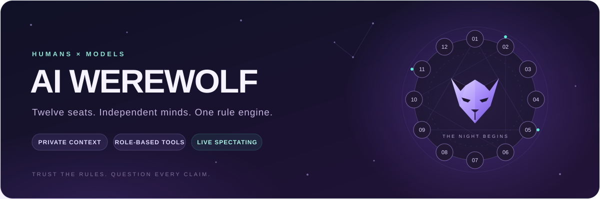
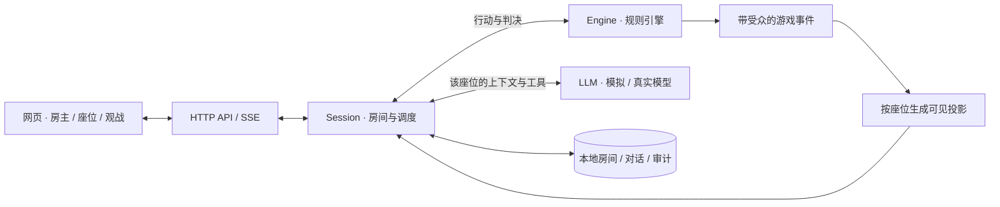

<div align="center">



# 🌘 AI 狼人杀

**让不同的大模型坐上同一张圆桌，让规则引擎主持这一夜。**

真人与 AI 混坐 · 每席独立上下文 · 身份技能工具 · 实时观战与复盘


[快速开始](#-快速开始) · [开一局](#-从建房到天黑) · [配置模型](#-把模型请上桌) · [项目架构](#-引擎与座位如何配合) · [开发与扩展](#-开发与扩展)

</div>

---

## ✨ 这张桌上有什么

十二个座位，可以坐真人，也可以接入不同模型。狼人密谈、预言家查验、女巫用药、守卫守护、猎人开枪，以及上警、退水、PK、警徽流转，都由规则引擎推进和裁决。

| 能力 | 你能做什么 |
| :--- | :--- |
| 🧠 **多模型同局** | 为每个 AI 座位选择模型、扮演风格、温度和思考强度，观察它们如何站边、悍跳与归票。 |
| 👥 **真人与 AI 混坐** | 给朋友分配座位链接，其余位置交给模型；也可以让全部模型自行对局。 |
| 🔐 **座位信息隔离** | 每个座位保存自己的对话。查验、刀口、狼队密谈按受众送达；网页与模型基于同一座位投影。 |
| ⚖️ **规则引擎当法官** | 技能效果、投票权重、死亡连锁和胜负由代码判定，模型通过工具提交行动。 |
| 🛠️ **明确的动作工具** | 救人与毒人、移交与撕徽、开枪与放弃分开提交；本轮菜单直接列出合法动作和座位。 |
| 🎛️ **思考强度按钮** | 跟随模型、关闭、轻度、标准、深度；按模型与入口能力启用对应档位。 |
| 🔌 **三种模型协议** | Chat Completions、Responses、Anthropic Messages；独立座位历史、原生工具续接与缓存统计。 |
| 👁️ **实时观战** | 座位环、发言记录、票型和模型输出随对局更新；房主可查看上帝视角与调用审计。 |
| ⏯️ **掌控节奏** | 暂停、单步、继续、终结，结束后用同配置再来一局。 |
| 📦 **本地保存** | 房间、座位对话和审计写入本地文件，可导出公开记录或上帝记录。 |
| 🎬 **离线制作素材** | 导出按昼夜分章的上帝剪辑稿与画面事实，固定每席配音标识，供后续配音、字幕与离线渲染。 |

> [!TIP]
> **没有 API Key 也能体验。** 所有座位保留为「模拟玩家」，即可运行完整流程。模拟玩家用于验证规则与调度，不代表真实模型的推理水平。

## 🚀 快速开始

准备 **Node.js 22.12 或更新版本**、**pnpm** 和 Git。当前网页依赖 Vite 8，使用较早的 Node 22 小版本时请先升级。

```bash
git clone https://github.com/ZhiqiangBao/ai-werewolf.git
cd ai-werewolf
pnpm install
pnpm dev
```

启动后打开 **[http://127.0.0.1:5173/](http://127.0.0.1:5173/)**。开发模式下，网页和 API 共用这个端口。

<details>
<summary><b>🔧 还没有 pnpm？展开安装方式</b></summary>

可以通过 npm 安装：

```bash
npm install -g pnpm
```

如果 Node 环境已经提供 Corepack，也可以使用：

```bash
corepack enable
```

Windows 上 `corepack enable` 遇到权限问题时，使用上面的 npm 安装方式即可。

</details>

<details>
<summary><b>📦 使用生产模式启动</b></summary>

先构建网页，再启动服务：

```bash
pnpm build
pnpm start
```

修改网页源码后需要重新构建。服务端代码更新后需要重启服务。

</details>

## 🎲 从建房到天黑

1. **创建房间**：首页点击「创建房间」，进入房主配置页。
2. **挑选版型**：九人经典、十二人预女猎守、预女猎白或镜隐迷踪，并按需要调整规则选项。
3. **安排座位**：选择真人、模拟玩家或已配置的模型。模型选好后，可逐席点击「测通」。
4. **调整风格与思考**：展开座位「设置」，配置扮演风格、思考强度等选项。
5. **分发邀请链接**：房主链接留给自己；座位链接发给对应玩家；观战链接交给旁观者。
6. **真人准备**：玩家打开自己的座位链接，确认昵称并准备。所有真人准备后，房主开始游戏；身份随机发放，引擎主持全部流程。

真人页面支持轮次提示、提交回执和刷新恢复草稿。房主本人参加时也应使用座位链接。详见 [真人玩家接入](docs/真人玩家接入.md)。

| 视角 | 能看到什么 | 能操作什么 |
| :--- | :--- | :--- |
| **房主／上帝** | 全部身份、公开与私密记录、各模型输出、调用审计 | 配置房间、开始、暂停、单步、继续、终结、导出上帝记录 |
| **座位玩家** | 公开记录、自己的身份与私密信息、自己的模型输出 | 按当前任务发言、投票或使用技能 |
| **旁观者** | 公开发言、法官公告、公开票型与结果 | 观看对局 |

> [!IMPORTANT]
> 邀请链接中的凭证就是对应身份的访问权限，请按座位分发。关闭网页不会停止服务端的模型调用；需要结束对局时，请使用房主页面的「终结」。

**暂停**会停止继续推进，之后可以单步或继续。**终结**会取消正在进行的模型请求，将本局记为无胜负的流局，不公开身份，也不生成正常结束时的复盘。

正常结束后可查看身份与夜间行动复盘，也可以点击「同配置再来一局」，沿用座位配置并生成新的房间与凭证。

## 🃏 版型与规则

| 版型 | ID | 狼人阵营 | 好人阵营 |
| :--- | :--- | :--- | :--- |
| **九人经典（预女猎）** | `classic9` | 狼人 ×3 | 平民 ×3、预言家、女巫、猎人 |
| **十二人预女猎守** · 默认 | `standard12` | 狼人 ×4 | 平民 ×4、预言家、女巫、猎人、守卫 |
| **十二人预女猎白** · 扩展示例 | `idiot12` | 狼人 ×4 | 平民 ×4、预言家、女巫、猎人、白痴 |
| **十二人镜隐迷踪** · 进阶 | `mirror12` | 狼人 ×3、觉醒隐狼 | 平民 ×4、魔镜少女、女巫、猎人、守卫 |

镜隐迷踪支持具体身份查验、整局一次模仿、延迟启用复制技能及隐狼继承刀权。真实阵营与查验表现独立；完整判例见 [镜隐迷踪规则](docs/镜隐迷踪规则.md)。

默认采用**闭眼局、屠边、竞选警长**。出局时不公开身份，正常结束后统一复盘。

对局记录显示发言、狼队密谈、上警名单、票型、出局、警徽、实际技能与结果。Agent 的行动问话、工具拒绝、托管诊断和随机种子留在内部记录中，避免干扰观众。

房主可以调整界面中开放的规则，例如屠边／屠城、是否竞选警长、竞选时机、退水者是否投票、是否允许弃票，以及角色相关的用药和守护选项。具体可调项随版型变化，页面规则卡显示本局采用的规则。

<details>
<summary><b>⚖️ 展开常用规则速览</b></summary>

| 环节 | 默认行为 |
| :--- | :--- |
| 基础版型夜间顺序 | 守卫 → 狼人 → 预言家 → 女巫，缺少的角色跳过；镜隐迷踪见专项规则。 |
| 狼人落刀 | 存活狼人提交刀口；可空刀、可刀队友，空刀不计票。 |
| 预言家 | 查验结果区分好人或狼人，私密发送给查验者。 |
| 女巫 | 默认不可自救、同夜不可既救又毒；解药耗尽后不再获知刀口。 |
| 守卫 | 可空守、可自守，不能连续两晚守护同一人。 |
| 同守同救 | 同一刀口同时被守护、被解药救起时仍会出局。 |
| 猎人 | 出局后是否开枪由死因决定；含毒的死因不能开枪。 |
| 放逐投票 | 同时秘密提交，收齐后公开谁投了谁；警长记 1.5 票。 |
| 平票 | 放逐平票先 PK 一次，再平为平安日；警长竞选平票则无警长。 |

完整规则基线见 [需求说明书](docs/需求说明书.md)；实际配置请结合当前页面规则卡和代码实现查看。

</details>

## 🧠 把模型请上桌

### 统一模型名单

在房间配置页的「模型」面板选择 **接口协议**，填写 **模型名称、接口地址、API Key**。添加一次后，各座位都可以从名单中选择，也可以批量应用到 AI 座位。

| 配置项 | 说明 |
| :--- | :--- |
| 模型名称 | 服务商接受的模型 ID，例如你账户已开通的模型名称。 |
| 接口协议 | Chat Completions / Responses / Anthropic Messages；旧条目缺省为 Chat Completions。 |
| 接口地址 | 所选协议的 API 根或完整端点；接受 `/chat/completions`、`/responses`、`/messages`。百炼 Anthropic 通常使用 `/apps/anthropic` 根，勿沿用 Chat 的路径。 |
| API Key | 对应服务商的密钥，在服务端用于真实调用。 |
| 输出方式 | 优先使用「工具调用」；不支持工具调用的模型可使用「JSON 文本」，仍由引擎校验行动。 |
| 扮演风格 | 调整措辞和冒险倾向；不会赋予额外信息或改变规则。 |

**三种协议均已接入。** 测通按所选协议发出请求；不会在失败时自动换协议。新增接口的输出 token 上限可在座位设置中调整，依供应商计数。实现、地址示例与真实缓存验证见 [多协议实现文档](docs/模块化与多协议设计.md)。

<details>
<summary><b>📥 自动读取 Qwen Code 中已有的模型</b></summary>

默认从 `~/.qwen/settings.json` 读取 `modelProviders.openai`、`responses`、`anthropic` 列表，分别对应三种协议；条目也可显式填写 `apiProtocol`。通过 `envKey` 指定的环境变量，或配置文件的 `env` 字段解析密钥。原有 Chat 条目的 ID 保持兼容。

这些模型以只读方式合并进模型名单，无需逐个重新输入。页面删除操作不会修改 Qwen Code 的配置。

要使用其他配置文件，可以设置 `WEREWOLF_QWEN_SETTINGS`。导入器的具体行为见 `packages/session/src/qwen-presets.ts`。

</details>

### 思考强度：给推理留出合适的空间

在 AI 座位「设置」中切换档位：

| 按钮 | 行为 |
| :---: | :--- |
| **跟随模型** | 明确采用接口自身默认的思考设置。 |
| **关闭** | 对支持关闭思考的模型发送关闭参数。 |
| **轻度** | 使用较低的原生推理力度，或较小的独立思考预算。 |
| **标准** | 使用中间档的力度或预算。 |
| **深度** | 使用较高的力度或预算，通常需要更多生成时间。 |

按钮按**模型与入口能力**启用：强制思考模型不能关闭；只有两个独立档位的接口不会显示三个可用档位。未知型号不启用未经确认的强度调节。更换模型时，保留兼容档位；不兼容时采用新模型的默认策略：支持轻度则选轻度，否则跟随模型。

**未设置过档位的座位，支持轻度时默认选轻度；没有真实轻度档时跟随模型。** 已明确选择的「跟随模型」或其他档位会保留。逐条旁听继续开启。旧房间缺少思考配置时也使用这一默认策略，不自动关闭思考。

档位只改变思考参数，不主动限制正文长度，也不改写系统消息和固定工具定义。不同模型的同名档位不代表相同的 token 数或推理质量，深度思考仍须在行动时限内完成。

### 🛠️ 一个工具，一个明确动作

新开局采用 **v2 动作接口**：标准十二人局所有身份合计 24 种工具，允许同夜双药时为 25 种。每席只获得公共能力和本身份能力，无参数动作填写 `{}`。

| 选择 | 明确提交 |
| :--- | :--- |
| **解药 / 毒药 / 不用药** | `witch_save({})` / `witch_poison({"targetSeat":3})` / `witch_skip({})` |
| **移交 / 撕毁警徽** | `badge_transfer({"recipientSeat":12})` / `badge_tear({})` |
| **开枪 / 放弃** | `hunter_shoot({"targetSeat":3})` / `hunter_hold_fire({})` |
| **上警 / 不上警** | `sheriff_signup({})` / `sheriff_stay_off({})` |
| **自爆 / 本次不自爆** | `wolf_explode({})` / `wolf_decline_explode({})` |
| **投票 / 弃票** | `vote({"targetSeat":3})` / `vote_abstain({})` |

**本轮许可直接写在最新法官菜单里。** 固定目录保持整局稳定，当前目标、剩余药品和合法动作由引擎给出；调用被拒绝时，反馈附上完整菜单。多余字段和错误类型会被拒绝，不能因为参数被忽略而执行相反动作。

旧局继续使用归档的 v1 接口，重启后追加清晰菜单；重启服务后新开局才使用 v2。不会按模型思考文字擅自改目标，也不会将历史行动重写成新版。完整的设计缺陷、修正与真实测试见 [工具说明审计](docs/工具说明审计.md)。

### 时限与超时

| 请求类型 | 时限 | 说明 |
| :--- | :---: | :--- |
| 发言、遗言、狼队密谈 | **180 秒** | 从实际行动请求开始计时。 |
| 放逐投票、警长投票 | **90 秒** | 同时行动的座位分别计时。 |
| 其他技能与旁听 | **90–300 秒** | 在座位「技能与旁听超时」中设置，默认 90 秒。 |

模型先收齐前序消息与当前法官问话，再启动正式行动的计时。旁听失败不会直接变成弃票或「过」；HTTP 重试和兼容降级共用一次请求的总时限。

房主可从审计区分旁听与行动、超时与取消，并查看当次协议、档位、首段文字耗时、思考字符数，以及输入/输出、缓存读取/写入 token。涉及非法工具调用时，模型会收到与调用编号对应的反馈；纠错重试仍使用本轮剩余时间。旁听误调普通工具只返回私有纠错，不会制造一条新的法官拒绝播报。

展开审计里的 **「实际发送的工具与参数格式」**，可核查当次真正编码的 description、JSON Schema 和 tool choice；JSON 兼容模式显示实际格式说明。认证头不进入这份快照，旧审计缺失的字段也不会事后伪造。

### 从记录到成片

在房主「链接与导出」中选择 **导出视频剪辑稿**，或直接读取本地对局：

```bash
node --import tsx packages/session/scripts/export-video.ts --room=ROOM_ID
```

剪辑稿写入 `data/exports/`，包含全部身份、分章配音文案，以及用于重建画面的事实事件。技术问话与错误不进入素材；已合并播报的出局等事实仍保留，并标记为无需重复配音。

制作流程采用 **游戏记录 → 分角色配音 → 音频时长与字幕对齐 → 重建画面 → 离线合成**，不依赖实时录屏。当前完成素材导出，配音与视频渲染仍待接入。具体格式、检查结果和下一步见 [视频素材与真实环境复查](docs/视频素材与真实环境复查.md)。

> [!NOTE]
> 超时可能来自持续生成思考、服务端负载或接口兼容性。单次测通只证明一次请求成功。排查结果、真实模型样本与修复细节见 [消息与超时诊断](docs/消息与超时诊断.md)。

## 🏗️ 引擎与座位如何配合



**事实由引擎产生，信息按受众分发，行动由引擎校验。** 发言可以真假难辨，工具调用必须满足本局规则。

每个座位拥有独立、持续追加的对话。其他玩家的公开发言以座位标签送达；模型自己的回复和工具反馈留在自己的上下文中。私密消息不会因为另一个座位使用相同模型或密钥而共享。

座位历史采用 **v2 语义格式＋该座位的原生协议数据**。Responses 完整回传 output items；Anthropic 原样保留 thinking/signature，并把工具结果放在正确位置。模型绑定改变后只转换可移植语义，不把旧签名、加密推理或其他座位的续接数据带过去。

**缓存交给提供方隐式匹配，不主动请求显式缓存写入。** Anthropic 不发送 `cache_control`；Responses 的 `prompt_cache_key` 只作为匹配路由提示，不创建缓存。实测 Token Plan Qwen3.8 Flash 的 Responses 第二轮缓存读取 **4096 / 4190** 输入 token；Anthropic 的历史实测使用了现已取消的显式断点，不代表当前模式的命中。是否支持隐式缓存及实际折扣依服务商而定，审计只展示上报值。详见 [缓存与价格](docs/模块化与多协议设计.md#缓存与价格)。

规则卡、身份说明和固定工具定义构成稳定的开局部分。当前阶段、存活状态和技能资源由引擎校验，通过后续消息告知座位，避免每轮重新改写工具集合。实时思考展示单独保存并按视角显示，不作为公共游戏事件广播。

### 仓库地图

```text
ai-werewolf/
├─ apps/
│  ├─ server/             HTTP API、SSE 与网页托管
│  └─ web/                React 房间配置、上帝页、座位页与观战页
├─ packages/
│  ├─ protocol/           规则、行动、事件、投影及共享配置
│  ├─ engine/             角色、流程、技能结算与胜负判定
│  ├─ llm/                提示词、模拟玩家与模型适配器
│  └─ session/            房间、座位对话、调度、存储与密钥处理
└─ docs/                  规则基线、诊断记录与架构设计
```

| 技术 | 用途 |
| :--- | :--- |
| TypeScript + pnpm workspace | 单仓库共享类型与模块依赖。 |
| React 19 + Vite 8 | 页面交互、开发与构建。 |
| Node.js HTTP + SSE | API 服务、网页托管、实时更新通知。 |
| Vitest | 规则、可见性、模型适配与会话回归验证。 |
| 本地 JSON / JSONL | 保存房间、每席历史与追加审计。 |

## 🛠️ 开发与扩展

### 常用命令

| 命令 | 用途 |
| :--- | :--- |
| `pnpm dev` | 开发模式，网页与接口共用端口。 |
| `pnpm build` | 构建生产网页。 |
| `pnpm start` | 启动生产服务，需先构建网页。 |
| `pnpm test` | 运行规则、可见性、会话与模型适配测试。 |
| `pnpm typecheck` | 检查整个工作区的 TypeScript 类型。 |
| `pnpm simulate` | 用随机合法行动运行一局引擎模拟，不调用真实模型。 |

引擎模拟可以指定版型与种子：

```bash
pnpm simulate classic9 demo
pnpm simulate standard12 night-001
```

回归验证覆盖上下文许可、默认轻度、逐条旁听、记录筛选与剪辑稿、24/25 种显式动作及旧存档重放。另完成 GLM 原女巫现场副本和 Token Plan Qwen 三种协议的 **43 次真实请求验证**；测试数、耗时与样本边界见 [工具说明审计](docs/工具说明审计.md)。

### 新增版型与角色

- **组合已有角色**：在 `packages/engine/src/presets.ts` 添加版型配置，再补充对应规则与对局测试。
- **增加新角色**：新增 `RoleModule`，通过 `tools` 声明固定工具，在 `builtin.ts` 注册，补充提示、模拟策略和可见性测试；无需再修改公共目录的身份分支。
- **动态复制技能**：镜隐迷踪已分离真实身份、查验表现、独立资源与启用时点，使用多夜间步骤和生命周期钩子。新角色复制效果仍须单独定义并验证。
- **扩展模型协议**：在 `llm/src/adapters` 注册编码与解析器，复用语义历史、工具 Schema、共享网络层和规则引擎。

角色工具注册、语义历史、三协议适配器、真人候场和镜隐迷踪已落地。扩展点见 [模块化与多协议实现](docs/模块化与多协议设计.md)，本次开发的优缺点与后续优先级见 [架构评估与后续演进](docs/架构评估与后续演进.md)。

<details>
<summary><b>🧪 使用已配置模型做诊断</b></summary>

下面的命令需要已有模型配置，并会产生真实 API 请求。统计保存到 `data/diagnostics/`，不会修改作为样本的已有房间。

```bash
# 真实座位上下文：默认四个入口，每个各做旁听与投票
node --import tsx packages/session/scripts/diagnose-models.ts --live --room=ROOM_ID

# 仅测试轻度投票
node --import tsx packages/session/scripts/diagnose-models.ts --live --room=ROOM_ID --thinking=low --purpose=action --models=qwen3.8-flash,qwen3.8-max-preview

# 对照关闭思考
node --import tsx packages/session/scripts/diagnose-models.ts --live --room=ROOM_ID --thinking=off --models=deepseek-v4-pro,qwen3.8-max-preview

# 独立内存对局：少量真实请求，其余由模拟玩家完成
node --import tsx packages/session/scripts/smoke-models.ts --live

# 注入错误工具调用，验证真实模型收到反馈后修正
node --import tsx packages/session/scripts/smoke-models.ts --live --retry-only

# 只读统计指定房间的旁听/行动超时，不发请求
node --import tsx packages/session/scripts/diagnose-timeouts.ts --room=ROOM_ID

# 对指定座位的真实超时输入做轻度重试，不提交对局行动
node --import tsx packages/session/scripts/diagnose-timeouts.ts --room=ROOM_ID --live --thinking=low --seats=2,9

# 对指定模型条目做两轮合成工具续接与缓存测试，不读取真实对局
node --import tsx packages/session/scripts/probe-protocols.ts --live --model=MODEL_ENTRY_ID --protocol=responses

# 用合成场景检查救人、移交、不开枪等动作编码，不读取真实房间
node --import tsx packages/session/scripts/probe-action-tools.ts --live --model=MODEL_ENTRY_ID

# 只挑选几个场景，支持三种协议
node --import tsx packages/session/scripts/probe-action-tools.ts --live --model=MODEL_ENTRY_ID --protocol=responses --cases=witch_save,badge_transfer,hunter_hold_fire
```

| 参数 | 可选值或要求 |
| :--- | :--- |
| `--live` | 必填，显式开启真实请求。 |
| `--room` | 样本房间 ID，需要有 1 号座位的投票审计。 |
| `--thinking` | `default` / `off` / `low` / `medium` / `high`。 |
| `--purpose` | `both` / `listen` / `action`。 |
| `--models` | 从脚本预设的四个入口中按模型 ID 筛选，以逗号分隔。 |

上下文诊断并发最多两个入口；不支持的思考档位会在发请求前被拒绝。完整流程脚本依赖已配置的 Token Plan `qwen3.8-flash` 与 `deepseek-v4-pro`。统计文件保留耗时、错误分类与字符数，不保存密钥或模型原文。

</details>

## ⚙️ 配置与数据

### 环境变量

| 变量 | 默认值 | 作用 |
| :--- | :--- | :--- |
| `PORT` | `5173` | HTTP 监听端口。 |
| `HOST` | `127.0.0.1` | 监听地址；局域网联机时可设置为 `0.0.0.0`。 |
| `WEREWOLF_DATA` | 项目下的 `data/` | 房间、模型配置、密钥与对局数据目录。 |
| `WEREWOLF_QWEN_SETTINGS` | `~/.qwen/settings.json` | 只读导入模型的配置文件。 |
| `WEREWOLF_SECRET` | 未设置时生成 `data/secret.key` | 加密 API Key 的主密钥来源，设置后需保持稳定。 |

<details>
<summary><b>🌐 自定义端口与局域网访问示例</b></summary>

PowerShell：

```powershell
$env:HOST = '0.0.0.0'
$env:PORT = '5173'
pnpm dev
```

macOS / Linux：

```bash
HOST=0.0.0.0 PORT=5173 pnpm dev
```

同一局域网的玩家通过服务器的局域网 IP 访问，再使用自己的座位链接。`127.0.0.1` 只指向玩家自己的电脑，分发链接时应使用可达的服务器地址。

当前版本主要面向本地与可信环境使用；公网部署需要自行配置 HTTPS 与访问控制。

</details>

### 本地会保存什么

```text
data/
├─ secret.key                  未指定主密钥时生成
├─ models.json                 页面添加的模型；密钥加密保存
├─ rooms/
│  ├─ <room-id>.json            房间配置、游戏状态与事件
│  ├─ <room-id>.audit.jsonl     模型调用与行动审计
│  └─ <room-id>/s<seat>.json    各座位独立对话
└─ diagnostics/                显式运行诊断脚本后生成的统计
```

服务端使用 **AES-256-GCM** 加密保存 API Key，页面获得脱敏显示。`data/`、`.env`、日志和构建产物已在 `.gitignore` 中排除。

迁移或备份时请保留数据目录及其对应的主密钥。仅拷贝加密后的 `models.json`，无法在不同主密钥的环境中恢复其中的 API Key。

## 📚 文档与常见问题

| 想了解什么 | 从这里开始 |
| :--- | :--- |
| AI 助手协作、项目架构、开发验证与贡献署名 | [项目协作指南](AGENTS.md) |
| 角色、夜间判定、警长、发言、胜负的规则基线 | [需求说明书](docs/需求说明书.md) |
| 消息重复、提前托管、模型超时的原因和实测 | [消息与超时诊断](docs/消息与超时诊断.md) |
| 真人准备、断线恢复、行动接口 | [真人玩家接入](docs/真人玩家接入.md) |
| 镜隐迷踪完整规则与模仿判例 | [镜隐迷踪规则](docs/镜隐迷踪规则.md) |
| 角色扩展、多协议如何保存上下文 | [模块化与多协议设计](docs/模块化与多协议设计.md) |
| 本次开发的架构评估与进一步建议 | [架构评估与后续演进](docs/架构评估与后续演进.md) |
| 24/25 种显式动作、纠错菜单、实际 Schema 与模型验证 | [工具说明审计](docs/工具说明审计.md) |
| 上下文抽查、最新长思考超时、离线视频素材格式 | [视频素材与真实环境复查](docs/视频素材与真实环境复查.md) |

<details>
<summary><b>模型为何经常说「过」或弃票？</b></summary>

先查看房主审计中的请求类型与错误原因。公开「过」和托管弃票可能来自正式行动超时或调用失败，不能仅凭结果判断接口一直没有连上。

当前版本已修复前序消息尚未收齐就开始计时、旁听失败影响行动等问题。仍可能出现真实模型长时间思考；可以选择已支持的轻度档，或在适用范围内调整技能与旁听超时。旧服务进程需要重启，新开对局才能使用更新后的系统提示。

</details>

<details>
<summary><b>能直接使用 Responses 或 Anthropic 原生地址吗？</b></summary>

可以。在模型面板或座位设置明确选择协议，再填写服务商提供的对应地址。适配器分别处理 Responses items、Anthropic content blocks、工具回执与原生思考续接；旧配置继续使用 Chat Completions。服务端需重启加载更新，当前第一版只允许开局前配置协议。

</details>

<details>
<summary><b>配置会丢吗？关闭浏览器后游戏会停止吗？</b></summary>

配置与对局保存在服务端本地数据目录。浏览器是客户端，关闭页面不会停止服务端自动推进；使用房主页面的暂停或终结控制对局。

</details>

## 🤝 贡献与协作

项目由 [ZhiqiangBao](https://github.com/ZhiqiangBao) 发起与维护，**[Codex（OpenAI）](https://github.com/apps/chatgpt-codex-connector)** 与 **[Cursor](https://cursor.com)** 参与辅助开发。

Codex 参与完成的改动通过提交中的共同作者署名（`Co-authored-by`）记录，让协作贡献可以从提交历史中追溯。

---

<div align="center">

**天黑请闭眼。下一轮，谁会先看穿谁？**

[项目仓库](https://github.com/ZhiqiangBao/ai-werewolf) · [反馈问题](https://github.com/ZhiqiangBao/ai-werewolf/issues) · [返回顶部](#-ai-狼人杀)

</div>
