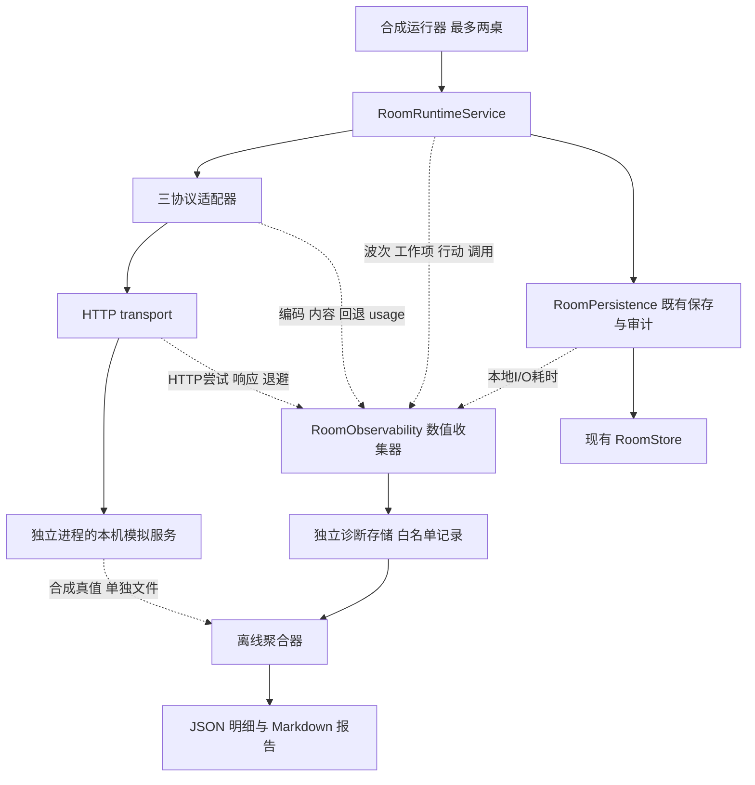

# ARCH-OBSERVABILITY 实施方案

日期：2026-11-02；实施状态更新：2026-11-03。设计基线：`08b1ed8`，房间服务实现为 `df52e31`。状态：观测与合成入口已实现，兼容回归、正常计时准确度、单／双桌采集开销及阻塞专项完成验收，已迁入[已解决记录](已解决问题与已实现改进.md)；执行范围和证据见[实施与验收记录](ARCH-OBSERVABILITY验收记录.md)。前置拆分的复核见 [RoomManager 外部审计报告](RoomManager职责拆分外部审计报告.md)。

目标是在保持现有调度行为的前提下，回答“时间消耗在哪一层、哪些提供方配置受到影响、两桌同时运行时本机是否阻塞”，并让每个统计数字都能追溯到不含正文的观测记录。默认验证范围为模型桩和本机模拟 HTTP 服务，最多两桌。

## 现状与最小修改范围

| 位置 | 现有观测与行为 | 本轮补充 |
| --- | --- | --- |
| [room-runtime.ts](../packages/session/src/room-runtime.ts) 的 `runAi`、`receive` | 单次调用记录 `firstDeltaMs`、`latencyMs`、`usage`、`purpose`、协议、模型和行动纠错 `attempt`。`markAsked` 后开始行动时限；纠错沿用剩余预算。 | 波次、工作项、逻辑行动、调用的关联标识；本地准备／等待；成功、失败、过期、取消的完整生命周期。 |
| 同文件的 `pumpOnce`、`prepareWave` | 按事件同步各席上下文；同波通过 `Promise.all` 并行，现有推进等待该 await。 | 波次成员、准备和门控等待、并行等待、每成员完成时刻与尾部等待。保留现有调度及异常行为。 |
| [llm/types.ts](../packages/llm/src/types.ts) 与三协议适配器 | `onDelta` 只提供思考／正文，`onRequest` 保存最终编码工具配置。工具参数流未必触发 `onDelta`；非流式回复通常没有首增量。 | 可选的纯数值／枚举观测端口；编码、首个有效内容、解析、兼容回退及原始 usage 字段存在性。 |
| [transport.ts](../packages/llm/src/transport.ts) | `runRequest` 以 `Date.now()` 计算调用耗时，共享超时／取消信号。`post` 对网络异常及 429／5xx 最多尝试三次，退避 800／1600ms；已开始消费成功响应后不重试。 | 每次 `fetch` 的起点、响应头、可观测正文读取节点、终态与退避；区分单次 HTTP 尝试与一次模型调用。 |
| [openai.ts](../packages/llm/src/openai.ts) | Chat Completions 存在 stream、tool_choice、response_format 兼容回退，并按 URL／模型保留进程内兼容记忆。 | 为每个请求变体单独编号，记录实际变更原因与继承状态；不误称为切换 API 协议。 |
| [Responses](../packages/llm/src/adapters/responses.ts) 与 [Anthropic](../packages/llm/src/adapters/anthropic.ts) | 共用 transport；保持原生数据。Anthropic 会合并开始和结束阶段的 usage。 | 接入同一观测端口，保留各协议的原生续接、工具配置与 usage 语义。 |
| [room-persistence.ts](../packages/session/src/room-persistence.ts) 与 [store.ts](../packages/session/src/store.ts) | 审计立即追加；首次写审计会读取已有日志计数。FileStore 使用同步文件操作；房间另有 300ms 合并保存。 | 记录既有读取／保存／追加的本地耗时；新增独立数值诊断输出，避免递归观测自己的写入。 |
| [diagnose-timeouts.ts](../packages/session/scripts/diagnose-timeouts.ts) | 默认按审计行的旁听／行动统计次数与分位数；`--live` 才调用模型。 | 新增独立离线聚合器与合成运行器，复用合理的读取逻辑；不让新基线隐式进入旧脚本的真实调用分支。 |

最小变更集中于上述文件，以及新增 session 观测收集器、诊断存储端口、离线报告器和测试用本机服务。`AuditEntry` 仅增加可选关联字段，`ManagerOptions` 增加可选观测配置；缺省关闭采集，合成命令显式开启。引擎、网页、房间存档模式和现有 `RoomStore` 接口保持兼容。

首轮不修改逐事件整波旁听、行动起点、纠错次数、HTTP 重试策略、总超时预算、模型原生续接或缓存键／缓存写入策略，也不新增生产并发限制。

## 职责与数据流



观测是旁路：不 await 上报，不在回调中请求网络、不拷贝消息或响应正文，不新增控制推进的分支。回调异常被观测边界吸收并计数。收集器只管理观测状态，不能改房间、线程、投影、工具、请求内容或取消信号。

## 时钟与指标定义

新增耗时统一使用可注入的单调时钟，生产实现采用 `performance.now()`，测试使用显式推进的时钟；时间单位为毫秒。`Date.now()` 仅用于报告时间范围和与既有审计关联。现有行动 `deadline`、`now` 及旧 `latencyMs` 不因插桩改用另一时钟；两类时钟不互相相减。重启后的单调时间没有跨进程可比性。

事件循环延迟采用 `monitorEventLoopDelay`，按纳秒转毫秒；ELU 使用 `performance.eventLoopUtilization`，另记 CPU 时间，不能把 ELU 当 CPU 利用率。只在合成运行窗口启用此类采样，默认分辨率 10ms，记录实际配置。[Node.js 性能测量文档](https://nodejs.org/api/perf_hooks.html#perf_hooksmonitoreventloopdelayoptions)

| 指标 | 起点 → 终点 | 包含关系与能力边界 |
| --- | --- | --- |
| `gateWaitMs` / `pacingWaitMs` | 进入原有推进间隔／展示 sleep → 原 await 恢复或终止 | 同时记录计划等待和实际等待；超出计划的时间只能称本机唤醒延迟，不能直接归因 CPU。未进入等待则标不适用。 |
| `wavePrepareMs` | 调用 `prepareWave` 前 → 返回 | 包含同步投影、上下文同步和许可准备；允许记录空波次，但排除在请求波次统计之外。 |
| `localPreDispatchMs` | 工作项被选入波次 → 实际调用 `adapter.decide` | 包含该项等待展示间隔及调用前本地准备，可能与其他成员重叠；不称提供方队列。无调用的工作项以终止原因结束。 |
| `actionSegmentMs` | 有效 `runAi` 开始 → 本次执行成功／托管／暂停取消／过期／失败结束 | 一个逻辑行动可跨多个恢复片段和多次纠错；暂停片段不代表游戏行动已完成。另记 `markAsked` 的相对时刻，不移动它。 |
| `modelCallMs` | session 即将调用一次 `decide` → 原 `abortable` 等待返回／抛出 | 每次纠错都是新调用。包含适配器执行和等待，外层取消时可能先于底层 Promise 真正结束；这是调用者可观察耗时。 |
| `adapterExecutionMs` | `runRequest` 入口 → 其 Promise 结算 | 包含编码、全部 HTTP 变体／尝试、退避、消费及解析。外层先取消时可晚于 `modelCallMs`，不强制满足父子时段嵌套。模型桩未接入时为不可观测。 |
| `requestEncodeMs` | 当前变体编码开始 → 编码结束 | JSON 序列化另在每次尝试原有位置记 `serializeMs`；不能为测量而把序列化移出原有重试循环。 |
| `requestSendMs` | 请求开始实际上传 → 最后字节完成上传 | **当前 fetch 路径不可观测。** 只记录 `fetchInvoked`，不把调用 fetch 到响应头命名为发送耗时。DNS、连接池等待、TCP、TLS 也不作精确分解。 |
| `headersMs` | 当前尝试调用 fetch → fetch 返回 Response | 含客户端连接／网络／服务端处理及本地回调延迟，不能等同网络或提供方排队。网络失败或提前取消时缺失。 |
| `firstBodyByteMs` | 当前尝试调用 fetch → reader 首次返回非空正文块 | 流式路径可测；是应用观察到的字节，不是网卡到包时间。非流式沿用 `response.text()`，首字节标不可观测，不能用完整正文时刻替代。 |
| `firstStreamContentMs` | 当前尝试调用 fetch → 协议解析器首次识别非空正文、思考或工具名称／参数 | 附 `firstContentKind`；不计空增量、心跳、usage、单独签名或纯工具 ID。新增旁路钩子不改变既有解析输出。不是首 token，也不等于旧 `firstDeltaMs`。 |
| `legacyFirstDeltaMs` | 旧 session 起点 → 第一次既有 onDelta 回调 | 保留历史定义，包括其可能接收空字符串的事实。报告与新指标分列，不重命名旧数据。非流式／纯工具结果可能没有此值。 |
| `bodyConsumeMs` | 观察到响应头 → 现有正文消费流程结束 | 流式包含解码与事件回调；JSON 在 `response.text()` 返回后结束该段，再测 JSON 解析。附 `bodyEndKind`，区分协议终止、EOF、错误或取消，不能将 `[DONE]` 后取消 reader 说成完整网络 EOF。 |
| `parseMs` | 对应 JSON／协议／结果解析入口 → 返回 | 可包含在正文消费或适配器耗时中；流式按块累积本地解析时间，不与父段相加。完整内容仅非流式可用时记录 `parsedOutputAvailableMs`。 |
| `httpAttemptMs` | 当前 fetch 调用 → 该尝试消费、失败或取消清理结束 | 每次网络／HTTP 重试独立记录。429／5xx 放弃正文时明确标记；不虚构完整正文或首内容。 |
| `backoffMs` | 进入原退避 await → 返回／取消 | 附计划值 800／1600ms、实际值、原因；包括在适配器耗时内，不包括在前后 HTTP 尝试内。 |
| `waveAwaitMs` | 执行现有 Promise.all 前 → 该 await 返回／抛出 | 正常情况下为整波并行等待。失败快速返回时标 `await_rejected`，保留还未结束的成员，不改成 allSettled。 |
| `memberTailWaitMs` | 成员结束 → 正常整波 await 结束 | 反映先完成者等待较慢成员的时间，不是请求排队或浪费 CPU。波次异常提前退出时不计算完整尾部等待。 |
| `waveWallMs` | 进入本轮循环门控前 → 本轮结束 | 包含门控、准备、展示等待及 await；空波次／异常分别标识，不累加成员耗时作为波次时长。 |
| `persistenceMs` | 既有同步读取／save／appendAudit 前 → 返回／抛出 | 区分操作，包含序列化和文件工作；不能把这一耗时计为提供方等待。观测输出本身的写入单独评估。 |
| `providerQueueMs` | 提供方声明的入队 → 出队 | 仅接收有明确单位、定义和来源契约的可信数据；当前默认不可观测。模拟服务真值仅在合成模式接受，来源标 `synthetic`。 |
| `roomWallMs` / `runWallMs` | 指定测量窗口开始 → 结束 | 每桌和整个双桌运行分别计时。并行调用累计毫秒单列 `sumModelCallMs`，不得作为整桌实际经过时间。 |

报告展示区间的包含关系，不用 `headersMs - localPrepareMs` 或“首段减网络估计”制造排队时间。事件循环指标只能提供同一窗口的本地阻塞证据；模拟服务另进程记录的真值可验证注入是否有效，真实服务没有对应真值时保留未知归因。

## 请求层级与一次性终态

关系是带关联边的层级，而不是所有对象都严格嵌套：

```text
runId / roomRef
  waveId → workId（某席一次被选中的旁听或行动工作）
  actionId（某席某决策的逻辑行动）→ actionSegmentId（一次运行／恢复片段）
  workId + 可选 actionId → callId（一次 adapter.decide）
    requestId（一次 post 请求变体）→ httpAttemptId（一次实际 fetch）
    下一个 requestId 可因兼容回退产生；同一 requestId 内可有 HTTP 重试
```

- 工具纠错产生新 `callId`，保留同一 `actionId`。旧 `attempt` 只是本次运行中的纠错序号，不能充当全局唯一 ID。
- `waveId` 关联当前波次；`decisionRef` 记录实际决策关联，不能把旁听时碰巧存在的 pending 决策当成该旁听行动授权。
- 旁听通常没有 `actionId`。若产生获准打断，另记 `interrupt` 行动及 `causedByCallId`；统计旁听调用与实际引擎行动时不能混为一个数。
- 游戏行动的接受／拒绝／托管以引擎提交结果为准。暂停结束一个运行片段和在途调用，但逻辑行动可在恢复后继续；过期、重复和取消结果不会算成有效游戏行动。
- ID 在本次运行内唯一；同一逻辑行动暂停恢复后可继续关联，重启建立新运行标识。跨进程不自动拼接时钟或合并行动次数；缺少持久关联时明确报告分段。
- 每次真正进入 `decide` 或 fetch 的操作，都先登记开始，并通过幂等 `finishOnce` 在完成、失败、取消和异常分支结束。取消前尚未发出调用只结束工作项，不增加模型调用或 HTTP 次数。
- 外层 `abortable` 先结束、底层仍清理时，调用者终态与底层终态分别记录；迟到回调不能重复结束调用或增加一次成功。报告列出未闭合子段和迟到补充记录。观测器不延长等待，也不强行终止现有调用。
- 进程被硬终止后，没有终态的开始记录标 `incomplete`；不得猜测为超时／取消。正常运行收尾保证已开始且已结算的操作一开始一终态；采集丢失有单独计数。

## 字段与接口草案

下列类型表达边界，不是已实现接口。新诊断使用独立版本化记录，既有审计只增加可选关联；这样取消路径可补齐观测，又不会伪造原来不存在的业务审计行或改变旧审计编号。

```ts
interface ObservationClock {
  monotonicMs(): number;
  wallTimeMs(): number;
}

type MissingReason =
  | 'not_observable' | 'not_applicable' | 'not_emitted'
  | 'cancelled_before_point' | 'failed_before_point'
  | 'incomplete' | 'legacy' | 'collector_dropped';

type Measurement =
  | { valueMs: number; source: 'client' | 'provider_reported' | 'synthetic' }
  | { valueMs: null; reason: MissingReason };

interface ObservationRef {
  schemaVersion: 1;
  runId: string;
  roomRef: string;
  waveId?: string;
  workId?: string;
  decisionRef?: string;
  actionId?: string;
  actionSegmentId?: string;
  callId?: string;
  requestId?: string;
  httpAttemptId?: string;
}

interface CallObservation extends ObservationRef {
  kind: 'model_call';
  providerId: string;
  modelKey: string;
  apiProtocol: ApiProtocol;
  purpose: 'listen' | 'action';
  correctionAttempt?: number;
  outcome: 'success' | 'invalid_tool' | 'timeout' | 'cancelled'
    | 'http_error' | 'network_error' | 'parse_error' | 'local_error'
    | 'stale' | 'incomplete';
  cancelReason?: 'pause' | 'end' | 'decision_changed' | 'dispose' | 'unknown';
  modelCallMs: Measurement;
  adapterExecutionMs: Measurement;
  httpAttemptsStarted: number;
  httpAttemptsFinished: number;
  compatibilityFallbacks: number;
  usage: ObservedUsage;
}

interface ObservedUsage {
  // 字段逐项保留存在性；输入总量按现有协议归一规则解释。
  inputTokens: number | null;
  outputTokens: number | null;
  cacheReadTokens: number | null;
  cacheWriteTokens: number | null;
  completeness: 'complete' | 'partial' | 'unknown';
  sourceHttpAttemptId?: string;
}

interface ObservationSink {
  // ObservationEvent 为固定事件联合，不允许任意对象／正文透传。
  emit(event: ObservationEvent): void;
}

// 新增的可选端口，不发送到远端请求体或请求头。
interface DecideObservationPort {
  clock: ObservationClock;
  emit(event: AdapterObservationEvent): void;
}
// DecideRequest.observation?: DecideObservationPort
// AuditEntry.observation?: ObservationRef
// ManagerOptions.observability?: { clock?: ObservationClock; sink: ObservationSink }
```

`ObservationEvent` 由 `run`、`wave`、`work`、`action_segment`、`model_call`、`http_attempt`、`backoff`、`local_span` 的 start/end 或 summary 联合组成，每种类型明确允许字段。HTTP 记录补充 `attemptIndex`、`variantIndex`、`variantReason`、实际 stream 状态、数值 HTTP status、上述耗时、`firstContentKind`、`bodyEndKind`。提供方排队另带 `contractId` 和来源，不保存原始响应头。

`variantReason` 使用固定枚举：`initial`、`stream_unsupported`、`tool_choice_unsupported`、`json_format_unsupported`。同一变体可能同时继承多个已经关闭的兼容特性，因此另记实际特性布尔值，不能仅靠原因推断请求。重试原因区分 network、429、5xx；记录错误类别，不复制错误正文。

收集器采用有界记录缓冲，初始上限为每运行 10,000 条或 4MiB，先达到者生效。业务回调只登记记录，后台每 100ms 或达到批量阈值后异步排出；待写批次也计入上限，写入未完成且缓冲满时丢弃新记录并累计丢弃数，不能继续堆积后台队列。上限、刷新周期和策略写入配置。采集失败不能阻塞或改变游戏行动，须累计写失败数；任何丢失均使该次准确性基线不合格。正常结束由合成运行器等待诊断输出完成，这个等待不计入对局耗时。生产进程异常退出只能报告观测不完整，不承诺零丢失。

## 提供方标识与统计口径

**提供方表示配置的接入端点，不能默认代表网关背后的实际模型厂商。** 内部按规范化的 scheme、host、有效 port 建立本机映射，移除 userinfo、query、fragment，并为同源的不同路由提供显式的非敏感分组别名。原始路径可能含凭证，不参与自动标签生成。不同协议路径属于同一接入方；确需按路由拆分时用显式别名。

映射表保存在忽略的数据目录，用稳定随机 ID 标识提供方，不使用 API key、密钥掩码或凭证哈希。同一安装重启后 ID 保持稳定，跨安装不承诺相同；映射表不进入分享报告。模型名也映射为 `modelKey`，可使用审核过的展示别名，防止私有部署名被无意公开。房间、决策和座位关联采用运行内别名，避免报告复制真实邀请凭证和房间地址。

聚合键为 `providerId × modelKey × apiProtocol × purpose`，另可按 outcome、stream 模式、冷／热兼容记忆分组。所有记录均按各自 ID 去重后统计，禁止将旧审计关联行与新诊断重复计数。

- 各层分别报告 started、finished、incomplete、成功、失败、超时、取消、过期、无首内容数量；HTTP 错误与模型工具无效分开。模型成功以 session 接受结果为准；HTTP 2xx 不等于工具合法或游戏行动成功。
- 调用成功率为成功调用数／已结束调用数，分母包含超时和取消；另列总开始数、覆盖率和终态缺失量。逻辑行动成功率另算，不能用最终成功覆盖此前纠错失败。
- 每项时长列有效样本数、缺失数和 P50／P90／P95／最大值。分位数采用 nearest-rank：升序后取 `ceil(p × n)` 项；`n=0` 显示 N/A，低于 20 个有效样本标小样本。总体耗时包含所有已结束状态，并另列成功／失败子集，防止幸存者偏差。
- `sumModelCallMs`、`sumHttpAttemptMs`、`roomWallMs`、`runWallMs` 分列。前两者相互嵌套，且各席可能并行，不能互加或作为整桌耗时。每桌耗时也不能相加作为双桌经过时间。
- usage 以产生它的 HTTP 尝试为来源，每份累计快照只合并一次：Anthropic 开始／结束快照合并，流式更新不是增量求和。没有 usage 的重试、失败和取消保留未知；合法收到 usage 的失败调用仍计入已知用量。
- `tokenUsage` 当前会把部分缺字段归一成零；新观测须在适配器读取原始 usage 时额外捕获字段存在性，既有 `DecideResult.usage` 保持兼容。旧行中的归一零只能标记“历史归一值，来源完整度未知”，不能提升为精确零消耗。
- 输入、输出和缓存读／写量分别汇总，并附各字段覆盖率。沿用现有协议的输入总量归一含义，缓存量是其中的分类信息，不能再次相加抬高总 token；不由 token 推算未配置价格下的费用。
- 新记录的缺失值为 `null + reason`；旧记录缺新字段为 `legacy`。不知道提供方或 purpose 的旧行放入 unknown 分组，不从当前座位配置倒填历史调用，也不把缺失时长补零。

诊断文件仅输出固定标识、枚举、数值、计数和报告元数据。不得透传 `messages`、`request` 工具说明、`response`、`toolCall.args`、思考、原生块、认证头、原 URL 或任意错误字符串。新增诊断留在服务端忽略目录；本轮不新增公开 HTTP／SSE 端点，既有审计仍要求房主鉴权。

## 最多两桌的合成基线

### 固定负载与运行约定

1. 通过测试用 `RoomStore` 载入固定 `standard12` 快照，复用现有兼容测试的建局方式。种子固定为 `obs-standard12-001`、`002`、`003`；双桌分别使用对应种子的 `-A`、`-B` 后缀。不改生产 `start` 的随机种子接口。
2. 每桌 12 个模型席位，回复由固定种子的模型决策桩生成，再经真实适配器、本机 HTTP 服务和解析路径返回。正文、工具与分块计划全部为合成材料。测量窗口为 30 个非空波次或自然终局，以先到者为准；记录实际波次数、调用数及终止原因。同场景重复运行时，逻辑工作清单必须一致。
3. 常规基线使用合法计时配置、明确记录各类 limit 和 interval；正常延迟与故障延迟分开运行。非零推进间隔另设专门场景。HTTP 超时的短预算用于适配器专项；session 综合场景使用其合法配置及受控时钟，不为了跑快改生产时限。
4. 本机服务独立进程运行，支持头部延迟、首块延迟、块间隔、块数量、错误状态、断流与模拟队列。它记录自己的单调时段和注入参数，作为合成真值；客户端和服务端时钟不跨进程相减。
5. 故障由逻辑工作标识选择，如房间别名、座位、purpose、波次及重试序号，不由并行请求到达顺序决定。合成运行器为每次调用建立独立异步上下文；测试进程专用的 fetch 包装器从该上下文取得已登记的 `httpAttemptId`，加入无敏感信息的 `x-synthetic-attempt-id`，服务据此查询控制通道预登记的故障计划与真值关联。禁止使用全局可变的“当前调用”。包装器只允许运行器创建的回环 origin，命中外部地址立即拒绝；该机制不进入生产 transport，也不改提示词、模型名、缓存键或协议正文。并发、重试和兼容回退都各用自己的尝试 ID，取消后的迟到请求仍能独立识别。
6. 基本拓扑为单桌、双桌同一接入端点、双桌不同端点。不同端点分别占独立端口／进程；同一端点不默认施加容量限制。需要模拟服务端排队时由场景显式配置服务端容量，客户端调度保持原样。
7. 每个基本拓扑分别运行三协议；每个单元先预热一次，再对三个种子各测三次，共九次正式重复。故障专项每协议至少三次；Chat 专有回退仅在 Chat 场景要求，另两协议验证没有新增回退。冷回退使用新进程；热回退专门复用同进程与同一端点／模型，报告记忆状态。
8. 同时活跃房间数始终不超过二。每次报告记录源码提交、锁文件摘要、Node 精确版本、OS／CPU／内存、存储类型、服务进程数、种子、负载、流式模式、故障配置、预热／重复次数、观测开关及采样分辨率。先以 MemoryStore 验证归因，再以临时 FileStore 单独测同步 I/O，二者不混合统计。

### 合成场景矩阵

所有时间均为未来注入参数，不是实测结果。D 表示无网络的受控时钟断言；H 表示真实本机 HTTP 与系统时钟验证。

| 场景 | 拓扑与注入 | 重点验收 |
| --- | --- | --- |
| S01 正常单桌 | 单桌；头部 20ms，首内容再等 30ms，随后四个 10ms 块；D＋H | 三协议、旁听／行动、阶段计时、计数、token 及正常终态关联正确。 |
| S02 双桌共享端点 | 两桌同时启动，单服务，无额外容量限制；H | 两桌波次、上下文和请求 ID 隔离；并行累计时长与实际经过时间分开。 |
| S03 双桌不同端点 | A 沿用 S01，B 头部 80ms；H | 聚合正确区分接入方，B 的注入不被记录成 A 的提供方耗时。 |
| S04 慢旁听 | 固定一个 listen 工作项增加 500ms；D＋H | 当前整波 await 被该成员拖长，较快成员出现尾部等待；后续问话／行动起点不提前。 |
| S05 长响应与纯工具流 | 100 个固定大小块、每块 10ms；另设仅工具参数和空心跳；D＋H | 首字节、首有效内容和完整消费分离；空增量不触发新首内容；工具流无需出现文本 onDelta。 |
| S06 非流式回复 | 同一合法结果经 JSON 返回；D＋H | 完整正文和解析可测；首字节／首流式内容正确标不可观测或不适用，不补零。 |
| S07 HTTP 重试 | 首次 429、其次 500、第三次成功；另设一次连接失败后成功；D＋H | 一次模型调用对应三次／两次 HTTP；计划退避仍为 800／1600ms，实际等待正确归属，共用预算。 |
| S08 工具纠错 | 第一模型调用返回非法工具，第二次合法；D＋H | 一个逻辑行动、两个调用；工具反馈和原生链保持完整，失败调用的有效 usage 不丢失。 |
| S09 兼容回退 | Chat 分别拒绝 stream、required、JSON format，并包含一次组合回退；D＋H | 请求变体和 HTTP 尝试分别计数，原因与实际特性吻合；冷／热记忆分列，不产生跨协议回退。 |
| S10 超时 | 头部前、首内容后、退避期间分别超时；D＋H | 缺失节点原因准确；已有部分内容不当成功；整个调用及各 HTTP 尝试无漏计／重复计，预算不重新开始。 |
| S11 取消及旧结果 | 暂停、end、决策切换、dispose；含忽略 signal 的迟到模型桩；D＋H | 调用者取消和底层清理分开；迟到结果不得改变行动或补写一次成功；未知子段显示 incomplete。 |
| S12 本地阻塞 | 客户端在固定边界阻塞 200ms；服务进程维持 S01；H | 客户端延迟与事件循环窗口异常可见，服务真值没有相同排队变化；不将两者差值命名为精确服务商排队。 |
| S13 持久化阻塞 | 使用注入延迟的 Store 桩，再跑临时 FileStore；D＋H | 同步 save／审计追加分别归因，本机成本不计入 HTTP 发送或服务端队列。 |
| S14 提供方队列 | 独立模拟服务显式配置容量一，返回已定义的 synthetic queue 数值；另一次省略该数据；D＋H | 有来源时验证排队真值；省略时为不可观测，不能从 TTFT 估计填补。该容量只属于模拟服务。 |
| S15 异常与采集故障 | 断流、无首内容、解析错误、非法本地配置、观测回调抛错、缓冲写失败；D＋H | 错误归类、零 HTTP 的本地失败、终态和丢失计数明确；采集异常不触发新的行动／重试／托管。 |

### 准确度与本机噪声

D 类断言使用可注入时钟与假 transport，不打开 TCP；所有已知节点、计数、状态、缺失原因与预期精确一致，浮点误差上限 0.001ms。至少包含一次墙钟前后跳变，证明新耗时不受其影响、旧行动计时机制未被观测修改。

H 类不要求计时器恰好准点。服务独立记录实际阶段耗时；正常、无阻塞场景的九次重复中，客户端相应观测区间对合成真值的中位绝对误差目标为不超过 `max(20ms, 真值的 10%)`，P95 不超过 `max(50ms, 真值的 20%)`。先对齐区间含义：例如头部阶段与首内容阶段分别比较，不能用服务端排队真值直接断言客户端 headersMs 相等。

如果事件循环明显阻塞、计时噪声超界或有记录丢失，该次标为环境受扰／采集不完整并保留原始结果，不能删除异常样本后宣布通过。S12 的目标就是识别已注入阻塞，不适用“无阻塞误差”门槛。真实提供方性能结论需要另行明确测试范围，不能由本机模拟推导。

## 示例报告

以下仅演示报告口径，所有数字均为手工构造，**未执行基线、不是实际性能结果**。正式输出包含 `manifest.json`、白名单 `observations.jsonl`、模拟服务 `synthetic-truth.jsonl`、`summary.json` 和 `report.md`，放在忽略的数据目录。可分享报告不携带本机映射表或原始业务审计。

```text
reportKind: illustrative_example
sourceRevision: 08b1ed8
environment: 未执行；正式报告必须填精确 Node/OS/CPU/内存/存储信息
topology: 两桌不同接入端点；每桌此演示窗口各10次调用
protocol: chat_completions（此示例不代表三协议均已测量）
repetitions: 1（小样本口径演示，不满足正式验收）
callStarted / callFinished / incomplete: 20 / 20 / 0
httpAttemptsStarted / httpAttemptsFinished: 23 / 23
roomWallMs: A=800, B=900
runWallMs: 900
sumModelCallMs: 3960（A=1880, B=2080；不能当作整桌耗时）
providerQueueMs: null, reason=not_observable
collectorDropped / collectorWriteErrors: 0 / 0
```

| 接入方／模型 | 调用数 | listen／action | 成功／超时／取消 | 成功率 | P50／P90／P95 调用毫秒 | 首内容有效／缺失 | HTTP 尝试 |
| --- | --- | --- | --- | --- | --- | --- | --- |
| p-A／model-A | 10 | 6／4 | 8／1／1 | 80% | 140／300／500 | 8／2 | 12 |
| p-B／model-B | 10 | 6／4 | 9／1／0 | 90% | 160／320／520 | 9／1 | 11 |
| 合计 | 20 | 12／8 | 17／2／1 | 85% | 必须从合并样本重算 | 17／3 | 23 |

上述 A 调用时长样本为 `[100,100,120,120,140,140,160,200,300,500]`，B 为逐项增加 20ms，用于复核分位数与累计值。每个组均标“小样本”；合计分位数不能取两个组分位数的平均。正式 `summary.json` 还需输出 purpose 交叉分组，例如本例 A 的 listen 为 5 成功／1 超时，action 为 3 成功／1 取消；B 的 listen 为 6 成功，action 为 3 成功／1 超时。

| 接入方 | 已知 usage 调用数／总数 | 已知输入／输出 token | 已知缓存读／写 token | 未知用量 |
| --- | --- | --- | --- | --- |
| p-A | 8／10 | 8000／800 | 1600／0 | 2 次调用未报告，不能当零 |
| p-B | 9／10 | 9000／900 | 1800／0 | 1 次调用未报告，不能当零 |

本例缓存读已属于归一输入总量，不再加到 8000／9000 上。报告还应列本地准备、响应头、首内容、正文消费、退避、波次等待、事件循环和持久化分位数及其各自样本数；本例没有这些构造样本，显示 N/A，不生成假数据。

## 实施与验收路线图

每阶段独立提交，提交记录引用本方案；每阶段保持可关闭观测并继续运行原业务。只有本项实现和验证完成后，才从唯一活动清单迁出。

| 阶段 | 可审查交付 | 进入下一阶段的条件 |
| --- | --- | --- |
| 0 固定契约 | 固定字段表、层级／状态机、指标起止点、缺失原因、提供方映射和合成 manifest 格式；记录实施前基准提交。 | 本方案每项指标都有插桩位置或明确不可观测标识；代码审查确认未混入调度改造。 |
| 1 观测基础 | 新增时钟、固定事件联合、幂等终态收集器、有界 sink 和独立数据存储；旧审计增加可选关联字段。 | 旧数据无新字段仍可读取；缺失不补零；回调异常隔离、缓冲限制、重复结束去重和输出白名单断言通过。未接端口时旧行为一致。 |
| 2 适配器与 transport | 在原位置记录变体、HTTP 尝试、响应节点、退避、内容与 usage 存在性。 | 三协议流式／非流式、429／5xx／网络错误、解析失败、取消和超时均覆盖；Chat 冷／热回退分别计数；原请求内容、重试次数、预算和原生链断言保持。 |
| 3 session 与持久化 | 增加波次／工作项／行动／调用关联，覆盖原有提前返回和取消分支，测量本地准备及既有 I/O。 | 报告收尾时 `started = finished + incomplete` 各层成立，运行中另计 active；正常结束全部已结算操作无漏记／重记；两房间同模型也不串 ID、线程或 usage；整波等待、单步和计时回归保持。 |
| 4 离线报告 | 聚合器、旧审计适配、提供方分组、覆盖率、分位数与分享报告白名单。 | 固定样本可手算复核；并行累计时间不冒充桌面经过时间；各层和各 purpose 计数守恒；旧未知提供方、缺时长、缺 usage 均正确展示。 |
| 5 合成运行器 | 独立本机服务、三个拓扑、固定种子、场景矩阵、真值输出和一条可重复执行入口。 | 完成 D 类精确断言与 H 类误差／噪声检查；同种子逻辑工作清单一致；报告注明所有环境和样本范围，最多两桌。 |
| 6 开销与整体兼容 | 完成采集开／关的配对测量、现有回归、类型检查；如果修改导出／构建依赖再补生产构建。 | 满足下述开销门槛及既有行为契约；审核实际结果后归档本项。 |

### 具体验收门槛

- **数值和状态：** D 类误差不超过 0.001ms；已开始并已结算的调用／HTTP 每个 ID 恰好一个终态；没有首内容的路径必须有原因；同一 usage 来源只统计一次。无新 provider 数据时，`providerQueueMs` 保持不可观测。
- **覆盖：** 三协议都覆盖旁听、行动、工具纠错、HTTP 重试、首内容前后超时／取消、无首内容和流式断流。Chat 额外覆盖三类兼容回退与组合回退。每个场景报告实际运行协议，禁止只执行一个协议却写“三协议通过”。
- **行为兼容：** 继续运行 RoomManager 拆分的四组基准、计时、竞态、三协议、HTTP/SSE、存档和上下文回归。观测关闭时原摘要保持；开启时仅允许新增观测字段，业务比较用显式剔除新增字段的投影，原摘要常量不为重构方便重新生成。新增观测字段单独验证。
- **隔离和隐私：** 在合成密钥、URL query、路径、工具参数、私密发言、思考及原生块中放置不同哨兵；全部诊断和报告中出现次数为零。不同席位和房间关联不串用；不开新增公开读接口。
- **故障隔离：** 观测回调抛错、缓冲满、诊断写失败时，原有行动／请求序列与禁用观测的同场景一致；报告反映采集异常。硬终止只验证 incomplete 语义，不承诺应用原本没有的强持久保证。
- **采集开销：** 在固定 S01、S02 配置下，采集关闭／开启按 AB／BA 交替运行至少 30 组配对样本，模型服务和既有审计均保持相同配置。运行时间中位数增幅不超过 5%；调用耗时 P95 增量不超过 `max(2ms, 关闭时 P95 的 5%)`；额外稳态堆中位数不超过 8MiB，缓冲不超过配置上限；正常运行诊断丢失为零。报告同时给出 CPU 时间、事件循环延迟、诊断字节数／写入成本和样本离散程度。环境噪声压过阈值时标无法判定并保留配对数据，不宣称性能通过。
- **资源回收：** 合成运行结束且等待诊断收尾后，该 run 的活动观测段和缓冲记录归零，不遗留额外定时器／监听器；并发运行最多两桌。外层结束后仍未闭合的子段最多保留 60 秒，运行收尾可提前将其标 incomplete 并释放；更晚的回调只增加迟到计数，不重新创建整段状态，也不干预底层请求。

### 回退与交付

各阶段可通过关闭可选观测配置回到原业务路径；需要撤销代码时按阶段提交逆序回退，使用正常 revert，不改已发布历史。新诊断文件不参与房间恢复，旧版本仍能使用原房间和审计；新增可选字段不得成为推进所需数据。

最终实现交付包括可运行的本机合成入口、场景与版本 manifest、白名单原始观测、聚合报告、计数／误差／权限回归证据和采集开销报告。所有性能结论绑定具体环境、提交与样本，不能把模拟服务表现写成真实提供方表现。本文件保留实施设计与构造示例；实际测试、测量及未通过项统一记录在[实施与验收记录](ARCH-OBSERVABILITY验收记录.md)，不能把示例当作执行证据。
