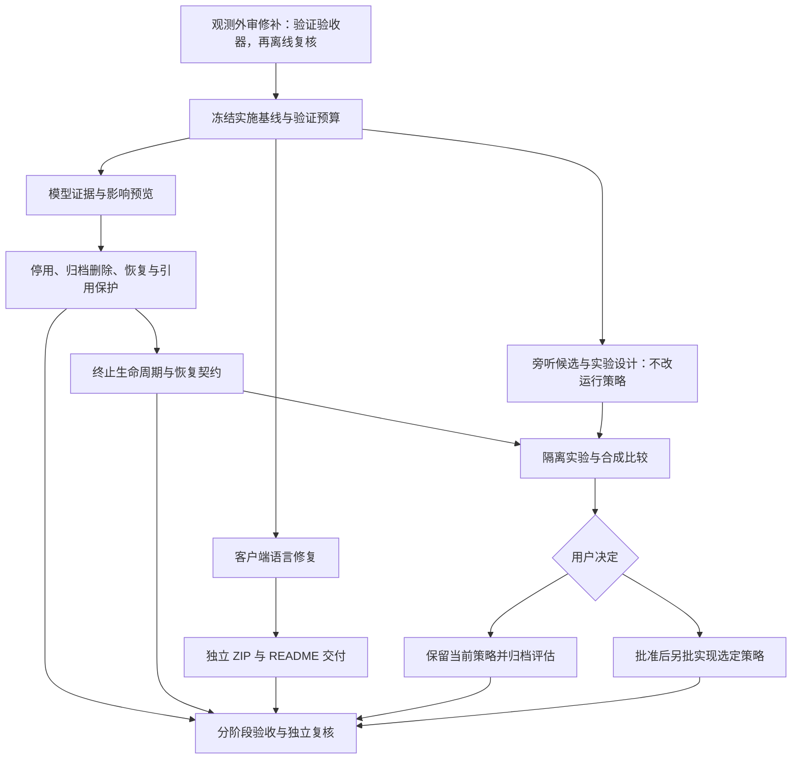

# 剩余四项 P1 一揽子实施方案

日期：2026-11-03。状态：设计基线及阶段记录。`MODEL-RETIREMENT`、`SESSION-DISPOSE` 与 `BUG-AGENT-LOCALE` 的实现和验收已完成；`AGENT-DELIVERY` 已发布并核验。`ARCH-PASSIVE` 的原 P1 评估已归档，不表示候选策略上线；后续 `MODEL-PASSIVE-COMPLETION` 是按用户指令暂缓的 P2。原 P1 项目状态见[唯一待解决清单](待解决问题.md)，阶段结果见第 10 节。

本方案编制时只审阅源码、测试文本及已有合成材料，没有运行测试、类型检查、构建、负载或真实服务调用。其后的实际施工、测试和服务核验记录见第 10 节；未在该节注明实际结果的命令、指标和预算仍是后续要求，不代表已通过。ChatGPT 子代理施工编排另在聊天交付，不作为产品设计或固定开发依赖。

## 1. 固定基线与交付边界

| 对象 | 固定基线 | 使用方式 |
| --- | --- | --- |
| 主仓库源码 | `42a42d262fd72823eb972a5fc2a92bfb00a5636e`，分支 `codex/observability` | 本文现状判断对应此提交。实施前记录实际 HEAD、工作树差异和依赖锁文件哈希，再逐项核对差异；不把别的任务改动混入本批提交。 |
| 外审文档 | `c2eefc234b2899ae939ba5b7c75e8f9c11dfc13c`，[ARCH-OBSERVABILITY 外部审计报告](ARCH-OBSERVABILITY外部审计报告.md) | 主体实现已有证据，但验收器双向完整性仍需修补及离线复核。用户已安排独立修复，此处不重复实施。 |
| 外部客户端 | `D:/werewolf-agent` 当前不是 Git 仓库，不能编造客户端提交号 | 以源文件哈希固定版本；实际迁入和修复前重算，发生漂移先更新交接清单。 |
| 客户端入口 SHA-256 | `player.mjs`：`3b66f507506168a088e2d09e1666830e0677c40728ab254137a6939ebd8e9072` | 来自本轮只读清点。 |
| 客户端说明 SHA-256 | `AGENTS.md`：`a82330ba4876c8826415667ba5f46b6c356ceb85d17b1091735d91430cdb1f89` | 不用仓库根指南替换客户端的席位代理说明。 |
| 客户端现有测试 SHA-256 | `test/player-join.test.mjs`：`027da54570e87e293e20ad7bfc1b0fcbd01600763c2ccb1a1e40adf111230919` | 现有 join 用例不足以覆盖所有唤醒入口。 |

外审新增的 `OBS-ACCEPTANCE-COVERAGE` 是独立验收前置，不是本方案“四项”中的第五项。该前置的修补与复审已完成；原始压缩包按用户授权删除，保留的离线索引和复核材料见 OBS 清理记录。后续各阶段绑定自己的源码提交及验收脚本版本，不因修补报告器直接重跑全部 HTTP 矩阵。

编制期间，独立修补提交 `28ba1d15e881a2f738952c6e69dcff46cf476df4` 已出现，修改验收器及归档读取工具；本文没有复测或复审该提交，不将其专项测试声明当作全量外审通过。最新闭环状态以唯一问题清单及后续复核记录为准。

前置状态更新（2026-11-03）：后续 `19ee1bf` 修补与 `53d04e1` 证据已完成[外部复审](ARCH-OBSERVABILITY外部审计报告.md#re-audit-53d04e1)，`OBS-ACCEPTANCE-COVERAGE` 已关闭。原始包后续按用户授权删除；上文基线仅用于解释方案编制时的判断，不作为施工版本。各阶段实际源码与测试结果以第 10 节及对应证据文件为准。

共同边界：默认只用模型桩和本机服务，最多两桌；不修改引擎事实、席位权限、重试总预算、三协议原生续接或隐式缓存策略；不读取或提交真实席位凭据、私密对话。真实停供证据和真实模型性能是两类证据，不能相互替代。

**客户端交付采用用户已确定的方式：** 源码可以迁入本工作目录的 `local-clients/werewolf-agent/`，整个目录忽略、不提交 Git；它仍可独立安装，通过本项目 GitHub Release ZIP 分发。仓库只保存打包程序、README 说明及紧凑的版本／哈希清单。源码不迁入 `packages/` 或 `apps/`，服务端也不依赖此附件。本文不代表已复制、打包或发布客户端。

## 2. 依赖与分阶段排期



| 阶段／建议提交边界 | 目标、范围与依赖 | 独立完成标准 | 回退点 |
| --- | --- | --- | --- |
| F：冻结与验证器预检 | 记录两个源码来源、环境、命令和预算；复核 OBS 修补结果 | 损坏夹具能使验收失败；小规模试运行证明计数、资源上限及报告有效 | 仅文档／验证工具，不改游戏行为 |
| M1：模型证据及只读预览 | 新增证据分类、引用盘点和脱敏预览；不执行删除 | 模拟分类无误判，预览包含库、房间及 TTS 凭据依赖 | 回退新增只读入口，模型数据不变 |
| M2：模型维护事务 | 在 M1 上实现停用、归档、恢复；大厅和旧删除入口走同一保护规则 | 旧配置可读、引用不丢、失败不部分写入；维护结果可复查 | 回退实现并使用配套快照恢复模型元数据，不能让旧程序忽略停用标记后误启用 |
| S1：终止状态及代数隔离 | M2 合入后修改 Manager／Runtime 共享入口 | dispose 后零新增调度、迟到结果零提交、等待可收尾 | 独立功能提交；回退后重新声明旧 dispose 缺陷存在 |
| S2：持久化与服务器退出 | 在 S1 上封闭保存／通知／连接生命周期，处理失败和重启 | 逐房间 abort→flush 顺序、保存失败报告、退出和恢复断言通过 | 回退 S2 不撤销 S1 的安全终止入口；接口兼容保留 |
| L1：客户端语言 | 可与 M1／M2 独立并行，固定外部文件清单 | 所有唤醒入口三种语言及席位权限用例通过 | 用迁入前源码快照恢复，不覆盖 seats 等用户数据 |
| L2：客户端交付 | L1 后制作白名单 ZIP 和说明；对齐既有 `AGENT-DELIVERY`，不另建重复问题 | 干净目录可独立使用、校验和匹配、仓库无客户端源码和运行数据 | 撤回／替换未发布候选包；已发布版本保留标识并发布修正版，不静默覆盖同名资产 |
| P0：旁听设计 | 可并行编写场景、数据契约，不并行改 Runtime | 候选、收益门槛、行为决策均可审查 | 无运行行为变化 |
| P1：旁听实验 | 依赖 S2 和可信的观测验收器；实验开关仅用于合成环境 | 按第 6 节提交对比和推荐，不自动启用 | 删除实验开关或回退实验提交，生产仍用当前策略 |
| P2：有条件落地 | 只有用户批准行为变化后启动 | 选定策略全部语义与兼容门禁通过 | 停止新建使用该策略的房间，已有房间保留可读／可恢复能力 |

阶段状态更新（2026-11-03）：模型维护、退出生命周期、客户端语言和独立 Release 交付均已完成并有验收证据；原旁听 P1 只完成评估，生产继续保持 A；明确的新 P2 需求按用户指令暂不实施。各项证据见第 10 节和归档记录。

M1→M2→S1→S2 串行。客户端代码可以独立施工；共用的 Manager 入口、运行时、文档索引分别指定单一修改者。性能采样独占本机运行时段，不与另一批压测、构建或重负载测试并行。实施工时随代码审查调整；第 8 节给出可执行的验证时间及资源预算，不用模型回答速度充当工期保证。

<a id="model-retirement"></a>

## 3. MODEL-RETIREMENT：模型清理

### 3.1 现状、模块与状态所有权

当前 `model-library.ts` 保存 v2 模型库，支持显式旧 Qwen 配置导入、添加和直接删除；删除没有房间引用预览。`room-lobby.ts` 选预设时把模型、协议、地址、加密密钥和 modelId 复制到席位，`room-model.ts` 使用席位快照。删库条目并不会撤回历史快照中的配置或凭据。`model-presets` 是 API 别名，不是另一套模型库。

另有必须保护的引用：`project-models.ts` 从项目模型库寻找 Qwen Token Plan 凭据，`speech/qwen.ts` 在没有显式／环境凭据时使用它。停供的是某个模型，不等于同一凭据不能用于 TTS；直接删行可能影响配音。

| 模块 | 拟议职责与改动 |
| --- | --- |
| `packages/session/src/model-library.ts` | 唯一持有模型配置、生命周期和修订号；原子写入、失败回滚；不获取网络证据或遍历房间。 |
| 拟新增 `model-retirement.ts` | 证据分类和有效性校验；输入结构化证据，输出状态及理由，不凭错误文本猜测停供。 |
| 拟新增 `model-maintenance.ts` | 维护命令、引用盘点、影响预览、修订校验；通过只读房间／凭据依赖端口工作，不复制 RoomRecord 所有权。 |
| `manager.ts`、`room-lobby.ts`、`room-model.ts` | 保护原删除入口，筛选新选择，检查新局引用；保留已开始对局的席位快照语义。 |
| 拟新增项目维护租约，装配于 server 与维护命令 | 数据目录单写者约束，覆盖模型变更和房间引用写入；不把模型文件锁误当所有房间的一致快照。 |
| `project-models.ts`、`speech/qwen.ts` | 暴露“存在凭据依赖”的安全检查；停用模型不撤销凭据，不为清理自动换 TTS 提供方。 |
| `packages/protocol/src/` 中对应模型视图类型；`apps/server/src/main.ts` | 可选生命周期／可选中状态字段，兼容旧视图；不把私有引用预览公开到无管理鉴权的全局模型路由。 |
| `ModelLibrary.tsx`、`ModelList.tsx`、`pages/Setup.tsx` | 显示停用／不可选及原因；当前已选无效配置显式提示，不能悄悄换成其他模型或 custom。 |

### 3.2 停供证据与状态

证据状态与本地启停状态分开。官方公告、控制台声明或提供方明确且有文档的停供错误码，必须匹配具体提供方路由、模型版本及适用账号／区域／协议；记录核验时间、原始来源链接、有效日期、脱敏摘要和摘要哈希。未来停供日期只表示计划停供。公告支持范围不明确、来源相互矛盾或证据过期时转为待复核，不自动清理。

| 证据状态 | 判定依据 | 默认处理 |
| --- | --- | --- |
| `available` | 此范围内有近期可信可用证据 | 不代表其他账号／路由同样可用 |
| `retired_confirmed` | 明确官方停供资料或已文档化的停供响应，范围及生效时间一致 | 进入影响预览，人工选择停用／归档；不自动删库 |
| `credential_invalid` | 失效密钥等认证证据 | 修复凭据，不改停供状态 |
| `access_denied` | 无权限、区域／套餐限制等授权证据 | 检查访问范围，不解释成全局停供 |
| `network_error` | DNS、连接、TLS、传输错误 | 保持配置，报告连接问题 |
| `temporary_unavailable` | 限流、维护、暂时容量不足等有依据的临时状态 | 不误下架；检查退避／重试结果 |
| `unknown` | 泛化 404、未列入 models 列表、未文档化错误码、超时或无法归因的 5xx | 明示不可确认，不能把未知当停供 |

HTTP 状态码只是证据之一：401／403／404／429／5xx 不建立跨提供方通用的一对一停供映射。网络验证和维护操作分开；默认没有自动探测任务，不触碰全局 Qwen 配置。真实停供名单必须逐项核实，合成分类通过不能生成真实“已停供”名单。

### 3.3 操作、引用与接口草案

```ts
type ModelLifecycle = 'active' | 'disabled' | 'archived';
interface RetirementEvidence {
  status: EvidenceStatus;
  providerId: string; model: string; protocol?: string;
  checkedAt: string; effectiveAt?: string;
  sourceUrl?: string; sourceDigest: string; reasonCode: string;
  scope: { routeId: string; accountScope?: string; region?: string };
}
interface ModelImpact {
  modelId: string; revision: string; inventoryDigest: string;
  exactRefs: ReferenceSummary[]; possibleRefs: ReferenceSummary[];
  credentialDependencies: DependencySummary[];
  canArchive: boolean; blockers: string[];
}
preview(modelId: string): ModelImpact;
apply(command: { modelId: string; operation: 'disable' | 'archive' | 'restore';
  expectedRevision: string; expectedInventoryDigest: string }): MaintenanceResult;
```

类型是接口草案。ReferenceSummary 在本机维护视图包含最低必要的房间标识、阶段和引用类型；公开模型视图不返回房间名、席位凭据、对话或完整服务地址。providerId／routeId 复用观测的安全标识原则，不嵌入 key 或 URL 查询参数。

| 操作 | 契约与错误行为 |
| --- | --- |
| 预览 | 盘点精确 modelId 引用、无 ID 但模型／地址／协议相符的可能引用、待开局配置、运行／暂停局、结束历史、导入来源及 TTS 凭据消费者。可能引用不自动绑定；盘点不完整则不允许归档。外部未知消费者须列为范围外，不宣称全局无引用。 |
| 停用 | 默认保留配置、加密密钥和历史。新选择／新局启动拒绝引用已停用模型；复制旧局成新局时同样检查。已经开始的运行、暂停和重启恢复对局保持原快照，不热替换、不自动中止；实际调用失败沿用既有错误路径。 |
| 删除 | 第一版“删除”定义为可恢复的归档。运行／暂停局及仍需启动的配置引用会阻止归档；用户先逐项替换或移除配置引用。历史结束局不重写，保留稳定 ID 的归档记录供说明和恢复。若删除会破坏现用 TTS 凭据回退，先明确配置替代凭据，否则阻止。 |
| 恢复 | 恢复原 ID、协议、配置及证据，默认恢复到 disabled，由用户核对后启用；同 ID／配置冲突返回错误，不覆盖。证据不会因恢复而变成 available。 |
| 永久清除 | 不在默认第一版范围；需单独列明不可恢复内容、备份和引用证明。不能把归档按钮变成密钥擦除。 |

新增 `enable` 应作为独立显式命令，不能隐含在 restore 中；启用前提示仍有效的停供证据。第一版原 `DELETE /models/:id` 不再直接删除，返回稳定的 `409 MODEL_MAINTENANCE_REQUIRED`，提示停服后执行本机维护；禁止保留绕过引用检查的旧 remove 路径。这是有意收紧的 API 行为，网页同步说明，不把它描述成无感兼容。

**首版维护渠道建议采用本机维护命令。** 当前全局模型路由没有与房主凭据等价的管理权限，不能直接添加可枚举所有房间的远程 preview 接口。完整盘点和变更在服务停止后执行；新增项目数据目录的独占写者租约，由服务端或维护程序二选一持有，模型写入、房间配置引用变更及保存均处于该写者范围。维护程序持租约后读取全量房间元数据并执行事务，服务运行期间不会同时取得它；原有在线添加／导入仍在服务端租约内执行。发现活动写者或无法证明租约失效时返回 `MODEL_STORE_BUSY`，禁止仅凭文件时间抢占；进程身份需包含 PID 与启动标识，无法核实则保守拒绝。旧服务不支持租约，首次迁移必须确认旧进程已退出，不自动杀进程。网页保留状态展示和维护提示，在线删除与远程管理鉴权作为另行扩展，不在第一版含混承诺。

apply 在持有写锁时重新核对库修订与引用盘点摘要，变化返回 `MODEL_PREVIEW_STALE`；读取失败拒绝执行；保存失败恢复内存状态，旧文件保持完整。另有稳定错误码 `MODEL_NOT_FOUND`、`MODEL_DISABLED`、`MODEL_IN_USE`、`MODEL_RESTORE_CONFLICT`，调用方显示可执行的下一步，不吞错或自动替换。

旧 v2 数据缺字段按 active／unknown 读取；增加可选元数据，保留 legacyImported 与原密钥主钥关系，删除后不再次从全局配置导入。旧二进制可能忽略停用元数据，故回退不能只换程序：须停止服务、备份新状态、恢复匹配的模型库快照并核对可选模型；不回滚或改写历史对局。若未来升级存储版本，必须先提交兼容读取器再写新格式。

### 3.4 验收矩阵

| 编号 | 优先复用／补充 | 可判定标准 |
| --- | --- | --- |
| M-A | `qwen-presets.test.ts`、`protocol-config.test.ts` | 旧库／导入／加密／重启可读；缺新字段默认兼容；导入删除后不复活；三协议不混用 |
| M-B | 新增证据分类表驱动用例 | 上表七类及范围冲突、未来生效、泛化 404、列表缺项均覆盖；非停供样本误判数为 0 |
| M-C | 房间、配置及 TTS 依赖夹具 | 精确／可能引用分开；运行、暂停、新局、克隆、结束历史均有断言；归档不能切断现用凭据回退 |
| M-D | 维护事务用例 | 过期预览、写锁竞争、读写失败、恢复冲突不部分写入；重复 disable／archive 有稳定幂等结果 |
| M-E | Setup／模型库展示及接口用例 | 新局不能选用停用项；已有快照不被改写；公开响应不含 key、私有房间清单或全局配置 |
| M-F | 真实证据核验表，独立于测试报告 | 每个实际处理项有来源、范围、日期、操作与结果；无法确认的项保持 unknown，未核实名单不得标为清理完成 |

<a id="session-dispose"></a>

## 4. SESSION-DISPOSE：退出生命周期

### 4.1 当前缺口与所有权

`manager.ts` 当前停止 tick，然后逐房间 `runtime.disposeRoom → views.dispose → persistence.flush`。Runtime 只 abort 在途请求，没有管理器终态，pump／finally／等待仍可能继续；`whenIdle` 等待 running，可能挂住。`room-persistence.ts` 的 flush 捕获保存错误但没有结果；View 释放计时器不等于全部订阅关闭；`main.ts` 调用 dispose 后立即退出。`testSeat` 的在途连接检查也必须纳入，而不只处理正式模型行动。

| 所有者 | 新责任 |
| --- | --- |
| RoomManager 的单一生命周期端口 | `active → disposing → disposed`，终态不可恢复；对公共入口做统一检查；持有 dispose 完成 Promise 和错误汇总。 |
| RoomRuntimeService | 房间 generation、调度承诺、可取消等待、模型回调与迟到结果隔离；不维护第二套独立的全局终态。 |
| RoomPersistence | 每房间保存计时器、写入封口、最终 flush 结果；读操作不能重新创建写任务。 |
| RoomViewService | 通知订阅与思考发布计时器的回收；只读视图不隐式重新启动资源。 |
| Server／SSE 所有者 | 停止接受新请求、结束连接、清除 ping、等待管理器收尾；只释放自己创建的共享资源。 |

### 4.2 入口与顺序契约

保留同步 `dispose(): void` 作为“立即封闭入口并启动释放”的兼容入口，新增 `whenDisposed(): Promise<DisposeReport>` 供退出流程等待。重复 dispose 和重复等待共享同一次结果；whenDisposed 不隐式启动 dispose。报告包含各房间保存结果、资源收尾结果和有限错误码，不包含凭据／正文。

| 入口类别 | disposing／disposed 后行为 |
| --- | --- |
| create／clone／配置变更／模型增删导入／start／control／act／participate／testSeat／subscribe | 拒绝新工作，稳定 `MANAGER_DISPOSED`；服务层映射 503。无效凭据请求仍不得泄露私有对象存在性。 |
| tick／resumeAll／内部 pump 重入 | 安全 no-op，不登记新任务、不创建计时器；不能恢复这个 Manager。 |
| whenIdle | active 时保持原语义；终止后只等管理器拥有的收尾承诺，不等永不结束的外部 Promise。 |
| view／getSetup／catalog／modelPresets／audit／export／speechLocale／speechText | 保留授权后的只读能力；使用已存在状态或无副作用计算，不调用会新建资源的懒初始化。发起 TTS 合成等新外部工作不属于这些只读入口。 |
| dispose／whenDisposed | 幂等且可重复读取最终结果；调用结束不代表远端计费已撤销。 |

必须保持**逐房间**顺序，不能变成先 abort 所有房间再 flush 所有房间：

1. 先将全局状态设为 disposing、停止 tick，阻止任意房间的重入调度。
2. 对房间 A：递增 generation，取消排队和在途工作、清空 again／步进预算，结束管理器自己的等待；将取消终态记录一次，封闭迟到回调；清理通知／思考发布资源，最后 flush A。
3. A 的 flush 已返回或失败被记录后，再执行房间 B 的 abort→flush；某房间失败不阻止其他房间释放。
4. 结束观测等管理器自有资源、汇总结果，进入 disposed，完成等待者。

所有异步成功、失败、delta、工具纠错和 finally 分支都检查生命周期及捕获的 generation。`finishThought`、`rememberReply`、引擎提交、审计追加、scheduleSave 和 pump 重启均不能从迟到分支越过封口。取消记录在封口前完成，迟到结果不能重复统计、补写完整对话或发出通知。

模型桩可以忽略 signal、迟到 resolve、迟到 reject 或永不 settle；Runtime 对模型调用和注入的 sleep 都使用管理器拥有的取消承诺竞速，并接住迟到 rejection。清除自己创建的 timer／listener，并解除对外部承诺的调度依赖。**不能承诺强制终止不合作的第三方 Promise、其自建计时器或远端请求**；能保证它们不再推进房间、写状态或阻止 whenIdle。报告分别列出本地释放与外部未确认结束，不把逻辑取消冒充远端终止。

已经开始的 testSeat 也需登记和取消等待，返回稳定的终止结果；新 testSeat 不发请求。SSE 关闭由连接所有者释放 ping 和监听器，不能仅清空 View 回调后留下服务器连接。

### 4.3 保存、恢复、错误与回退

dispose 是服务生命周期，不是引擎的“结束对局”或“暂停游戏”动作。保存实际引擎状态、已提交事件和已完成的原生上下文；不为退出制造胜负／放弃，不把未完成响应写成完整 assistant／工具回执。重启必须创建新 Manager，沿用已有房间加载和恢复政策：当前 `resumeAll` 对运行房间调用 `armDeadlines(live, true)`，会重新设置符合条件的期限，本项保留此行为并明确回归，不宣称停机时间自动计入原窗口或恢复绝不重置期限。同一进程内的调用重试仍保持原总预算；若要改变跨重启期限／预算语义，应另定停机时间算法和兼容范围。

flush 改为可观测结果，例如 `{ roomId, saved, errorCode? }`。保存失败仍封闭调度，保留内存快照供明确的恢复导出／人工处理，最终报告 `durable: false`；禁止仅打印日志后宣称正常落盘。若提供最终保存重试，必须是显式只写快照的恢复入口，不能重新开放 Manager 或重启游戏。

服务器先进入 stopping 并拒绝新工作，再执行上述 dispose，等待 whenDisposed 及连接收尾，最后退出；设明确退出宽限（建议默认 5 秒，可配置），超时记录未收尾项并以失败退出状态结束。正常退出、保存失败和宽限耗尽分别有断言。这里只改现有 shutdown 连接，不趁机重构整个服务器装配。

不强制迁移 RoomStore 格式；新增运行时代数是内存状态，重启创建新代数。回退前用受控关闭／备份，不能对已经 disposed 的对象“取消终止”。若回退修复，文档必须重新揭示旧后台推进问题，不能沿用新验收结论。

### 4.4 验收矩阵

| 编号 | 复用入口／新增边界 | 可判定标准 |
| --- | --- | --- |
| S-A | `room-disposal.test.ts`、`runtime-races.test.ts` | 两房间记录严格为 abort A→flush A→abort B→flush B；dispose 幂等；终态入口全部按表执行 |
| S-B | 忽略 signal 的 resolve／reject／never 模型桩；永不结束的注入 sleep | dispose 后新 dispatch、引擎事件、对话追加、通知及延迟保存均为 0；受控微任务推进后 whenIdle／whenDisposed 可完成，不依赖第三方 settle |
| S-C | `timing-boundaries.test.ts`、`context-control.test.ts`、`protocol-session.test.ts` | 正常运行计时、工具纠错、每席顺序与三协议续接不变；取消不会留下半个工具交互 |
| S-D | `store.test.ts`、`room-compatibility.test.ts`、`observability-persistence.test.ts` | 保存失败被汇总且其他房间继续释放；重启不修改历史事实、不重复执行已提交动作；按现有 armDeadlines(reset=true) 规则恢复期限，固定新旧存档断言 |
| S-E | 连接检查、SSE、服务器 shutdown 补充用例 | 在途 testSeat 与连接等待退出；自有 timer／listener／排队任务最终计数为 0；外部不合作任务独立列示 |
| S-F | `observability-runtime.test.ts` 的旧缺陷记录 | 将“dispose 后请求可能增多”的已知缺陷用例改成新语义断言，移除依靠 dispose 后 control(end) 才收尾的做法；不能删掉该边界测试 |

<a id="bug-agent-locale"></a>

## 5. BUG-AGENT-LOCALE：外部客户端与 Release 交付

### 5.1 源码位置与交付责任

当前修复对象是 `D:/werewolf-agent/player.mjs` 及其代理说明，不是内置模型提示词。用户已允许迁入本工作目录，但不要求把客户端源码纳入 Git。实施时先按白名单复制到 `local-clients/werewolf-agent/`，计算源／目标哈希并保留旧目录；排除 seats、凭据、笔记和真实日志，不自动搬运用户运行态。明确新目录为后续源码维护位置，避免两边同时维护。

| 位置 | 交付范围 |
| --- | --- |
| 被忽略的 `local-clients/werewolf-agent/` | `player.mjs`、客户端 AGENTS 及兼容入口、规则资料、测试；本地修复和验证。客户端源码、源码补丁和完整源码快照均不提交主仓库。 |
| 主仓库 `.gitignore` | 精确忽略该客户端目录；与已有未提交改动逐行合并，不覆盖整份文件。验证忽略生效且没有已跟踪的客户端源文件。 |
| 拟新增 `scripts/package-agent.mjs` | 参数化客户端来源目录，显式白名单打包、校验版本及生成清单；不要求固定 D 盘路径，不将客户端加进 pnpm workspace。 |
| 根 `README.md` 与紧凑发布清单 | 说明它让外部 AI 工具通过真人席位 API 参局；安装要求、Release 下载、join／wait／act、语言规则、升级和故障边界；关联附件版本与源码树哈希。 |
| GitHub Release 附件 | 独立 ZIP、SHA-256、文件清单、版本和已验证服务端版本范围；源码保存在可下载附件中，满足独立安装及版本追溯。 |

主仓库目前没有可直接复用的 Release 工作流；网页 build 不生成客户端包。可参考 `scripts/video/package-skill.mjs` 的显式清单做法，另建最小打包脚本。不要把动态下载“最新版”当可重复构建输入：打包前核对源清单哈希，固定文件排序和时间戳；重建同一输入应产生一致清单与包哈希。

ZIP 建议白名单：`player.mjs`、客户端 `AGENTS.md`、`CLAUDE.md`、`GEMINI.md`、`QWEN.md`、`.cursor/rules/player.mdc`、`.github/copilot-instructions.md`、必要 `rules/*.md`、独立安装 README、已核对适用的许可文件及生成版本清单。测试保留在本地源码，通常不放运行包。客户端 `.gitignore` 可以附带，但不能替代打包白名单。包内绝不包含 seats、seat.json、last.txt、行动草稿、凭证、密钥、笔记或日志。

最低 Node 版本与项目先统一写为 22.12；兼容服务端先只声明实际验收的版本，不臆造最低历史版本。无第三方运行依赖时按 `node player.mjs ...` 独立运行，不要求克隆主仓库或 pnpm install。先生成候选包并验收，再发布附件、最后更新 README 的真实版本链接；没有附件时不能写“已可下载”。发布属于后续实施，不在本轮执行。

### 5.2 语言与权限契约

新增纯函数 `resolveLocale(view)`，严格采用 `projection.locale ?? room.locale ?? 'zh-CN'`。项目实际标识是 `zh-CN`、`en`、`ja`，不是语音层的 en-US／ja-JP。空值使用 nullish 语义；收到未知非空值时报告不支持的语言标识，不悄悄回退成中文。

所有唤醒展示走统一 `renderWakeContext(view)`，输出明确的对局语言及面向代理的简短语言要求；`viewSignature` 纳入有效 locale，使“仅语言改变”也能触发一次更新。记录当前有效 locale 不推进事件游标、不制造行动。旧本地游标没有 locale 时补发一次语言上下文，之后按原签名去重。

| 入口／状态 | 必须提供的语言上下文 |
| --- | --- |
| join 首次成功 | 与首次授权席位视图一起输出，不只依赖规则卡语言 |
| status、rules、log | 有授权视图时给出有效 locale；规则事实、事件和工具字段原样保留 |
| wait 首次、有变化、SSE／轮询唤醒、断线重连 | 每次实际唤醒包含 locale，不能仅在 cursor=0 时输出 |
| 暂停／恢复、行动窗口改变、结束 | 仍明确 locale；不因语言包装改变原有等待／行动权限 |
| act 后重新读取并展示新视图，以及重试后实际唤醒 | 共用同一函数；没有成功获取新授权视图的网络错误不编造新语言状态 |

客户端说明要求公开发言和狼队密谈使用有效 locale；工具名、参数键、decisionId 和规则标识不翻译。包装文字可以按三种语言提供最小映射，不扩大成整个客户端 UI 翻译项目。外部工具是否遵循指令仍是实际模型表现，合成输出只能证明提示完整。

locale 只能来自该席位已经获授权的视图；禁止为语言回退请求房主／上帝／其他席位数据。`cmdAct` 继续检查当前任务、打断许可及 decisionId；跨席凭据、过期事件、私密内容边界不因包装而变。每个 seats 子目录继续隔离，本地 last.txt 仍只写该席可见内容。

### 5.3 验收与回退

| 编号 | 覆盖 | 标准 |
| --- | --- | --- |
| L-A | 复用 `test/player-join.test.mjs` 并扩展入口 | projection 优先、room 回退、旧房间 zh-CN 默认；en／ja／zh-CN × 所有唤醒入口均有断言 |
| L-B | 公开发言、狼队密谈、暂停恢复、结束、语言单独改变 | 输出包含正确语言；合法工具与参数不变；不丢事件、不重复行动 |
| L-C | 重连、重复、过期、超时、失效凭据；复用服务端 `human-http.test.ts`、`invite-network.test.ts` | 无凭据越权；使用合成私密标记证明其他席位、房主和狼队信息不会混入不应收到的客户端输出 |
| L-D | ZIP 负面夹具与干净临时目录安装 | 故意放入假凭据／笔记／额外文件也不会被打包；附件清单和哈希可验证；解压后不借用原客户端路径、node_modules 或用户配置即可连接本机服务 |
| L-E | 仓库边界和版本追溯 | 忽略规则生效；Git 跟踪列表无客户端源码／运行态；README 链接与附件版本一致，可定位源清单和实际验证过的服务端提交 |

客户端源码回退使用本地迁入前快照或上一版已校验 Release ZIP；保留用户运行目录，不用回退覆盖凭证或事件游标。服务端字段为既有可选字段，不要求同步发布新 API。Release 交付属于已有 `AGENT-DELIVERY` 的落实，不把客户端语言问题与发布问题合并成一个无法独立验收的提交。

<a id="arch-passive"></a>

## 6. ARCH-PASSIVE：先评估，决策前维持当前策略

需求更新（2026-11-03）：本节所述原 P1 候选评估已完成。用户随后明确要求将评估标记完成，并把“已出局且本局全部后续任务结清后停止模型旁听”登记为 P2、暂不实施；同时要求验收报告注明该调整来自用户指令。活动需求及验收条件只维护在[待解决问题](待解决问题.md#model-passive-completion)，本节保留原评估设计及历史证据，不作为新需求已经实现的声明。

### 6.1 候选与推荐

当前 `room-runtime.ts` 按可见事件同步各席上下文，等待整波旁听完成，再推进。`prepareWave` 内的 syncThread／保存发生在 receive 完成前，`thread.seen`／heardSeq 不能直接解释为“该席模型已完成旁听”。改变这层语义需要新的完成游标，不能只把 Promise.all 换成 Promise.race。

| 候选 | 作用与代价 | 本轮建议 |
| --- | --- | --- |
| A：逐事件整波屏障 | 保持现有顺序、行动与打断时机；慢旁听阻挡整波 | 生产默认；作为所有比较的基线 |
| B：每席 FIFO、跨席独立推进 | 每席最多一条原生对话操作在途；其他席可先完成后续准备，减少慢席拖累；会改变交错、打断机会及结果分布 | 优先做隔离原型；达到收益和语义门槛后再请求用户决定 |
| C：合并／减少无打断旁听，或只同步事实不调用模型 | 可减少调用，但减少了模型中间思考和原生回应，属于更明显的玩法变化 | 先书面比较与小样本可行性，不作为首轮完整矩阵候选，不自动启用 |
| D：提供方并发预算 | 与 A／B 正交；在有限容量或 429 场景可能降低失败，也可能增加本地等待 | 首轮测 A＋预算的 4／8 槽位小样本；无受控收益不新增生产限制 |

推荐路径是“继续 A，先测 B；容量问题另测 D”。首段内容延迟不能作为提供方排队时间；真实提供方未提供可信字段时排队不可观测。D 的收益只能用本机服务的显式队列真值或真实提供方明确数据归因。

### 6.2 B 必须满足的设计契约

| 边界 | 明确约定 |
| --- | --- |
| 状态所有权 | Runtime 持有每席队列、执行租约及完成游标；SeatThread 仍持有该席语义历史和协议原生项；引擎持有许可／窗口与事实，观测器只记录。 |
| 作业与上下文 | 作业携带 seat、事件范围、cueId、原始 decision/window、投影版本和 generation；使用不可变可见投影。每席只允许一个原生对话操作在途，后续事件不能先追加到正在调用的线程。 |
| 完成游标 | 分开记录 queued／synced、已处理高水位 processedThrough 与逐作业结果。完整响应及回执形成 succeeded；有限重试后的失败形成 terminal_failed，允许 processedThrough 前进但不冒充成功听完。seen 不能替代这些状态，未完成取消也不能默默推进。 |
| 三协议原生续接 | Chat 工具调用与回执、Responses 原生输出／续接项、Anthropic thinking／签名及 tool_use 关系原样保留；不同席位／协议／模型不共享。切换策略不转换签名或重写历史。 |
| 行动计时 | 本席先完成行动 cue 之前全部必需上下文，再获得实际执行资格；紧邻真正 dispatch 的 markAsked 才启动 AI 行动预算。队列等待单列观测，不消耗行动时长；原 HTTP 重试与纠错仍共享原行动总预算。真人窗口不因本优化自动延长。 |
| 打断许可 | 既检查作业创建时获授的许可，又检查提交时仍是同一有效窗口，并交引擎校验。慢旁听错过原窗口就拒绝，不能借后来重新开放的同名工具提交旧结果；这可能减少慢席打断机会，须明确让用户决定。 |
| 暂停、取消与迟到 | 停止派发，取消在途及排队工作并失效代数；保留可重建范围，恢复时从引擎事件／完成游标重建；旧响应不提交行动、上下文、通知或保存。dispose 使用第 4 节终态契约。 |
| 有界性与公平 | 原型每席最多 32 个未完成作业，高水位让房间回到等待屏障，不能静默丢事件。跨席轮转且不让后来的行动越过同席前置旁听；报告积压和等待。 |
| 单步模式 | 建议保留可解释的屏障：一次单步选定其允许的一波并等待该波收尾；不能因为跨席队列把“一步”变成无界后台推进。正式启用前写入产品说明和回归。 |
| 保存／崩溃恢复 | 持久化策略版本、每席完成范围与必要回执；原生响应与回执作为逻辑提交单元。当前文件存储不保证跨文件事务，必须定义以引擎事件及回执对账的恢复规则；不能宣称远端请求恰好一次。重复行动由 decision/window 和引擎事实拒绝。 |

失败前进规则必须先于 B 原型实现：沿用 A 的单次旁听失败反馈和原 HTTP 有限重试，不额外无限重发。网络／协议／本地准备失败在预算耗尽后写入无私密正文的 terminal_failed 回执，记录事件范围、原因及逻辑幂等键；原事实仍保留在线程中，后续行动可在已知失败状态下继续，不伪造 assistant 或原生工具项。暂停取消保留 pending，恢复只重建尚未处理范围；窗口已过期的旧打断记为 expired，决不重放行动。退出后由新实例按同一回执对账，已经 terminal_failed 的范围不因重启再调用；确需重试由显式操作创建新尝试并计入预算。幂等键至少包括 room／seat／事件范围／cue／策略版本，不能只用重启就变化的 generation。半成品原生响应不落为成功回执，持久化对账不一致时停止该席并报告，不猜测成功或无限重试。

D 需定义 provider key 的范围、槽位排队顺序、取消、重试和退避占用。原型默认一个完整模型调用占槽，含其重试和退避；等待槽位不启动行动计时。若要求限制远端真实并发，忽略取消的调用必须继续计为未确认在途，不能释放本地槽后宣称远端已释放。该限制可能牺牲活性，应在真实服务接入前单独取舍；本轮不添加生产限制。

### 6.3 合成场景与收益门槛

固定 `standard12`、种子 `obs-standard12-001/002/003`，固定角色配置、事件窗、工具纠错计划及模拟服务响应。三协议 × S01 单桌／S02 双桌共享提供方／S03 双桌不同提供方；环境最多两桌，客户端请求和模拟服务真值均按 run／seat／call／attempt 对账。

| 场景 | 服务／本地控制 | 必须比较的结果 |
| --- | --- | --- |
| 正常、慢旁听 | 正常阶段延迟固定；一席旁听首内容额外 400ms，其他席保持基线 | 整窗墙钟、行动获得资格后的 dispatch、每席积压；不能只看所有请求耗时之和 |
| 长响应 | 首内容相同，后续 20 段按固定间隔输出 | 完整响应、native 顺序、缓冲上界与旁听完成游标 |
| 容量及重试 | 服务明确 4／8 个容量槽、可控 429／503、固定退避 | 真实队列等待、失败／重试数、总预算、D 是否比 A 改善 |
| 超时／取消／忽略 signal | 响应头前、首段前、流中分别触发；迟到 resolve／reject | 终态一次、无新调度、无跨席提交、无孤立上下文 |
| 本地阻塞 | 可控本地准备等待与单独的 50ms 事件循环阻塞段 | 本地等待／调度延误不误归因为提供方排队；合成墙钟与受控时钟分开 |
| 中断与恢复 | 暂停、恢复、退出、存档重载、旧窗口打断 | 权限、窗口、游标和恢复回执对账；失败不伪造已完成 |

验证分两条线。**性能线**锁定事件投影回放和模型桩返回值，不让候选返回的行动改变输入事件；比较相同工作清单的准备、旁听、行动请求与调度等待，不声称测得完整游戏吞吐。每个测量窗口包含预先命名的正常段和慢旁听段，分段及整窗分别报告。**行为线**运行真实引擎配合模型桩，允许 B 因行动／打断时序产生事实分叉，按权限、窗口、顺序和恢复契约验收；分叉后的调用数和整局时长只能作描述，不能并入同工作量性能样本。两条线使用独立场景编号及报告。

正式比较按每个协议／拓扑／种子配对，重复 1、3 采用 AB，重复 2 采用 BA；运行顺序在清单中固定。每单元每策略 9 次正式回放，墙钟以窗口为样本；行动等待 P95 先在每次回放内对符合定义的行动请求计算，再报告 9 个运行级 P95 的中位数及范围，不能将相关请求当独立重复扩大样本量。样本不足、基线为零或预检噪声超过收益门槛时报告不可判定，不强行给出改善百分比。

建议采用以下**预先声明、尚未测得**的门槛：

- 所有权限、每席顺序、原生续接、行动窗口及迟到隔离违规为 0；完整性门禁无丢失、重复或跨运行污染。
- B 在慢旁听段的墙钟中位数至少改善 20%，行动前本地等待 P95 至少改善 30%；在正常段，整窗墙钟中位数退化不超过 5%。三协议分别报告；少数单元无收益必须披露，不能只报告最优单元。
- 相同工作清单下模型调用／HTTP 重试和 token 用量不无故增加；允许最多 5% 的测量差异，但额外调用都须按 cause 解释，不能把 5% 当允许重复调用的额度。模型桩 token 不证明真实 token 成本。
- 每席队列不超过 32；新增稳态堆建议不超过 16MiB／桌，以固定环境重复采样确认，短时峰值另报。D 的收益需同时包括失败率或墙钟改善，不能仅以并发数下降验收。
- 报告每单元样本数、中位数、P95、范围、失败数、置信／不确定性说明、源码与环境。小样本不能证明真实模型质量或厂商 SLA；不宣称真实对局胜率提升。

### 6.4 逐项验收、兼容与结论出口

| 编号 | 优先复用／补充 | 通过条件 |
| --- | --- | --- |
| P-A | `context-control.test.ts`、`message-regression.test.ts`、`protocol-session.test.ts`、LLM `protocols.test.ts` | 每席事件及工具回执严格有序；三协议 native 原样续接；同提供方同密钥也不混席 |
| P-B | `timing-boundaries.test.ts`、`runtime-races.test.ts`、新窗口／队列夹具 | 行动计时不提前，打断只能命中原许可窗口；高水位回压不丢事件；单步无后台失控 |
| P-C | S 阶段取消／退出断言与存档兼容用例 | 迟到结果零提交；保存／恢复对账无重复本地动作；旧房间默认 A |
| P-D | 可信验收器、独立真值与第 8 节预算 | 各候选按固定输入、受控环境比较，失败和缺值保留，不靠筛样本达标 |
| P-E | 独立策略决策记录 | 用户选择保持 A，也可完成“评估”并归档理由；只有批准 B／C／D 的行为和范围后，才将其实施视为目标 |

生产开启其他策略前新增可选 `passivePolicyVersion`，旧房间缺字段视为 A；默认仅新房间可选，不热切正在运行的旧局。先交兼容读取器，再允许创建新策略房间。回滚时禁止新建 B，但保留读取／完成已有 B 房间的能力；不能用不认识 B 游标的旧程序恢复这些存档。若 A 的既有兼容摘要改变，必须解释；不能要求 B 的游戏交错与 A 完全相同后又声称异步行为无变化。

## 7. 报告与提交验收格式

每阶段一份紧凑报告，包含：问题编号、实现提交、受影响模块、实际运行命令、环境与种子、预期／实际断言、失败和未验证项、兼容／回退说明、原始材料索引及审阅结论。原始数据、真实性核验、合成性能三栏分开。

```json
{
  "issue": "ARCH-PASSIVE",
  "status": "planned_not_run",
  "sourceCommit": "<实施后填写>",
  "validatorCommit": "<实施后填写>",
  "scenario": "S02/slow-passive", "protocol": "responses",
  "seeds": ["obs-standard12-001", "obs-standard12-002", "obs-standard12-003"],
  "samples": 0, "wallMedianMs": null, "actionWaitP95Ms": null,
  "modelCalls": null, "httpAttempts": null, "successRate": null,
  "timeouts": null, "cancellations": null, "tokens": null,
  "invariantViolations": null, "truthMissing": null,
  "rawManifestHash": null, "limitations": ["尚未执行，缺值不是零"]
}
```

以上是格式示例，没有示例通过数字。每个统计项标注分母、缺失数及单位；并行请求累计耗时与整桌实际经过时间分列。真实提供方报告另附授权范围、模型版本和时间，不与本机数据合并。

提交前按变动复用相关测试：M 修改网页还需类型检查和生产构建；S／P 修改调度须运行协议、计时、上下文、保存及权限回归；L 在客户端副本和本机服务验证。整合版本在正式验收前运行一次现有完整回归和类型检查，有网页变化则构建。测试数量按实际运行输出记录，不照搬历史 558 项。

## 8. 验证成本与数据生命周期

### 8.1 先验证脚本，再做正式验收

预检顺序：先用极小夹具验证计数与失败判定，再做一个有硬上限的 loopback 窗口，最后才允许矩阵。至少覆盖整个 start/end 对丢失、重复 truth、跨 run 污染、非有限／缺失字段、错误源码哈希、写失败、预算耗尽和取消；可用的旧产物先离线重算。只看到退出码 0 或 summary 文件存在不算脚本通过。

运行器须有 dry-run 清单、预估调用数／窗口数、总预算计数器、超限停止和 resume 检查。每个窗口限制最多两桌，预先固定结束条件，正常窗口 HTTP 尝试上限 512；如果上限不足以完成指定工作，该样本标失败并调整方案，不能截断后当成功。重试计入 HTTP 尝试数，工具纠错计入模型调用数；游戏行动、本机 API 请求及模型 HTTP 请求分别计数。

### 8.2 分批预算（待小样本校准的上限）

| 批次 | 预计时间 | 请求／规模上限 | 复跑范围 |
| --- | --- | --- | --- |
| 验证器夹具与小样本预检 | 2–5 分钟 | 离线夹具 0 HTTP；试窗不超过 48 次模型 HTTP | 只重跑失败夹具及相应试窗 |
| M 针对性回归 | 5–10 分钟 | 本机模拟探测最多 36 次；真实模型 0 | 分类、引用或存储相关单元 |
| S 针对性与三协议退出 | 5–15 分钟 | 模型桩为主，本机模型 HTTP 最多 360 次 | 受影响的取消、协议、恢复路径 |
| L 入口／权限／ZIP | 3–8 分钟 | 本机玩家 API 最多 500 次；模型 HTTP 0 | 客户端路径和对应服务端权限用例 |
| P 候选筛选 | 5–15 分钟 | A／B／A＋D 共 3 个候选 × 3 协议 × 3 拓扑 × 1 窗＝27 窗；最多 13,824 次模型 HTTP | 未达语义门禁的候选停止，不进入正式矩阵；D 的 4／8 槽位先在故障小样本选一个固定值 |
| P 正式比较，仅一个候选与 A | 20–60 分钟 | 2 策略 × 9 单元 ×（1 次预热＋3 种子×3 次正式重复）＝180 窗；最多 92,160 次模型 HTTP | 同工作清单，正常／慢旁听段分别报告；不展开所有候选组合 |
| 长响应／重试／超时／取消／阻塞等故障 | 5–15 分钟 | 配对、分支定向覆盖，最多 4,000 次模型 HTTP | 先验证一次正确性，仅关键计时分支做 3 次重复 |
| 新采集开销，只有观测路径实际变更才运行 | 10–30 分钟 | S02、固定代表协议，on/off 30 对＝60 窗；最多 30,720 次模型 HTTP | AB／BA 顺序、同输入；结论只覆盖该协议拓扑，若要外推再扩预算 |
| 整合回归与必要构建 | 5–15 分钟 | 优先桩；预留 3,000 次本机模型 HTTP，真实调用 0 | 集成提交一次；新的失败或源码变化才追加 |

全批模型 HTTP 硬上限 **150,000 次**，另计玩家 API 上限 **500 次**；真实模型／TTS 调用默认 **0 次**。上述分项模型 HTTP 上限合计 144,148 次，余量也在总上限内，不能各子进程独立再获得一份额度。由单一预算协调器持有跨进程原子计数，在每次发送前预留额度，重试、预热、失败及在途都计入；续跑读取原批次已消耗量，不重置额度。全批验证墙钟上限 **180 分钟**；预计时间不是已测值，预检后记录机器、Node／pnpm 版本、CPU／内存、电源及负载条件再修订。预算耗尽停止并报告已覆盖范围，不自动追加样本或循环重试到通过。

如果候选筛选后建议继续 A，不运行 180 窗正式候选矩阵；M、S、L 本身不需要跑旁听性能全矩阵。若采集路径没改，不为了凑齐表格重做开销测试。真实停供探测如确有必要，另行明确模型／提供方／凭据范围，建议先限每模型 2 次、全批 12 次；该建议不是当前授权。

### 8.3 完整复跑条件与样本规则

- 改动调度／上下文／计时／HTTP 重试、提供方映射或关键报告含义，且现有证据不再对应实现：重跑受影响的完整单元；影响全部协议或拓扑时才重跑全部矩阵。
- 只修复离线验收器／聚合器，原始字段和真值充分：先对旧归档离线重算；只有数据缺失或采集语义改变才重新发请求。文档与排版修正不触发业务测试矩阵。
- 保存失败、采样干扰或机器噪声超阈值：保留失败材料和原因，只允许按预先规则追加一轮校准；仍不稳定则报告不确定，不挑选最快一次。
- 不同源码哈希、模拟服务配置或负载版本不能合并成同一性能总体。每次正式运行前冻结输入，按预登记的种子与 AB／BA 顺序采样。

### 8.4 磁盘、压缩和清理

本批新增数据上限：原始逻辑量 **4GiB**，压缩原始文件 **768MiB**，长期紧凑材料 **128MiB**，临时展开峰值 **256MiB**，新增落盘峰值 **1.25GiB**。这是独立于既有归档的本批预算；开始前盘点 diagnostics 实际占用，保留至少 5GiB 可用空间。70% 提醒、90% 停止派发并为在途收尾保留余量，达到上限将运行标 incomplete，不能丢行后仍通过。

每窗结束关闭文件后流式压缩，建议 ZIP／gzip level 6；记录每个原始文件的字节数和 SHA-256，验证压缩成员可读及哈希一致，再删除临时展开副本。按窗读取和对账，不一次展开数 GiB，不将原始 JSONL 注入代理上下文。压缩比不达预算就提前停止，不假定所有数据都像现有样本一样可压缩。

长期保留：源码和验收器版本、锁文件／源清单哈希、环境、配置、种子、完整命令、输入／原始文件哈希及成员索引、紧凑汇总、失败原因、变更说明、独立审计报告。原始合成数据只在外审明确通过、无相关未闭环问题且紧凑证据已保存后清理；审计已完成但结论待整改不满足条件。当前 OBS 修补复审已通过，原始 ZIP 仍保留；后续按保管契约另行评估清理，本次不执行。

清理程序仅处理本批 manifest 列出的 diagnostics 路径，先校验绝对路径、工作目录边界和链接目标，再删除；不能宽泛删除 data、历史房间、密钥、模型库备份或客户端源目录。客户端源码、正式 Release 资产与恢复快照属于交付版本，不属于可清理合成数据。真实服务产物若将来获授权产生，另设脱敏与留存规则，不混进合成包。

## 9. 实施前仍需用户决定的事项

以下决定可分别在对应阶段开始前作出，不阻碍前面的只读证据整理和设计核对：

1. **模型清理对象与真实核验范围：** 具体提供方／模型清单，是否只依赖官方停供资料，还是允许有限真实连接探测；当前默认无真实调用。
2. **维护入口和删除含义：** 推荐先采用本机停服维护、可恢复归档；若需要在线远程管理或永久擦除，需另定权限与范围。恢复默认 disabled，不自动启用。
3. **客户端发布标识：** 交付方向已确定为工作目录内独立、Git 忽略、Release ZIP＋README；后续选择附件版本命名和关联的服务端 Release。无需再决定是否把源码提交 Git，也不要求给旧目录初始化 Git。
4. **旁听行为：** 先看合成报告，再决定是否接受 B 的跨席推进、慢席失去旧打断窗口、单步屏障及新房间启用范围；C 的减少旁听和 D 的并发限制分别决定。决定前保持 A。

退出终态、逐房间 abort→flush、迟到隔离、数据白名单和旧配置兼容属于本方案必需契约，不作为可省略的优化项。每项只有实现、相应验收和复核材料均成立时才迁入已解决；出方案、做合成评估或发布报告均不自动等于问题已关闭。

<a id="p1-acceptance"></a>

## 10. 施工与阶段验证记录（2026-11-03）

本节补记方案编制后的阶段结果。开头及第 3–6 节保留原设计基线和验收契约；最新状态为 M、S、L 的实现与验收均已完成，原 `ARCH-PASSIVE` P1 评估完成并归档（不表示候选策略上线），新 P2 需求按用户指令暂缓。

### 10.1 OBS 前置状态

独立 OBS 复审已通过，用户确认后按授权删除原始 ZIP；清理记录列明文件大小为 237,697,148 字节及保留的索引、摘要和审阅材料。本轮没有读取、重跑或重新展开 OBS 原始包；见[OBS 清理记录](../data/diagnostics/p1-20261103/obs-cleanup.json)。该状态更新取代第 8.4 节的旧留存记录。

### 10.2 MODEL-RETIREMENT

在源码 `8664333` 上完成已授权的模型维护：真实核验共 6 次请求；其中当前套餐范围内 4 个模型返回 `AccessDenied.Unpurchased` 并归档，属于当前账号／套餐不可用证据，不表示提供方全球停供。`qwen3.8-max-preview` 的实际返回模型为 `qwen3.8-max`，按官方别名说明归并到 `max`；另将同 URL、密钥、协议和实际模型均为 `glm-5.2` 的重复项归并。维护后 44 条模型记录／相关配置和密钥材料均保留，4 项归档、2 项归并、38 项仍可选，36 个房间快照哈希不变；操作前备份留存。实际 UI 核对显示 42 行（38 可选＋4 归档）、Token Plan 下仅有一行 `qwen3.8-max` 且没有 preview 项；维护入口只显示本地操作指导，未发写请求。对应证据见[真实模型探测](../data/diagnostics/p1-20261103/real-model-probes.json)、[维护结果](../data/diagnostics/p1-20261103/model-maintenance-result.json)、[停服记录](../data/diagnostics/p1-20261103/model-service-stop.json)、[维护前备份](../data/backups/models-before-maintenance-20261103.json)及[只读 UI 核对](../data/diagnostics/p1-20261103/client-ui-check.json)。专项 19 项测试、TypeScript 检查和生产构建通过。

### 10.3 SESSION-DISPOSE

实现提交 `8dcfa7d` 后由 `8a6563e` 修补退出终态所有权。首次整合全量回归为 83 个测试文件、680 项用例，663 通过、17 失败；预算修复前失败的 2 个 HTTP 用例随后单独重跑通过。最终补丁影响的 6 个文件共 66 项全部通过（含 2 项新增），TypeScript 检查和网页生产构建通过。跨批覆盖为 682 项，但没有在最终补丁后重跑一遍全量 83 文件，不宣称单次全量全绿。摘要见[全量首轮结果](../data/diagnostics/p1-20261103/regression/results.json)、[生命周期修补回归](../data/diagnostics/p1-20261103/regression/lifecycle-fixed.json)及[HTTP 预算用例补验](../data/diagnostics/p1-20261103/regression/http-budget-completion.json)。

### 10.4 BUG-AGENT-LOCALE 与预算

客户端原始单测 15 项首次运行时 14 项通过，1 项因计时仪表的相对导入错误未完成；修正测量入口后，仅重跑该失败项并通过。两次本机合成服务联调分别固定服务端源码 `6325ea6` 与 `8a6563e`，每次 45 次玩家 API，覆盖中、英、日三种语言及席位权限，均通过；另有服务端声明 `408` 后按授权重试的 3 次 API 请求通过，真实模型调用为 0。超时记录不证明不合作的 fetch 可被客户端本地超时中断。最终客户端包已发布为 [`agent-v0.1.0`](https://github.com/ZhiqiangBao/ai-werewolf/releases/tag/agent-v0.1.0)：tag 指向工具提交 `accd21234ec002e6735a70e7b3352933e13fd30c`；ZIP 为 73,210 字节，SHA-256 `5483cf9a9f0ec828ea1f74f590cf79139c9da32d02a528fa74298aeaaabc67bd`，交付 tree SHA-256 `fb442a6e96890d1df53b9257ec998e79585a46c62af66a073f179e6ffd58497f`。`manifest.json` 为 2,253 字节，SHA-256 `b7493a42463e6372b8455e25e197bf76d7361eb236c9038a64a4a15c68769000`；ZIP、manifest 和 `SHA256SUMS.txt` 均已上传，GitHub 只读 API 显示附件已发布且非 draft，tag target 和本地哈希相符。构建和联调环境为 Node `24.18.1`；最低声明 `22.12`，不声称在所有 Node 版本和操作系统上实测。对应客户端修复与交付分别归档。

用户先将玩家 API 上限从 500 调至 800，随后明确批准提高至 1,100；当前计数为 966 次实际请求，另为一次首页 UI 检查保守预留 32 次，账面合计 998/1,100。模型相关预算分类分别为：独立真实模型 6 次、P 合成实验 1,478 次、集成测试 1,462 次，未追加请求；模型总上限仍为 150,000 次。证据见[客户端验收摘要](../data/diagnostics/p1-20261103/client/acceptance-summary.json)、[6325 服务联调](../data/diagnostics/p1-20261103/client-server/summary.json)、[8a 最终服务联调](../data/diagnostics/p1-20261103/client-server-final/summary.json)、[408 重试联调](../data/diagnostics/p1-20261103/client-timeout-v3/summary.json)、[网络与预算计数](../data/diagnostics/p1-20261103/network-counts.json)和[模型预算账本](../data/diagnostics/p1-20261103/budget.json)。

### 10.5 ARCH-PASSIVE：原 P1 评估完成，后续需求按用户指令列为 P2

首轮源码 `6f626e6` 的 preflight 仅有 12 次客户端 start、0 个 server 配对，验收失败；原材料保留在 `data/diagnostics/p1-20261103/passive-failed-6f626e6/`。失败原因未知，现有证据不能归因为 `EACCES`。

修补后源码提交 `6325ea6`、源码内容 pin `70c5ae5d4ca3277bb8ebf164a82f11a640b5a210bbed04cc7c38372665a4ea3e` 的批次包括 1 个 preflight、5 个故障预选窗口和 27 个 screening 窗口，共 33 个完整窗口。逐文件只读核对确认 gzip 长度与 SHA-256、解压内容长度与 SHA-256 均匹配 manifest；成功窗口共有 1,466 个预期请求，每个请求在客户端和服务端账本均有匹配的 start/end。活动预算账本的 `pActual=1,478`，由上述 1,466 次完整请求和首轮失败的 12 次 start 构成。逐窗哈希、长度、双端计数、来源 pin 和预算对账见[旁听核对账本](../data/diagnostics/p1-20261103/passive/reconciliation.json)。

9 个 protocol/topology screening 单元各只有 1 个样本，其中 3 个达到计时筛选线；这不是正式统计，也没有运行 180 窗正式矩阵。实验使用自定义 HTTP 合成桩和实际协议映射，不是生产 adapter 端到端测试；恢复内存模型，没有 heap、噪声或 token 证据。固定注入的 503 不能证明 D 面临真实容量故障。原 P1 评估已完成，生产继续使用 A，不新增生产限流。

**验收范围调整来自用户明确指令：** 用户确认新需求为“该席已出局，且遗言、开枪、移交警徽等整局全部后续任务结束后，停止向模型播报”；要求“原 P1 问题标记为已完成评估，现更新为需求”，新需求列为 **P2、先不要解决**，并要求验收报告注明指令来源。因此原评估归档，新需求 `MODEL-PASSIVE-COMPLETION` 保留在唯一待解决清单，暂不实施、不计为本次功能验收通过。真人网页／SSE 继续按既有权限接收后续对局，是新需求必须保持的边界。

旁听完成批次目录当前占用 797,489 字节（其中原始 gzip 与逐窗摘要材料 754,803 字节、核对账本 42,686 字节）；失败批次保留 19,861 字节；两个旁听证据目录合计 817,350 字节。成功窗口逻辑内容合计 11,638,866 字节，仅在内存中核对，没有展开写回磁盘。

### 10.6 整合状态

全量整合回归首轮有 17 项失败；最终修补后受影响测试与 HTTP 预算失败用例已分批定向通过，但没有最终补跑单次全量全绿。最终 TypeScript 检查与网页生产构建通过。客户端服务联调用合成席位与数据，不是生产模型推理；Release 已正式发布并完成 tag、附件和哈希核验。范围限制是当前只在 Node `24.18.1` 实测，最低 Node `22.12` 及其他平台组合未逐一实测。当前 P1 诊断目录实测占用约 2,016,217 字节（约 1.93 MiB），Release 资产目录 296,509 字节，均远低于原计划预算；本批原始材料保留待审计，不自动清理。开发服务已恢复到 `8a6563e`，启动时 0 个运行房间；只读 UI 检查未产生写请求或用户房间改动。
