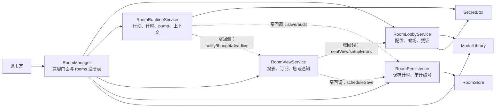

# RoomManager 职责拆分与兼容验收

## 基准契约（拆分前）

本文保留 `packages/session/src/manager.ts` 在基准提交 `ea8e7f7849553f9c5c718d00cb6947338072361f` 的职责、数据和顺序契约，并补充当前拆分实现的位置与验收矩阵。基准快照与当前源码的对应关系见下文。

基准 commit 为 `ea8e7f7`；分阶段提交为 `0a7e536`、`4c39aa9`、`35a4e9a`、`eee4c1e`、`721fa8c`、`df52e31`。当前实现以 `df52e31` 为准。2026-11-02 已完成整体验收，结果见文末。

## 导出与公开入口

`packages/session/src/index.ts` 将 `RoomManager`、`ApiFailure`、`ManagerOptions` 作为包入口导出。`actionLimitSec` 是 `manager.ts` 的具名导出，但当前没有从 `index.ts` 转出。拆分需要维持包入口的既有导出与 `RoomManager` 方法签名/行为；内部服务可以新增模块，不要求作为包 API 导出。

| 模块导出 | 同步性 | 兼容边界 |
| --- | --- | --- |
| `ApiFailure` | 同步类 | 保留 `status`、`code` 和错误消息字段，供 HTTP 层映射错误。 |
| `ManagerOptions` | 类型 | 保留依赖和可选运行参数，见“装配字段”。 |
| `RoomManager` | 同步构造 | 保留现有门面和下表全部方法。 |
| `actionLimitSec(stepType, fallback)` | 同步函数，从 `manager.ts` 和 `room-runtime.ts` 直接导出 | 发言/wolf discuss 为 180 秒、放逐/警长投票为 90 秒，其余回退到传入值；不是 `@werewolf/session` 包入口导出。 |

`RoomManager` 保留 24 个公开实例方法（不含 constructor），拆分前后名称一致：`resumeAll`、`dispose`、`catalog`、`modelPresets`、`importLegacyModels`、`addModel`、`deleteModel`、`createRoom`、`cloneRoom`、`getSetup`、`updateSetup`、`testSeat`、`start`、`control`、`participate`、`view`、`speechLocale`、`speechText`、`act`、`subscribe`、`audit`、`exportRecord`、`tick`、`whenIdle`。

| 公开入口 | 同步性 | 当前归属 / 转发 | 兼容边界 |
| --- | --- | --- | --- |
| `constructor(options)` | 同步 | `RoomManager` 装配 | 读取 `store.loadAll()`；Runtime 补齐旧存档的 `heardSeq`、`threads` 并建立每房间运行状态；按 `tickMs` 启动并 `unref` 周期计时器。 |
| `resumeAll()` | 同步启动、后台推进 | Runtime | 对运行中的房间重装截止时间并启动 pump；不等待模型调用完成。 |
| `dispose()` | 同步 | facade 协调 Runtime、View 与 Persistence | 停止全局 tick，再逐房间 abort、清理思考通知计时器、同步 flush；精确顺序见下文。 |
| `catalog()` | 同步 | Lobby／配置查询 | 返回引擎目录与 `STYLES`。 |
| `modelPresets()` | 同步 | facade 转发 `ModelLibrary` | 返回不含密钥明文的模型视图。 |
| `importLegacyModels()` | 同步 | facade 转发 `ModelLibrary` | 显式一次性导入；返回导入数量。 |
| `addModel(body)` / `deleteModel(id)` | 同步 | facade 转发 `ModelLibrary` | 校验和错误包装为 `ApiFailure(400, 'BAD_REQUEST', ...)`；模型库自身持久化。 |
| `createRoom(input?)` | 同步 | `RoomManager` 房间生命周期 | 校验风格与语言；创建全新房间和凭证；将初始记录写入 store 后返回 `roomId` 与 `hostToken`。 |
| `cloneRoom(roomId, tok)` | 同步 | `RoomManager` 房间生命周期，配置委托 Lobby | 仅房主可克隆；复制规则、计时及座位配置（含密钥密文），重新生成房间和座位凭证，清空候场状态；保存最终克隆记录。 |
| `getSetup(roomId, tok)` | 同步 | Lobby 鉴权，View 构造设置视图 | 房主鉴权；构造设置视图，掩去密钥明文。 |
| `updateSetup(roomId, tok, input)` | 同步 | Lobby | 只允许 setup 状态；校验规则、语言、版型、计时、座位设置；按现有条件撤销真人准备；变更后进入统一 `changed` 顺序。 |
| `testSeat(roomId, tok, seat)` | **异步** | Lobby／模型连接检查 | 房主鉴权；mock 不联网；其他适配器异步测试连接并脱敏错误。 |
| `start(roomId, tok)` | 同步返回设置视图；异步启动 Runtime | `RoomManager` 生命周期到 Runtime 的转接 | 房主鉴权、setup 校验、创建引擎初态、切换 running、清空旧上下文/计时状态，先 `changed` 后触发不等待的 pump。 |
| `control(roomId, tok, action)` | 同步返回 `RoomBrief`；可能异步推进 | Runtime | pause/resume/step/end；暂停取消请求并冻结剩余时间；结束作废代数并停止推进；非 end 操作在 `changed` 后启动 pump。 |
| `participate(roomId, tok, input)` | 同步返回 `ViewResponse` | Lobby | 仅真人座位凭证可接入本人座位；只可在 setup 修改本人昵称/准备；保存变更并返回该凭证的视图。 |
| `view(roomId, tok)` | 同步 | View | 凭证决定 host/seat/spectator 投影，附加死因展示和可用时间；不得先泄露上帝投影再由调用方隐藏。 |
| `speechLocale(roomId, tok)` / `speechText(roomId, tok, seq)` | 同步 | View | 依凭证校验并按其投影取可朗读的已提交发言；私密或非 speech 事件不可读。 |
| `act(roomId, tok, body)` | 同步返回结果；可能异步推进 | Runtime | 只允许当前真人座位凭证、运行中且未暂停时提交；须带 decision ID 和参数对象；提交后触发 pump，但不等待。 |
| `subscribe(roomId, tok, send)` | 同步返回取消订阅函数 | View | 订阅者按自身视角签名变化通知；建立/取消连接也更新在线状态。 |
| `audit(roomId, tok)` | 同步 | 保存／审计组件 | 房主鉴权后读取该房间审计记录。 |
| `exportRecord(roomId, tok, kind)` | 同步 | View／导出 | god 仅房主可取；public 房主可在终局前导出，其他视角须等终局。 |
| `tick()` | 同步检查；超时后触发异步推进 | Runtime | 只处理运行中、未暂停、当前 pending 的房间；到点执行引擎托管行动并触发 pump。 |
| `whenIdle(roomId)` | **异步** | Runtime | 等待该房间当前 pump；房间不存在时直接完成。 |

表中的归属现在由 `RoomManager` 兼容门面转交给服务，公开方法名和同步/异步边界保持基准行为。

## 状态字段所有权

所有权指业务写入与不变量的维护责任。`RoomStore` 负责序列化和持久化，不因此取得房间字段的业务所有权。View 读取并投影状态，不应写入对局事实。

### `RoomRecord`

| 字段 | 拆分后所有者 | 字段用途与当前约束 |
| --- | --- | --- |
| `id` | identity 初值（由 Lobby 建房工厂生成）；RoomManager 注册索引 | 房间标识；关联运行状态、store 文件和审计文件。 |
| `createdAt` | identity 初值（由 Lobby 建房工厂生成） | 建房时间戳。 |
| `avatarStyle` | Lobby | 房间人物风格；仅 setup 可改。 |
| `locale` | Lobby | setup 语言；运行时以 `rules.locale` 为准，旧记录可缺省。 |
| `hostToken`, `spectatorToken`, `seatTokens` | Lobby 凭证 | 房主、旁观、各座位凭证；clone 时全部换新。 |
| `participants` | Lobby | 真人 `joined` / `ready` 候场记录；旧房间可缺省。在线状态不落在此字段。 |
| `status` | 生命周期／Runtime | setup→running→ended；Runtime 负责开局后推进与结束状态，Lobby 仅据此拒绝已开局配置写入。 |
| `paused` | Runtime | 对局暂停门闩；pause/resume/end 和推进错误路径修改。 |
| `presetId`, `ruleValues` | Lobby | 版型与可编辑规则选项。 |
| `timing`, `humanTimeoutSec`, `aiPacingMs` | Lobby 写入，Runtime 消费 | 新计时配置与旧客户端兼容字段；旧记录可能没有 `timing`。 |
| `seats` | Lobby | `SeatRecord[]` 座位/模型配置；Runtime 只读取控制者、适配器和请求参数。开局时座位昵称用于建立引擎状态。 |
| `seed`, `rules`, `state`, `events`, `actions` | Runtime | 引擎事实与已提交输入；由开局、`submit`、结束流局等流程维护。View 只按凭证投影。 |
| `deadlines`, `actionAvailableAt`, `actionGateRemainingMs`, `deadlineRemainingMs` | Runtime | 行动截止、推进间隔及暂停期间剩余时间；须随暂停、恢复、重载保持现有语义。 |
| `thoughts` | Runtime 写入；View 只读 | 模型思考/工具外正文的持久化记录；不能写入对局事件或其他座位提示词。旧房间可缺省。 |
| `threads` | Runtime | 每座位独立模型上下文和消息同步进度；旁听/行动回复都留在对应座位。旧房间可缺省。FileStore 将其写入座位分文件。 |
| `heardSeq` | Runtime | 已广播给其他座位的最后一条发言序号；旧存档缺省时从 `events` 最大 `seq` 推导。 |

`seats[]` 中 `SeatRecord` 的完整字段如下。字段除 `apiKeyEnc`、`apiKeyMask` 外均来自 `SeatConfigView`（其中 `apiKeyMasked` 是接口字段名，不是存档字段）：

| `seats[]` 字段 | 所有者 | 说明 |
| --- | --- | --- |
| `seat`, `name`, `nameSource` | Lobby | 座号、昵称和默认/自定义来源；`nameSource` 可缺省以兼容旧房间。 |
| `controller`, `adapter`, `apiProtocol`, `baseUrl`, `model`, `modelId` | Lobby | 真人/AI、适配器与模型连接配置；协议/模型 ID 对旧记录可缺省。 |
| `temperature`, `style`, `persona`, `toolMode`, `timeoutSec`, `maxOutputTokens`, `thinkingMode` | Lobby | 模型生成配置；可选字段按旧存档兼容规则推导默认值。 |
| `apiKeyEnc`, `apiKeyMask` | Lobby／凭证安全 | 密钥密文与掩码；不得将明文写入 RoomRecord、API 视图或审计。 |

当前 `room-types.ts` 中 `roomFieldOwners` 为 `RoomRecord` 的 28 个顶层字段逐一归属（identity 2、lobby 12、runtime 14），并由 `satisfies Record<keyof RoomRecord, ...>` 要求穷尽。新增记录字段若未登记会导致类型检查失败。`RoomLobbyRecord` / `RoomRuntimeRecord` 限制各自服务能替换的顶层字段，其余顶层字段只读；这是浅层字段替换约束。`RoomReadRecord` 提供只读读取视图。

### 原 `Live` 与当前状态结构

| 拆分前字段 | 当前所有者及存放位置 | 字段用途与当前约束 |
| --- | --- | --- |
| `rec` | facade 的 `rooms: Map<string, RoomRecord>`；Runtime 状态也保留同一记录的受限引用 | facade 维护唯一房间注册表；服务按类型约束写入各自字段。 |
| `running`, `again`, `stepBudget`, `gatePausedAt`, `gen`, `inflight` | `RoomRuntimeService.rooms` 中的 `RoomRuntimeState`（定义在 `room-types.ts`） | pump 串行化/重跑标记、单步预算、暂停间隔锚点、失效代数和可取消请求。结束或暂停时作废请求，迟到结果不得提交。 |
| `subscribers` | `RoomViewService.states` 中的 `RoomViewState` | 按凭证解析的订阅者集合；参与真人在线状态计算。 |
| `thoughtTimer`, `thoughtNotifiedAt` | `RoomViewService.states` 中的 `RoomViewState` | 合并思考流更新，默认最多每 80ms 通知一次；最终思考状态立即通知。 |
| `saveTimer` | `RoomPersistence.states` 中的 `PersistenceState` | 300ms 合并 RoomRecord 保存；`flush` 取消挂起计时并同步保存。 |
| `auditId` | `RoomPersistence.states` 中的 `PersistenceState` | 首次写审计时从已有审计条数初始化，之后逐条递增。 |

### 拆分前 `RoomManager` 装配字段

基准版 facade 有 `rooms`、`store`、`secrets`、`now`、`sleep`、`adapters`、`models` 和周期 `timer`。`ManagerOptions` 字段为 `store`、`secrets`、可选 `now`、`sleep`、`adapters`、`tickMs`、`modelsPath`。

## 当前拆分实现

### 服务边界与文件定位

实线表示装配/依赖，虚线表示窄回调调用；回调在构造时作为 ports 传入。全局模型目录接口通过 facade 持有的 `ModelLibrary` 处理，房间级流程委托相应服务。运行时服务不持有 `RoomManager`，服务模块不导入 manager 或包入口；依赖边界由 `room-boundaries.test.ts` 检查。

| 当前文件 | 职责与当前状态位置 |
| --- | --- |
| `packages/session/src/manager.ts` | 兼容门面、依赖装配和 `rooms` 注册表；转发全部 24 个公开实例方法。构造时恢复记录并注册 Runtime 状态，随后启动 Runtime 的全局 tick。自身不直接调用 engine/llm，不保存 subscriber、inflight 或任何服务计时器。 |
| `packages/session/src/room-types.ts` | `ManagerOptions`、`Viewer`、`Subscriber`、`RoomRuntimeState`、`RoomViewState`；`roomFieldOwners` 对全部 `keyof RoomRecord` 做 `satisfies Record<...>` 穷尽约束。`RoomLobbyRecord` / `RoomRuntimeRecord` 允许服务替换自己拥有的顶层字段，对其他字段提供 readonly 类型；`RoomReadRecord` 是只读读取端口。 |
| `packages/session/src/room-lobby.ts` | 建房身份初值、版型/规则/座位配置、规则目录与座位模型选择、候场加入与准备、凭证解析和开局校验；模型配置依赖 `ModelLibrary`。 |
| `packages/session/src/room-runtime.ts` | 独立 `RoomRuntimeState` map、全局 tick 定时器、开局与控制、行动提交、截止时间、超时托管、pump/wave、座位上下文、AI 请求与旁听。 |
| `packages/session/src/room-view.ts` | 独立 `RoomViewState` map；设置/房间视图、视角投影、可朗读文本、导出、在线状态、订阅签名和思考通知节流。 |
| `packages/session/src/room-persistence.ts` | 独立 `PersistenceState` map；300ms 保存合并、同步 flush、保存错误处理、每房间审计编号和读取。 |
| `packages/session/src/room-model.ts` | 座位适配器参数组装与密钥解密。 |
| `packages/session/src/room-failure.ts` | `ApiFailure` 单一构造器定义；manager 和 package index 复用同一导出对象。 |
| `packages/session/src/store.ts` | `RoomRecord` / `SeatRecord` 持久化模式与 `RoomStore` 实现；`roomFieldOwners` 是对应全部 28 个顶层记录字段的写入责任表。 |

RoomRuntime、RoomView、RoomPersistence 各自维护 keyed state map；Lobby 不持房间生命周期状态，模型清单由 `ModelLibrary` 持有。`RoomManager` 保留记录注册表、服务引用与模型库装配句柄，不保存 Runtime/View/Persistence 的逐房间业务状态。Runtime 自己拥有一个全局 tick interval，按遍历的房间状态调用 tick。

`dispose()` 的当前顺序是契约：先 `runtime.stopTimer()`；随后逐房间执行 `runtime.disposeRoom(rec)` abort 在途行动、`views.dispose(rec)` 清思考通知计时器、`persistence.flush(rec)` 同步保存。顺序按房间分组，不先批量 abort 全部房间再统一 flush。

### 拆分提交阶段

| 提交 | 引入的职责 |
| --- | --- |
| `0a7e536` | 固定拆分前兼容契约（本文基准）。 |
| `4c39aa9` | 提取服务内部类型、房间状态及保存/审计组件。 |
| `35a4e9a` | 提取投影、订阅签名、在线状态及思考通知。 |
| `eee4c1e` | 提取规则目录、座位模型配置、候场与房间凭证逻辑。 |
| `721fa8c` | 提取统一运行调度、行动生命周期、计时和模型上下文。 |
| `df52e31` | 收口字段所有权穷尽类型约束与服务写入边界，并固定逐房间 dispose 顺序。 |

`df52e31` 将两项加固纳入实现：让 `roomFieldOwners` 对 `RoomRecord` 新增字段保持穷尽检查，并把 `dispose` 固定为“停止全局 tick，再逐房间 abort→清思考 timer→flush”。

## 保存、通知与计时顺序

### 记录变更

常规状态变更沿用基准 `changed(live)` 顺序；当前由 facade 调 `RoomRuntimeService.changed(rec)` 或由 Runtime 提交行动后进入 `changedState(live)`：

1. `armDeadlines(live, false)` 更新行动截止时间。
2. 按当前 pending 决策清理已过期的在途行动；`:hear:` 旁听请求不会仅因行动决策改变而取消。
3. `scheduleSave(live)` 注册 300ms 的合并保存（已有计时器则复用）。
4. `notify(live)` 逐个计算视角签名，只通知签名变化的订阅者；发送异常会移除对应订阅。

创建新房间立即 `flush`；克隆先建立默认房间、再覆盖复制配置并再次 `flush`。当前思考流通知 timer 存于 `RoomViewState`，普通增量节流到 80ms；通知时先通过 Persistence 安排合并保存，再通知订阅者；最终状态立即执行这一顺序。房间的 `saveTimer` 位于 `PersistenceState`，不写入 `RoomRecord`。`flush` 同步调用 `store.save` 并捕获记录保存错误。审计由 `RoomPersistence.writeAudit` 独立立即追加，不等待房间的 300ms 保存。

`RoomRuntimeService.apply` 先调用引擎 `submit`，再写回 `state`、追加 `events`/`actions`、更新 ended 状态和推进间隔，最后调用 `changedState`。新决策的 `actionAvailableAt` 是从上一决策的步骤类型读取间隔。RoomRecord 的普通保存因 `changedState` 延迟合并；上下文同步和 wave 准备过程也会安排保存，不能丢失 `threads` 或 `heardSeq`。

### 行动与模型时序

- `start` 完成状态初始化后先 `changed`，后启动 fire-and-forget `pump`；`control` 的非 end 分支和 `act` 在状态/行动提交后也按此顺序触发 pump。调用方不等待模型网络请求。
- pump 同一房间只运行一个 `running` promise；并发触发置 `again`，当前轮结束后重新检查。每轮先遵守 `actionAvailableAt`，准备可见消息/行动 wave，然后对同 wave 的 AI 行动和旁听以 `Promise.all` 并行执行。
- `prepareWave` 把新事件同步到各自 `SeatThread` 后更新 `heardSeq` 并安排保存；只有问话已进入该模型座位上下文、`readyToAct` 成立后，才由 `runAi` 标记行动开始并设置模型截止时间。真人截止在等待行动时设置；AI 排队、旁听和展示间隔不占用其行动时限。
- AI 请求回调的流式思考只更新对应 `Thought` 并触发节流通知；有效行动通过 `apply` 进入引擎。回答、失败轮次及工具回执写入该座位线程；审计编号按顺序追加。结束、暂停或决策变化后，generation 与 `AbortController` 检查阻止迟到结果提交。
- `tick` 同步检查当前截止时间；到期后以引擎托管行动提交，随后异步触发 pump。暂停期间不 tick。resume 要恢复间隔与各座位剩余时间，不能重置为完整时限。
- `control('end')` 先作废 generation、取消请求并清理运行时门闩，再经外层 `changed` 保存和通知；不得执行常规胜负结算或提前公开身份。

## 现有测试映射

以下是拆分前已经覆盖相关契约的主要测试；一个测试可能覆盖多个入口。该表是覆盖导航，不代表拆分后的测试已执行或通过。

| 职责／入口 | 现有测试位置与覆盖点 |
| --- | --- |
| 模拟对局、基本鉴权、视角隔离、密钥保存、模型调度、订阅、思考、房间克隆、结束流局、审计和导出 | `packages/session/test/session.test.ts`：整局模拟；凭证/投影边界；请求超时、失败重试和托管；暂停/单步；视角签名通知；思考显示；取消请求；clone 配置与换凭证。 |
| 真人候场、凭证、候场重置、在线通知、重连、真人行动与朗读 | `packages/session/test/human.test.ts`：真人进入/准备校验；改规则撤销准备；多连接在线通知；重启在线状态清空；运行中重接入；speech 按当前视角读；真实人类 act。 |
| deadline、行动间隔、暂停/恢复、单步、重载剩余时间 | `packages/session/test/timing-boundaries.test.ts`；`packages/session/test/locale-timing-presentation.test.ts`。 |
| 座位上下文、问话和许可顺序、旧线程恢复、旁听与行动互不串扰、重试回执、模型计时起点 | `packages/session/test/context-control.test.ts`；`packages/session/test/message-regression.test.ts`。 |
| 语言/计时、clone 与持久化、投影展示边界 | `packages/session/test/locale-timing-presentation.test.ts`。 |
| 真人候场、旧记录兼容、clone 清空候场、在线/准备的存档边界 | `packages/session/test/human.test.ts`。 |
| 昵称字段、默认昵称来源和旧存档迁移 | `packages/session/test/avatar-names.test.ts`。 |
| 文件存储、座位线程分文件、旧嵌入式线程读取 | `packages/session/test/store.test.ts`。 |
| 项目模型库与旧模型迁移、增删、模型选择、克隆和重载 | `packages/session/test/qwen-presets.test.ts`；`packages/session/test/protocol-config.test.ts`。 |
| 多协议旁听/行动、暂停重启和上下文/行动不重复 | `packages/session/test/protocol-session.test.ts`。 |
| 启动恢复与旧记录 pending 消息状态 | `packages/session/test/message-regression.test.ts`。 |

上述拆分前回归仍是兼容导航；如果拆分改变持久化、上下文顺序、取消边界、在线签名或计时锚点，应补充针对该边界的回归用例。当前新增的拆分验收用例如下。

## 当前验收矩阵

以下测试名和断言对应实际拆分边界；最终运行结果见文末。

| 测试 | 验收边界 |
| --- | --- |
| `packages/session/test/room-compatibility.test.ts` — `matches the pre-refactor legacy timing record` / `matches the pre-refactor modern timing record` | 使用基准 `ea8e7f7` 生成的真人全席情景 golden，比较暂停/恢复、视角快照、订阅通知、行动、终局导出和最终存档；覆盖旧字段缺省与新 timing 两种房间。 |
| 同文件 — `matches pre-refactor AI requests and context with legacy timing` / `matches pre-refactor AI requests and context with modern timing` | 比较模型旁听/行动请求、消息前缀、投影、工具/重试、审计、座位线程、视角快照及最终引擎记录；首轮注入非法工具后验证重试兼容。 |
| 同文件中的真人 golden SHA-256 | `legacy`: `05af15a7056fa046be733d2f7634428df03ce958f6f29fe73811d0b68520647f`；`modern`: `eff9be2a42273b58095cfd08452624bfb046eb1b5505a282866381d9222f5ee4`。情景由 `ea8e7f7` 的原 manager 精确生成。 |
| 同文件中的 AI golden SHA-256 | `legacy`: `78b4aa5edc12aba9fc9867125cbd63058f7c3bafd96093ec867f1ee90e8cd782`；`modern`: `58dc1fdf4a362622e0a3fe3117225f016bdb78172c7a6538f90f943d365897db`。AI 侧 golden 由独立补充情景生成，基准同为 `ea8e7f7`。 |
| `packages/session/test/room-services.test.ts` — `300ms 内的保存合并为一次，立即 flush 会取消原来的定时保存`；`保存失败记录错误而不抛出，后续仍可安排保存` | Persistence 每房间计时状态、合并窗口、显式 flush、失败后可重试保存。 |
| 同文件 — `审计编号从已有条数接续，记录受控时间并按房间隔离` | 重载审计编号连续、时间来源受控、不同房间独立。 |
| 同文件 — `思考流在 80ms 内合并，结束立即通知并取消待发通知，不改变行动时限`；`在途行动的思考通知不取消请求或重置截止时间，完成后立即公布结束` | View 通知节流/最终立即通知；流式 thoughts 不改行动 deadline、不 abort 请求；完成后投影停止标记并通知。 |
| 同文件 — `包入口、manager 和服务导出同一个 ApiFailure 构造器` | `index.ts`、`manager.ts` 与 `room-failure.ts` 的错误类身份、字段和 `instanceof` 兼容。 |
| `packages/session/test/room-boundaries.test.ts` — `业务服务不反向依赖兼容入口，且可达的本地模块没有循环依赖` | Lobby、Runtime、View、Persistence 可达依赖图不回到 manager/package index，也无本地循环依赖。 |
| 同文件 — `兼容入口不直接执行引擎或模型流程，也不保存调度、连接或保存计时器` | facade 保持转发/装配边界；调度、请求取消、订阅和保存计时器归属服务。 |
| `packages/session/test/room-disposal.test.ts` — `flushes each room before aborting requests in the next room` | `dispose` 的实现按房间执行 abort→View 思考 timer 清理→flush；本测试断言开始处理下一房间前，前一房间已保存。View timer 的取消另由 `room-services.test.ts` 覆盖。 |
| `packages/session/test/runtime-races.test.ts` — `超时与提交先后竞争时，每个决策只接受一次，暂停期间不触发超时`；`超时先结算后，迟到提交和重复 tick 不会再执行原行动` | 同一决策的 tick/手动提交竞争、幂等托管及暂停不计时。 |
| 同文件 — `自爆先于发言提交时，旧发言与重复自爆不能再次改变对局`；`暂停与单步不接受自爆；恢复后同窗口仅执行一次，并使旧发言超时失效` | 插入行动与窗口/暂停/单步/generation 边界一致，旧操作不得落入下一决策。 |
| 同文件 — `同一房间重复触发推进时不重复请求在途座位；暂停使迟到结果失效` | pump 合并、在途去重、取消信号和迟到模型结果失效。 |
| `packages/session/test/session.test.ts` — `订阅只在本视角的内容变化时推送`；`思考和正文只出现在对应视角，不进入任何座位的提示词`；`房主终结会取消正在进行的模型请求，并记为流局且不公开身份` | View 签名/投影信息边界、Thought 可见范围、end 与请求取消语义。 |
| 同文件 — `复制房间保留配置、换掉全部凭证`；`座位凭证拿不到上帝视角、审计和上帝记录（VIS-06）` | clone 配置复制与凭证轮换、房间凭证权限边界。 |
| `packages/session/test/human.test.ts` — `仅本人可确认昵称并准备；新房间必须全部真人准备后才能开局`；`加入、准备和多连接的离线状态即时通知房主；最终断线不改变准备状态`；`重启保留昵称和准备，不保留在线；克隆清空准备并更换凭证` | Lobby 候场字段、View 在线派生状态、订阅生命周期、存档/clone 兼容。 |
| 同文件 — `私密 speech 也必须先经过本人投影，其他座位和观战不能请求隐藏发言`；`朗读按各凭证的投影编号读取已接受公开发言，不读取私密记录或自由文本` | 视角安全、speech 文本和编号读取边界。 |
| `packages/session/test/timing-boundaries.test.ts` — `暂停冻结间隔，单步不会清除真人等待的间隔，恢复后仍阻止提前提交，结束清理间隔`；`暂停期间重载房间后仍保留推进间隔的剩余时间`；`暂停保留已用时，重载后恢复每席剩余行动时限`；`暂停取消在途行动，迟到的工具结果不执行也不触发托管，单步可重新执行` | 停/启/单步/结束的剩余计时持久化与 generation 取消边界。 |
| `packages/session/test/message-regression.test.ts` — `重启时问话已经落盘但尚未提交，直接恢复行动而不重复问话`；`恢复积压消息：最后一位发言送到后才允许行动，旁听期间不开始计时`；`换下一位时不取消还在收听上一条发言的模型`；`五次失败的助手调用和工具反馈均进入后续上下文及座位存档` | `threads` / `heardSeq` 重载、逐条上下文顺序、旁听/行动取消隔离、失败回执及工具对应关系。 |
| `packages/session/test/protocol-session.test.ts` — `${protocol} 逐条旁听、正式行动与暂停重启后可完成整局，不重复执行行动` | 三种 API_PROTOCOLS 的 HTTP/session 往返专项在 `ea8e7f7` 基准与当前拆分实现分别通过。测试以本机 `127.0.0.1` 模拟 HTTP 服务，覆盖旁听、正式行动、暂停重启、attempt 1 失败后 attempt 2 成功、原生工具错误回执/签名/加密推理续接、座位间隔离和行动去重；这是本地模拟端点验证，不是真实模型或外网调用。 |
| `packages/session/test/store.test.ts`；`avatar-names.test.ts`；`locale-timing-presentation.test.ts`；`context-control.test.ts`；`protocol-config.test.ts`；`qwen-presets.test.ts` | 继续覆盖座位分文件与旧内嵌线程、昵称来源迁移、语言/计时投影、上下文许可顺序、协议配置兼容和模型库迁移；具体用例名见各文件。 |

## 最终验收（2026-11-02）

- 实现提交：`df52e31`；拆分前基准：`ea8e7f7`。
- `RoomManager` 从 1457 行缩至 187 行；全部 24 个公开实例方法逐项核对，全部 28 个顶层存档字段均有唯一写入方。原 Live 的每个可变字段均已分配到运行、视图或保存服务；本地服务依赖无循环、无业务服务反向导入完整 manager。
- 全量回归：`node node_modules/vitest/vitest.mjs run --maxWorkers=4`，56 个文件、474 项测试全部通过。
- 类型检查：`node node_modules/typescript/bin/tsc -p tsconfig.json --noEmit`，通过。
- 生产构建：在 `apps/web` 中执行 `node node_modules/vite/bin/vite.js build`，通过。
- 固定兼容基准：真人／AI × 旧／新计时四组精确摘要均与重构前一致。AI 两组包含完整模拟对局、非法工具重试、请求及上下文顺序；新计时摘要的间隔为零，非零间隔、暂停／重载的毫秒余量由独立计时回归验证。
- 三协议分别覆盖旁听、正式行动、失败 attempt 1 到成功 attempt 2 的重试、工具调用与错误回执对应、原生思考／签名续接、暂停重启及跨席隔离；同一专项在历史基准和新实现均通过。
- 真实本机 HTTP/SSE 接入、授权投影和连接生命周期回归通过；所有模型调用使用合成桩或本机模拟服务，未调用真实外部模型，未操作用户正在进行的房间。
- 最初受限环境阻止回环 TCP 和测试临时文件的原子替换；在允许这些测试操作的环境中重新执行全套回归并通过，没有放宽断言或增加超时。

本项已达到职责明确、行为兼容的实施范围，处理结果迁入[已解决问题与已实现改进](已解决问题与已实现改进.md)，不再保留活动待办。
