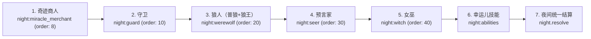

# 十二人奇迹商人版型（`merchant12`）实施方案

2026-11-18 修订。本文供实现和验收 `merchant12` 的开发者使用，规定十二人预设的合法行动、各席可见信息、结算和存档行为。实施状态见[待解决问题中的 PRESET-MERCHANT12](待解决问题.md#preset-merchant12)。

---

## 一、版型与规则判例

### 1. 标准阵容与基础规则

十二人奇迹商人（`merchant12`，预设版本 `1`，标签「进阶」）采用四神四民对四狼。好人有奇迹商人（`miracle_merchant`）、预言家（`seer`）、女巫（`witch`）、守卫（`guard`）各一人，平民（`villager`）四人。狼人有三名普通狼人（`werewolf`）和一名狼王（`wolf_king`）。全部狼人出局则好人胜，全部神职或全部平民出局则狼人胜。[网易十二人阵容说明](https://langrensha.com/news/official/20200611/26904_885985.html) · [官方角色问答及胜利条件](https://www.taptap.cn/moment/19875502311345790)

预设默认使用闭眼屠边局（`winCondition: 'side'`），开启警长竞选。首日先竞选再报死，警上自爆沿用首次延期、再次自爆吞徽的项目流程。女巫全程不可自救（`witch.selfSave: 'never'`），本职每夜最多用一瓶药，同守同救则刀口出局（`resolve.guardAndSaveKills: true`）。新局沿用 `toolsetVersion: 2`、`electionVersion: 4`、`inspectionVersion: 2`、`deathResolutionVersion: 2`、`hunterShotVersion: 2`。[开局规则](../packages/engine/src/rules.ts) · [警选及通报顺序](../packages/engine/src/flow/day.ts)

### 2. 角色与幸运儿能力

#### （1）奇迹商人（`miracle_merchant` · 好人阵营 · 神职）

从首夜起，仍存活且未交易的商人每夜最先行动（`night:miracle_merchant`，顺序 `8`）。可以等待，也可以选择一名其他存活玩家，赠予一次查验、毒药或守护。合法交易整局一次，选中任一阵营均消耗机会。等待保留机会。官方表演赛有首夜等待、次夜赠毒、平民当夜用毒的实例。[官方技能详解](https://www.sohu.com/a/401237710_100077559) · [网易表演赛复盘](https://langrensha.com/news/official/20200618/26904_887512.html)

给好人时，目标当夜私下获知自己是幸运儿及所获技能。给普通狼人或狼王时，目标收不到交易通知或技能，商人次日出局。[官方技能详解](https://www.sohu.com/a/401237710_100077559)

本项目的闭眼投影对幸运儿隐去商人座号。商人两种情况下都只收到自己选的技能和座号。`night.resolve` 计算反噬（`merchant_backfire`）在内的死亡原因，实际出局和死讯在 `dawn.announce` 处理。[项目夜间结算](../packages/engine/src/flow/night.ts)

#### （2）幸运儿（Lucky One · 附加能力实例）

幸运儿保留原身份、阵营及查验表现。受赐平民仍计入平民一边。附加能力实例（`AbilityInstance`）从获赐当夜起生效，持有人可在当夜或以后任一存活夜晚，于常规角色行动结束后的 `night:abilities` 使用一次，也可以跳过。使用后或持有人确认出局后停止询问。[官方角色问答](https://www.taptap.cn/moment/19875502311345790)

查验一名其他存活玩家，只向查验者反馈「好人／狼人」。毒药可用于一名其他存活玩家。守护可选一名存活玩家（含自己），仅挡当夜狼刀。本职资源和赠予的使用次数分别扣减，同一行动人的选人限制见下表。

#### （3）狼王（`wolf_king` · 狼人阵营 · 狼人）

狼王的阵营、类别和查验结果均为 `wolf`。狼王与普通狼人互知队友座次，共用密谈与合刀流程，可自刀，可在本局允许的白天窗口自爆（`wolfTeam: true`、`canExplode: true`）。[网易对狼王基本能力的说明](https://langrensha.com/news/official/20231113/26904_1119723.html)

本预设中，狼王被放逐、死于狼刀（含自刀、队友刀）或同守同救，且死亡批次结算后胜负未分，法官才私下询问是否开枪。狼王可以选择一名存活玩家，开枪后公开狼王身份与中枪者座号。放弃按现有 `hunter.declineReveals` 处理，默认仅本人收到回执。自爆或实际死因包含任何一份毒药均禁枪。默认十二人阵容没有猎人。在含猎人的自定义阵容中，现行枪击连锁规则允许被猎人射杀的狼王在胜负未分时回枪。[项目死亡职责与胜负顺序](../packages/engine/src/game.ts) · [开枪规则及旧版本](../packages/engine/src/roles/hunter.ts)

**自爆亮牌按项目规则处理。** 上述官方资料说明狼王可以自爆，未交代十二人奇迹商人局向其他玩家显示的牌面。方案沿用项目现行自爆公告公开具体角色的行为，在该局规则卡中明确「狼王自爆会亮出狼王牌，不能开枪」。[自爆公告](../packages/engine/src/flow/explode.ts) · [公开座位投影](../packages/engine/src/projection.ts)

### 3. 关键边界判例表

官方问答分别限定同一玩家的双验、双毒、双守，并明确不同玩家不能据获赐能力看到原神职的行动。菜单、提交校验与身份说明共同执行下表的判例。[官方角色问答](https://www.taptap.cn/moment/19875502311345790)

| 场景 | 合法选择与结算 |
| --- | --- |
| 预言家获赐查验 | 本职已验 3 号时，幸运儿查验只能选另一名合法目标。本职空验则不占目标，两次查验的阵营结果都只给本人。限制适用于同一夜。 |
| 女巫获赐毒药 | 本职阶段仍可救、毒或停药，每夜最多用一瓶本职药。本职毒 3 号后，幸运儿毒药可另毒一人。本职用解药或停药，均不占用幸运儿毒药或其毒人目标。 |
| 守卫获赐守护 | 本职与获赐守护同夜须选不同人，两次选择还都要避开本人前一夜实际守过的人。若首夜本职守 3 号、获赐守 7 号，次夜两人都禁守。若本职空守、只用获赐守 7 号，次夜只禁 7 号。若整夜未守任何人，下一夜没有由该夜产生的禁守目标。 |
| 守卫与另一席幸运儿守同一人 | 两人都可选择该目标，各自的菜单与回执隐藏另一人的选择。目标中狼刀时，无解药则双守挡刀，有解药则同守同救出局（`guard_and_save`）。幸运儿单独守刀口遇解药同样出局。 |
| 商人或幸运儿当夜中刀或中毒 | 先完成赐福和幸运儿行动，再统一结算当夜攻击。幸运儿可当夜使用，若留存后出局则失去后续使用机会。 |
| 商人反噬并同时中刀 | 守护或解药只影响狼刀，不能抵消 `merchant_backfire`，已用解药照常消耗。好人获赐、商人中刀，与狼人被选、商人反噬，都能产生同一份单死名单。商人回执只确认选择，警选和死讯均不公布交易成败或夜间死因。 |
| 狼王同夜中刀且中毒，或同批触发胜负 | 汇总实际致死原因，含女巫毒或幸运儿毒即禁枪。每批死亡及每项死亡职责前先判胜负。最后一狼与最后一民或最后一神同批出局时，按项目规则好人优先，直接终局。 |

---

## 二、核心架构设计

### 1. 固定工具目录、授予资格与当前菜单

`seatTools` 和 `grantAbility` 共用同一份按开局规则与持有人身份计算的能力目录。保留角色已声明的 `abilityCatalog`，在含 `miracle_merchant` 的局中，仅为商人以外的好人追加 `lucky_seer`、`lucky_poison`、`lucky_guard`。各能力注册稳定的 `catalog`，共用的 `lucky_skip` 只收录一次。这样平民也能通过授予校验，其他版型沿用自身目录。[固定工具目录](../packages/engine/src/catalog.ts) · [授予校验](../packages/engine/src/abilities.ts)

固定目录在开局、受赐和用尽后三个时点保持相同的顺序、参数和说明，沿用模型的隐式前缀缓存策略。真实工具请求与阶段 `actionMenu` 分别生成。未获赐、已经用尽或确认出局的席位跳过幸运儿询问。仍有次数的持有人只在自己的幸运儿阶段看到获赐的具体动作和 `lucky_skip`。所有目标都被排除时，只能跳过并保留次数。[工具与上下文设计](模块化与多协议设计.md)

目标为好人时，`grantAbility` 创建持久实例，设为 `active: true`、`activeFromNight` 为当前夜。成功使用后在实例内记录使用夜与目标，查验还记录阵营结果。保留已用实例供后夜守护校验、本人查验记录和读档使用。等待或跳过保留次数，非法提交不生效，重送已处理的决策不会重复授予或扣减。商人自己的交易记录只包含选择的夜次、技能和目标。

### 2. 按行动人和夜次校验目标

幸运儿阶段在本职行动之后。菜单和服务端提交使用相同的合法目标计算。每项先检查存活、能否选自己和剩余次数，再按下表读取持有者自己的动作。不同席位可各自选择同一目标，错误回执也只说明本人触及的限制。

| 技能 | 同席目标的依据 |
| --- | --- |
| 查验 | 持有人是预言家时，从该席 `seer.checks` 取本夜已验目标。本职空验没有目标。获赐查验复用预言家的阵营判定，私密结果留在能力实例。[预言家](../packages/engine/src/roles/seer.ts) |
| 毒药 | 持有人是女巫时，从当前夜 `attacks` 取本人已提交的 `poison` 目标。本职救人与停药均不产生毒药目标。附加毒药使用 `kind: 'poison'`，单独消耗获赐次数。[女巫](../packages/engine/src/roles/witch.ts) |
| 守护 | 以夜号合并守卫本人的 `guard.log` 和该席 `lucky_guard` 实际使用记录。两份守护都排除前一夜集合，幸运儿阶段再排除本夜已守目标。空守或跳过不写入目标集合。本职阶段、幸运儿阶段和身份附录读取同一集合，不能只看会被本职空守清空的单个 `last`。获赐守护使用 `blocks: ['wolf']`，纳入 `resolveGuardAndSave`。[守卫](../packages/engine/src/roles/guard.ts) |

### 3. 显式单动作工具（Action Tools v2）

对外工具各表达一个动作，目标是整数座位号。无参数工具提交 `{}`。内部映射使用已有 `operation` 机制。[工具说明审计](工具说明审计.md)

| 归属 | v2 显式工具名 | 参数 Schema | 内部映射（`operation`）与说明 |
| :--- | :--- | :--- | :--- |
| **奇迹商人** | `merchant_gift_inspect` | `{"targetSeat": number}` | `merchant_gift`，将 `targetSeat` 映射到 `target`，固定 `skill: "seer"` |
| **奇迹商人** | `merchant_gift_poison` | `{"targetSeat": number}` | `merchant_gift`，同样映射 `target`，固定 `skill: "poison"` |
| **奇迹商人** | `merchant_gift_guard` | `{"targetSeat": number}` | `merchant_gift`，同样映射 `target`，固定 `skill: "guard"` |
| **奇迹商人** | `merchant_wait` | `{}` | `merchant_gift`，固定 `target: null, skill: null`，保留交易机会 |
| **幸运儿** | `lucky_inspect` | `{"targetSeat": number}` | 查验一名其他存活玩家的阵营（好人／狼人） |
| **幸运儿** | `lucky_poison` | `{"targetSeat": number}` | 对一名其他存活玩家使用幸运儿毒药 |
| **幸运儿** | `lucky_guard` | `{"targetSeat": number}` | 对一名存活玩家（含自己）使用幸运儿守护 |
| **幸运儿** | `lucky_skip` | `{}` | 本夜暂不使用幸运儿技能，留存至后续夜晚 |
| **狼王** | `wolf_king_shoot` | `{"targetSeat": number}` | `wolf_king_shoot`，将 `targetSeat` 映射到 `target`，开枪并亮牌 |
| **狼王** | `wolf_king_hold_fire` | `{}` | `wolf_king_shoot`，固定 `target: null`，放弃开枪 |

狼王的整局目录还要复用普通狼队的密谈、落刀／空刀和本局自爆工具。密谈、刀口投票和自爆窗口继续由对应阶段许可。模拟玩家按内部 `merchant_gift` 选择技能，`simulationTools` 要能还原三种字符串选择，`exposeAction` 再映回对应显式工具。`merchant_wait` 的空值仅表示等待。[狼队工具](../packages/engine/src/roles/werewolf.ts) · [v2 工具映射](../packages/protocol/src/action-tools.ts) · [模拟玩家](../packages/llm/src/mock.ts)

### 4. 夜间流程时序（`nightOrder`）

---

## 三、分模块代码实施清单

| 模块与文件路径 | 具体改动内容 |
| --- | --- |
| 预设、角色与规则卡 | 在 `roles/miracle-merchant.ts` 和 `roles/wolf-king.ts` 实现角色。在内置注册入口登记两名角色与 `merchant12`。规则卡使用本局阵容说明谁参与狼队行动、哪种情况公开身份，以及同席技能的选人限制。[预设](../packages/engine/src/presets.ts) · [内置注册](../packages/engine/src/builtin.ts) · [规则卡](../packages/engine/src/rulecard.ts) |
| 夜间结算与死亡职责 | 商人反噬写入 `attacks`，与狼刀、毒药逐项结算，上帝记录保留实际致死原因。给狼王单设 `wolf_king.shoot` 死亡步骤，复用枪击结算的批次、死因来源及遗言顺序。实际开枪设置 `revealedAs = 'wolf_king'` 与 `revealed = true`，中枪者以 `via: 'shot'` 出局，公开 `wolf_king.shot` 携带 `shooter`、`target`、`role: 'wolf_king'`。放弃走 `wolf_king.decline`，仅在本局开启放弃亮牌时公开。保留猎人及模仿猎人的既有事件与牌面。[夜间](../packages/engine/src/flow/night.ts) · [死亡职责](../packages/engine/src/flow/deaths.ts) · [猎人](../packages/engine/src/roles/hunter.ts) |
| 能力、读档与行动协议 | 在 `abilities.ts` 的 `AbilityStateMap` 声明三种幸运儿状态，在引擎的 `lucky-abilities.ts` 注册有版本的 `AbilityDefinition`。扩展 `RoleDataMap` 并注册新角色数据结构。装载定义后再恢复房间，保留未用／已用实例、本人行动记录和待决动作。复用既有规则选项，使旧 `RuleSet` 仍可校验及重放。v2 的提交、托管和模拟使用同一套动作映射。[能力框架](../packages/engine/src/abilities.ts) · [角色数据迁移](../packages/engine/src/role-data.ts) · [动作协议](../packages/protocol/src/action-tools.ts) |
| 座位消息与投影 | `merchant.gift.received` 只发给幸运儿，保留所获技能与可用时机。该通知省略商人行动的 `round`，正文、载荷、标识均不能编码赠予者座号。商人只收自己的选择，狼人不会因被选而多收事件。用私密增量消息送达已有模型会话。让 `ability.act` 按能力定义生成标题与问话，幸运儿得到本技能说明，觉醒隐狼继续使用原有提示。查验事实按阵营仅加入本席知识。[座位投影](../packages/engine/src/projection.ts) · [座位对话](../packages/session/src/agent.ts) |
| 网页、出局标记与回放 | 扩展 `DeathCause` 与 `deathCauses`，上帝可见 `merchant_backfire`，闭眼局进行中的公共死讯只见夜晚出局。玩家和旁观者座位牌按公开开枪事件亮出狼王，事件日志、技能效果与视频回放在同一事件将中枪者标记为出局。补齐两张角色图标和三语显示。[死因与图形](../packages/protocol/src/death-glyphs.ts) · [公开座位牌](../apps/web/src/game-ui.ts) · [事件日志](../apps/web/src/components/EventLog.tsx) · [技能效果](../packages/protocol/src/skill-effects.ts) · [视频回放](../scripts/video/replay.ts) |
| 录制、翻译与规则文档 | 为商人行动与幸运儿行动提供各自的 `roundKind`、稳定轮次标识与 `nightRoundSummary`，向被授权的视角生成对应的事件和分章。既有狼队和觉醒轮次仍按原格式读取。规则卡、身份附录、阶段提示、工具、回执和界面文案补齐简中、英语、日语。实现后新增 `docs/奇迹商人规则.md` 并更新 README 的版型表。[轮次类型](../packages/protocol/src/index.ts) · [记录导出](../packages/protocol/src/recording.ts) · [语言资源](../packages/protocol/src/locales/catalog.ts) · [README](../README.md) |

---

## 四、实施后的验收标准

| 验收对象 | 通过条件 |
| --- | --- |
| 赐福与使用次数 | 从房间选择 `merchant12` 开局。覆盖首夜等待后赠予、三种赠予动作、幸运儿当夜使用和跳过至后夜。本人受刀或中毒仍能完成当夜行动。已经使用或已出局的幸运儿不再被询问。收到技能的平民仍按平民判胜。 |
| 同席与不同席的目标 | 预言家双验、女巫双毒、守卫双守时，重复目标不在合法菜单内，手工提交也被拒绝，改选合法目标仍可用。女巫本职救人后仍能用赠毒。守卫本职守 3、获赐守 7 后，跨夜和读档后都禁 3、7。只用一盾则只禁该目标。另一席幸运儿仍可选守卫选过的目标，其可见信息不因守卫守谁而改变。 |
| 夜间攻击与警上信息 | 分别将技能给普通狼人和狼王，核对其无获赐通知或能力，护盾与解药均救不回反噬商人。对照「给好人后商人中刀」与「给狼人后商人反噬」两个公开死讯相同的局面，商人同一选择的回执一致，警选前无提前死讯，报死时无交易结果。上帝可查看真实死因。双守与守救分别按上表结算。 |
| 狼王与公开结果 | 狼王能与队友密谈、落刀，仅剩狼王时仍可用狼刀。验放逐、狼刀及同守同救后的开枪或放弃，自爆、两种来源的毒及刀毒并中均禁枪。最后一狼、最后一神或最后一民出局时先判胜，双方同批达成时好人优先。开枪、放弃、自爆三种结果在玩家、旁观座位牌及相应回放中与本局亮牌规则一致。 |
| 模型席、真人席与导出记录 | 同一候选席的对话保留开局系统消息，开局、获赐和用尽后的模型工具定义及顺序一致，受赐通知只追加到持有人对话。由真人菜单和模型席的 v2 工具分别完成合法行动，模拟玩家能区分三种赠礼和等待。幸运儿看到本技能提示和自己的选择或查验结果。席位与旁观投影只包含获准接收的事件及字段，经授权的导出正确标识商人、幸运儿与狼王枪击。 |
| 保存、续局与确定性重放 | 在已获赐未用（含待决行动）、已使用两种状态下保存并恢复。续局保留行动者、合法目标、守护历史和剩余次数，先前确认的交易与行动仅生效一次。用相同开局参数、种子与已接受的行动序列调用引擎 `replay`，逐项比对终局状态与完整事件。旧版型用原存档续局、原始规则重放，维持既有工具及判定。[重放入口](../packages/engine/src/game.ts) · [既有重放与旧档用例](../packages/engine/test/core-workflows.test.ts) |

版型专项用例放入 `packages/engine/test/merchant.test.ts`。实现时运行 `pnpm i18n:check`、`pnpm typecheck`、`pnpm test`、`pnpm build`。`pnpm simulate merchant12 night-001` 用于核对随机对局能否到达终局。该命令在行动被拒时可转托管，确定性重放与存档恢复分别以上表的状态和事件比对验收。[模拟入口](../packages/engine/scripts/simulate.ts)
