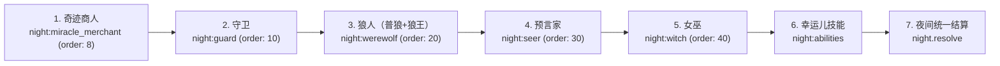

# 十二人奇迹商人版型（`merchant12`）实施方案

日期：2026-11-17。范围为 `PRESET-MERCHANT12`。这是实施前设计与后续验收的依据，不表示功能已经完成；活动状态与最终处理只在[待解决问题](待解决问题.md)及其归档维护。

---

## 一、 版型配置与规则判例定界

### 1. 标准阵容与基础规则（Preset ID: `merchant12`）

- **版型名称**：十二人奇迹商人（`presetId: 'merchant12'`，`presetVersion: 1`，标签：`进阶`）
- **好人阵营（8 人 · 4 神 4 民）**：**奇迹商人**（`miracle_merchant`）、**预言家**（`seer`）、**女巫**（`witch`）、**守卫**（`guard`）、**平民 × 4**（`villager`）
- **狼人阵营（4 人 · 3 普狼 1 狼王）**：**普通狼人 × 3**（`werewolf`）、**狼王**（`wolf_king`）
- **默认规则配置**：闭眼局、**屠边**（`winCondition: 'side'`，杀光所有神职或杀光所有平民）、开启警长竞选（`sheriff.enabled: true`）、**女巫全程不可自救**（`witch.selfSave: 'never'`）、同守同救则刀口出局（`resolve.guardAndSaveKills: true`）。新局沿用 `toolsetVersion: 2`、`electionVersion: 4`、`inspectionVersion: 2`、`deathResolutionVersion: 2`、`hunterShotVersion: 2`。

### 2. 三大核心角色与能力机制

#### （1）奇迹商人（`miracle_merchant` · 好人阵营 · 神职）
- **行动时序**：每夜最先行动（`nightPhase: { id: 'miracle_merchant', order: 8 }`，位于守卫 `10` 与狼人 `20` 之前）。
- **核心技能（赐福／交易）**：整局游戏**限发动一次**。从第 1 夜起，只要尚未发动过技能，每夜均可选择一名其他存活玩家成为**「幸运儿」**，并从以下三项一次性技能中指定一项赋予该玩家，或选择**本夜暂不赋予**（保留机会至后续夜晚）：
  1. **查验（`seer`）**：查验一名其他存活玩家的阵营（返回好人或狼人）。
  2. **毒药（`poison`）**：使用毒药毒杀一名其他存活玩家。
  3. **守护（`guard`）**：守护一名存活玩家（可守自己）免受当晚狼刀。
- **正负向结算（给好人 vs. 给狼人）**：
  - **目标属于好人阵营（平民、预言家、女巫、守卫）**：交易成立。目标成为「幸运儿」，当晚立即收到私密通知获知自己成为了幸运儿及所获的具体技能（不告知奇迹商人的座位号），并获得对应的一次性能力实例（`AbilityInstance`），可在**当夜或之后任意存活夜晚**的 `night:abilities` 阶段使用。
  - **目标属于狼人阵营（普通狼人、狼王）**：交易失败并触发**技能反噬（`merchant_backfire`）**。**目标狼人不会获得任何技能，也不会收到任何私密通知**；奇迹商人自身将在本夜结算（`night.resolve`）时因技能反噬直接出局，且**反噬无法被守卫守护或女巫解药救起**。无论给好人还是给狼人，奇迹商人的赐福机会均视为已消耗。

#### （2）幸运儿（Lucky One · 附加能力实例）
- **身份与阵营属性**：幸运儿是附加在好人座位上的独立能力实例（`AbilityInstance`），**不改变持有者的真实身份（`player.role`）、所属阵营、查验表现或胜负判定**（例如平民成为幸运儿后，屠边统计仍计为平民）。
- **使用时机与库存**：在常规夜间角色（奇迹商人、守卫、狼人、预言家、女巫）行动结束后的 `night:abilities` 阶段单独唤醒。三项技能均为**一次性**（用完即止）；当晚可选择立即发动，也可选择暂不使用并留存到后续夜晚。若持有者在技能使用前已出局，未使用的幸运儿技能不再唤醒。

#### （3）狼王（`wolf_king` · 狼人阵营 · 狼人）
- **狼队属性**：真实身份为 `wolf_king`，所属阵营 `faction: 'wolf'`，类别 `category: 'wolf'`，阵营查验结果 `inspectAs: 'wolf'`；与普通狼人**互知队友、共同参与夜间狼队密谈与合刀**（`wolfTeam: true`），白天**可以自爆**（`canExplode: true`）。
- **出局开枪（狼王枪）**：当狼王出局后**胜负未分**，且出局原因符合开枪条件时，法官私下询问狼王选择一名存活玩家开枪带走，或放弃开枪。实际开枪时公开狼王身份表现（`revealed = true, revealedAs = 'wolf_king'`）与中枪目标；放弃开枪默认不公开身份（遵循本局 `hunter.declineReveals` 或独立选项配置）。
- **禁枪条件**：
  - 狼王**自爆出局**（`death.via === 'explode'`）时**不能开枪**；
  - 狼王出局原因**包含毒药**（`death.causes.includes('poison')`，无论是女巫毒药还是幸运儿毒药）时**不能开枪**；
  - 新局（`deathResolutionVersion === 2`）中，若狼王出局时场上已达成好人获胜（如狼王是最后一匹狼）或狼人屠边获胜，胜负立即成立，**不再询问或发动狼王开枪**。

### 3. 关键边界判例表

| 边界场景 | 项目固定判例 | 规则与信息边界依据 |
| :--- | :--- | :--- |
| **奇迹商人提交赐福时，是否立即得知目标是好人还是狼人？** | **不立即揭晓**。提交回执仅记录“你选择将【X技能】赋予 Y 号”。若给到狼人，在天亮公布昨夜出局名单时体现反噬结果。 | 避免奇迹商人在天亮警上竞选（死讯公布前）凭夜间即时回执直接得知目标阵营，确保与闭眼局信息时序一致。 |
| **奇迹商人当夜被狼刀或被毒杀，当夜送给好人的技能是否生效？** | **生效**。好人目标当夜正常收到幸运儿通知并可在 `night:abilities` 使用技能。 | 遵循 [rulecard.ts](../packages/engine/src/rulecard.ts) 既有原则：“狼人的攻击与女巫的毒药不会取消目标当夜尚未完成或已提交的行动”。 |
| **好人成为幸运儿当夜被狼刀或被毒，当夜能否使用幸运儿技能？** | **当夜可用**。夜间攻击在 `night.resolve` 才统一结算生杀，在此之前的 `night:abilities` 阶段该好人仍存活。 | 与预言家当夜中刀仍可查验、女巫当夜中刀仍可用毒一致；若该幸运儿当夜选择不用，天亮确认出局后技能作废。 |
| **幸运儿获得「守护」时，与守卫守护、女巫解药如何交互？** | ① 幸运儿守护可自守，仅一次性，挡狼刀不挡毒药； ② **幸运儿守护 + 女巫解药**同时作用于同一狼刀目标，触发**同守同救（`guard_and_save`）**出局； ③ **守卫守护 + 幸运儿守护**同时作用于同一狼刀目标（且无解药），仍成功挡住狼刀。 | 扩展 [guard.ts](../packages/engine/src/roles/guard.ts) 的 `resolveGuardAndSave`，将 `lucky_guard` 与 `guard`、`awakened_guard` 一并归入守护类保护。 |
| **神职（预言家／女巫／守卫）成为幸运儿并获得同名技能时如何结算？** | **原身份技能与幸运儿能力实例完全独立**。例如预言家获赐查验，当夜在 `night:seer` 查验一次，随后在 `night:abilities` 可再使用幸运儿查验一次；守卫获赐守护，不受原守卫上一晚禁守目标的限制；女巫获赐毒药，与自身药瓶库存及同夜双药限制独立。 | 复用 [abilities.ts](../packages/engine/src/abilities.ts) 的实例隔离设计，能力状态保存在各自的 `AbilityInstance.state` 中，不读写源角色 `PlayerState.data`。 |
| **奇迹商人给狼触发反噬，同时当夜又被守卫守护或被女巫解药救治** | **仍然出局**。反噬攻击类型 `merchant_backfire` 不被任何 `protections` 阻挡。若商人当夜同时也是狼刀目标且女巫对其使用解药，解药仅抵消 `wolf` 攻击（药瓶照常消耗），商人仍因 `merchant_backfire` 出局。 | 反噬属于规则强制惩罚，不可被常规守护或解药抵消。 |
| **狼王自刀或被队友刀死、同守同救出局、被放逐出局、被猎人射杀** | 只要死因不含毒药（`poison`）、非自爆（`explode`）且当时胜负未分，**均可开枪**。 | 与官方标准狼王规则及项目 `hunterShotVersion: 2` 逻辑保持一致。 |

---

## 二、 核心架构设计

### 1. 保持固定工具目录（Fixed Catalog）与隐式 KV 缓存稳定

根据 [模块化与多协议设计.md](模块化与多协议设计.md) 与 [catalog.ts](../packages/engine/src/catalog.ts)，每个座位整局发送给模型的 `tools` 定义必须由开局规则和身份唯一决定，**绝不在对局中途因成为幸运儿或消耗技能而增删工具 Schema**，以保护大模型服务商的隐式前缀缓存（Prompt Cache）。

- **能力目录装配**：
  - 在 `packages/engine/src/copied-abilities.ts`（或独立模块）注册 `lucky_seer`、`lucky_poison`、`lucky_guard` 三项 `AbilityDefinition`，各自声明稳定的 `catalog` 工具。
  - 在 [catalog.ts](../packages/engine/src/catalog.ts) 的 `seatTools(state, seat)` 中，当 `state.rules.roles.includes('miracle_merchant')` 且该席角色满足好人可受赐条件（`getRole(player.role).faction === 'good' && player.role !== 'miracle_merchant'`）时，自动将 `['lucky_seer', 'lucky_poison', 'lucky_guard']` 的目录工具并入该席的开局固定工具列表。
- **轮次动态裁剪**：
  - 未获得幸运儿能力时，`night:abilities` 不会询问该座位，法官每轮末尾的 `actionMenu` 中也绝不出现 `lucky_*` 工具；
  - 获得某项幸运儿能力后，`night:abilities` 仅在当轮菜单中向该座位开放所获得的那一项工具（如 `lucky_inspect`）与 `lucky_skip`。

### 2. 显式单动作工具（Action Tools v2）规范

遵循 [工具说明审计.md](工具说明审计.md) 的 v2 设计，所有新增动作均拆解为语义单一的显式工具，不使用复合布尔开关或 `null` 表示相反动作：

| 归属 | v2 显式工具名 | 参数 Schema | 内部映射（`operation`）与说明 |
| :--- | :--- | :--- | :--- |
| **奇迹商人** | `merchant_gift_inspect` | `{"targetSeat": number}` | 映射到 `merchant_gift`，固定 `skill: "seer"`；赋予目标一次查验 |
| **奇迹商人** | `merchant_gift_poison` | `{"targetSeat": number}` | 映射到 `merchant_gift`，固定 `skill: "poison"`；赋予目标一瓶毒药 |
| **奇迹商人** | `merchant_gift_guard` | `{"targetSeat": number}` | 映射到 `merchant_gift`，固定 `skill: "guard"`；赋予目标一次守护 |
| **奇迹商人** | `merchant_wait` | `{}` | 映射到 `merchant_gift`，固定 `target: null, skill: null`；本夜暂不赋予 |
| **幸运儿** | `lucky_inspect` | `{"targetSeat": number}` | 查验一名其他存活玩家的阵营（好人／狼人） |
| **幸运儿** | `lucky_poison` | `{"targetSeat": number}` | 对一名其他存活玩家使用幸运儿毒药 |
| **幸运儿** | `lucky_guard` | `{"targetSeat": number}` | 对一名存活玩家（含自己）使用幸运儿守护 |
| **幸运儿** | `lucky_skip` | `{}` | 本夜暂不使用幸运儿技能，留存至后续夜晚 |
| **狼王** | `wolf_king_shoot` | `{"targetSeat": number}` | 映射到 `wolf_king_shoot`；开枪带走一名存活玩家并亮出狼王牌 |
| **狼王** | `wolf_king_hold_fire` | `{}` | 映射到 `wolf_king_shoot`，固定 `target: null`；放弃开枪 |

### 3. 夜间流程时序（`nightOrder`）

---

## 三、 分模块代码实施清单

| 模块与文件路径 | 具体改动内容 |
| :--- | :--- |
| [packages/protocol/src/index.ts](../packages/protocol/src/index.ts) | 扩展 `SeatDeathCause` 增加 `'merchant_backfire'`；扩展 `NightRoundKind` / `NightActionKind` 支持奇迹商人及幸运儿夜间轮次标记。 |
| [packages/protocol/src/action-tools.ts](../packages/protocol/src/action-tools.ts) | 在 `expandActionTools`、`simulationTools`、`exposeAction` 中支持 `merchant_gift`（展开为 4 个显式工具）与 `wolf_king_shoot`（展开为开枪／放弃 2 个显式工具）。 |
| [packages/protocol/src/recording.ts](../packages/protocol/src/recording.ts) | 在 `PRIVATE_STATUS`、`projectNightRound`、`gameRecordEvents` 中补充 `merchant.*`、`lucky.*`、`wolf_king.*` 事件的标准化文案与视频分章支持。 |
| `packages/protocol/src/locales/` | 在 [catalog.ts](../packages/protocol/src/locales/catalog.ts)、`messages.ts`、`game-additions.ts`、`presentation.ts` 补齐 `merchant12`、奇迹商人、狼王、幸运儿相关的中、英、日三语模板。 |
| `packages/engine/src/roles/miracle-merchant.ts`（新增） | 实现 `miracleMerchant` 角色模块：声明 `nightPhase (order: 8)`、工具集、规则卡、身份附录、好人赋权（`grantAbility` + 私密通知 `merchant.gift.received`）与狼人反噬攻击（`kind: 'merchant_backfire'`）。 |
| `packages/engine/src/roles/wolf-king.ts`（新增） | 实现 `wolfKing` 角色模块：声明 `wolfTeam: true`、`canExplode: true`，复用或参数化猎人开枪校验与死亡钩子（排除 `explode` 与 `poison`），公开 `revealedAs = 'wolf_king'`。 |
| [packages/engine/src/copied-abilities.ts](../packages/engine/src/copied-abilities.ts) | 注册 `lucky_seer`、`lucky_poison`、`lucky_guard` 三种一次性 `AbilityDefinition`，实现各自的 `catalog`、`tools`、`validate`、`apply`、`fallback`、`knowledge` 与 `appendix`。 |
| [packages/engine/src/catalog.ts](../packages/engine/src/catalog.ts) | 在 `seatTools` 中为包含 `miracle_merchant` 对局的好人候选座位挂载 `lucky_*` 固定能力工具目录。 |
| [packages/engine/src/roles/guard.ts](../packages/engine/src/roles/guard.ts) & [flow/night.ts](../packages/engine/src/flow/night.ts) | `resolveGuardAndSave` 识别 `lucky_guard`；`CAUSE_LABEL` 增加 `merchant_backfire: '技能反噬'`。 |
| [packages/engine/src/role-data.ts](../packages/engine/src/role-data.ts) | 在 `RoleDataMap`、`AbilityStateMap` 与 `registerRoleDataSchema` 中增加 `miracle_merchant`、`wolf_king` 及 `lucky_*` 能力状态定义。 |
| [packages/engine/src/presets.ts](../packages/engine/src/presets.ts) & [builtin.ts](../packages/engine/src/builtin.ts) & [rulecard.ts](../packages/engine/src/rulecard.ts) | 注册 `miracleMerchant`、`wolfKing` 与 `merchant12` 版型；在 `buildRuleCard` 中补充反噬出局、幸运儿与狼王开枪规则说明。 |
| [packages/llm/src/mock.ts](../packages/llm/src/mock.ts) | 补充模拟玩家对 `merchant_gift_*`、`lucky_*`、`wolf_king_shoot` 的决策支持。 |
| [apps/web/src/components/Icons.tsx](../apps/web/src/components/Icons.tsx) & [DeathMark.tsx](../apps/web/src/components/DeathMark.tsx) | 为 `miracle_merchant`、`wolf_king` 映射角色图标；为上帝视角补充 `merchant_backfire` 出局标记展示。 |
| `docs/奇迹商人规则.md`（实施时新增） & [README.md](../README.md) | 编写正式版型规则说明并更新 README 版型总表。 |

---

## 四、 验收标准与回归测试矩阵

1. **规则与判例单测（`packages/engine/test/merchant.test.ts`）**：
   - 奇迹商人首夜暂不赋予、次夜赋予好人查验／毒药／守护，验证幸运儿当夜可用、留存隔夜可用、用完即止；
   - 奇迹商人赋予普通狼人或狼王技能，验证狼人零私密通知、无能力实例，且奇迹商人在天亮因 `merchant_backfire` 强制出局（即使同夜被守卫守护或被女巫解药救治仍出局）；
   - 奇迹商人或幸运儿当夜中狼刀／中毒时，当夜提交的赐福或幸运儿技能正常生效；
   - 幸运儿守护与女巫解药作用于同一狼刀目标触发 `guard_and_save`（同守同救）出局；幸运儿守护与守卫守护重叠不触发奶穿；
   - 狼王参与狼队密谈与合刀，被放逐／被狼刀／同守同救／被猎人射杀时可开枪，自爆或死因含毒药（女巫毒或幸运儿毒）时不可开枪，开枪前若胜负已分（`deathResolutionVersion: 2`）则直接终局不再询问。
2. **视角隔离与固定工具目录验证**：
   - 验证 `seatTools` 在赐福发生前后生成的工具 Schema 完全一致，不破坏隐式缓存前缀；
   - 验证 `projectSeat` 与 `projectSpectator` 严格隔离：幸运儿不知道商人座次、商人提交时不提前得知目标阵营、非上帝视角只见「夜晚出局」而不暴露 `merchant_backfire` 死因。
3. **全量工程检查**：
   - `pnpm i18n:check` 中、英、日三语资源零缺项、占位符一致；
   - `pnpm typecheck`、`pnpm test`、`pnpm build` 全部通过；
   - `pnpm simulate merchant12 night-001` 模拟对局与重放一致性验证通过，已有旧版型与旧存档不受影响。
