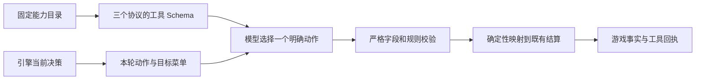

# 模型动作工具：结构、提示与真实验证

> 更新：2026-10-31。上一轮核对了 15 种工具的说明、Schema 示例和引擎规则，但遗漏了**相反动作共用字段、轮次许可遗漏、拒绝后的纠错质量**。那次检查不足以证明工具易用。本次据真实女巫误操作修正这些结构问题，新开局改用显式单动作工具 v2。

## 🔎 真实问题与原因

9 号女巫首夜得知刀口是 7 号。模型第一次提交：

```json
{"tool":"witch_act","args":{"save":true,"poisonTarget":7}}
```

引擎按“同夜不能双药”拒绝。下一次提交变成：

```json
{"tool":"witch_act","args":{"save":false,"poisonTarget":7}}
```

第二次结构合法，实际执行了**毒 7 号**。两次模型展示文字都在表达救人选择，参数却相反。旧反馈只说不能双药，没有给出完整的正确重填格式。

这里暴露的是工具设计缺陷：救人无需另选目标，却要求模型同时填写一个救人开关和一个可空毒药目标；纠错时，只改开关就可能执行相反动作。不能只归结为“模型填错”。

本局规则仍允许**有意对刀口使用毒药**，例如刀口可能被守护；此次不增加策略禁令，也不从模型思考文字推断或覆盖工具目标。工具意图由明确动作表达，效果由引擎执行。

## 🛠️ 全量结构复查

标准十二人局所有身份合计 **24 种 v2 动作工具**；允许同夜双药时增加到 **25 种**。单个座位只收到公共工具和本身份工具。内部连通性 `ping` 不计入游戏动作。

| 原来的易错点 | v2 工具与参数 | 当前约束与效果 |
| :--- | :--- | :--- |
| 女巫 `save` 与 `poisonTarget` 交叉表达三种选择 | `witch_save({})`、`witch_poison({"targetSeat":3})`、`witch_skip({})` | 解药目标直接使用法官刀口；毒药单独选目标；只消耗所选药品。 |
| 双药合法性靠模型记住布尔组合 | `witch_save_and_poison({"targetSeat":3})` | 仅规则允许同夜双药、且两瓶药与刀口均可用时进入本轮菜单。 |
| 警徽 `target:null` 代表不可逆撕毁 | `badge_transfer({"recipientSeat":3})`、`badge_tear({})` | 接收者是其他存活玩家；撕毁后本局不再产生警长。 |
| 猎人 `target:null` 代表放弃开枪 | `hunter_shoot({"targetSeat":3})`、`hunter_hold_fire({})` | 只在死因允许且法官询问时使用；放弃不带走任何人。 |
| 守卫 `target:null` 代表空守 | `guard_protect({"targetSeat":3})`、`guard_skip({})` | 本轮目标排除禁守座位；空守不守任何人，并解除连续目标限制。 |
| 狼刀 `target:null`，容易误认为取消整个狼队刀口 | `wolf_kill({"targetSeat":3})`、`wolf_empty_kill({})` | 空刀只表示该狼自己不投目标，其他狼的票仍可形成刀口；规则不允许空刀则不提供此选项。 |
| 上警 `run:true/false` 容易填反 | `sheriff_signup({})`、`sheriff_stay_off({})` | 分别表达上警和不上警；全部提交后公开名单。 |
| 询问自爆 `explode:true/false`，与直接自爆工具混淆 | `wolf_explode({})`、`wolf_decline_explode({})` | 依本局窗口使用；询问多人同时选择自爆时，仅较小座位号执行，其余仍存活。 |
| 放逐投票与弃票共用可空目标 | `vote({"targetSeat":3})`、`vote_abstain({})` | 真实存活座位；PK 仅允许本轮 PK 名单；依规则限制自投和弃票，按实际票重结算。 |
| 警长投票沿用放逐工具的通用 `target` | `sheriff_vote({"candidateSeat":3})`、`sheriff_abstain({})` | 本轮有投票权的人选当前候选人，与放逐投票的字段和用途明确区分。 |
| 查验 `target` 缺少座位语义 | `seer_inspect({"targetSeat":3})` | 其他存活玩家、可重复查验；结果仅本人可见，只返回阵营。 |
| 普通警上许可只说可用 `speak`，遗漏退水 | `speak({"content":"我是好人。"})`、`sheriff_withdraw({"content":"我退水。"})` | 当前菜单同时列出发言与退水；竞选 PK 不提供退水。退水一次即结束本段发言。 |
| 公开发言与狼队密谈的可见范围 | `speak`、`wolf_discuss({"content":"今晚讨论刀口。"})` | 发言公开，密谈仅狼队可见；密谈不直接落刀。内容必须非空，无人为字数上限。 |
| 发言方向 | `set_speak_direction({"direction":"clockwise"})` | 保留两个明确枚举：`clockwise` 号码增大、`counterclockwise` 号码减小；循环排位、警长末置，首位由法官决定。 |

**字段只有一种含义。** v2 内置动作不再用布尔值或 `null` 表示相反操作；目标字段是整数座位号，不是候选列表下标。例子中的 3 号只说明格式，最新菜单才是本轮合法目标。

## 🧭 轮次许可与纠错

固定工具目录描述整局可能拥有的能力，保持顺序和 Schema 稳定以便缓存。**最新法官消息列出本轮允许的工具和实际目标**，并明确现在可以提交。例如：

```text
法官：狼人今晚选择刀 7号。你现在持有解药、毒药。同夜不能双药。
本轮只能从以下工具中选择一个调用：
- witch_save：使用解药救刀口。无参数，填写 {}。
- witch_poison：使用毒药。targetSeat=整数座位号；可选：1、2、3、4、5、6、7、8、10、11、12
- witch_skip：本夜不用药。无参数，填写 {}。
现在轮到你行动，请调用本轮菜单中的一个工具。
```

- 药品用尽、空刀、禁止自救、守卫禁守、投票权、候选名单与自爆窗口，都会裁剪本轮菜单。
- 参数被拒绝后，工具回执包含原因和完整本轮菜单；模型重新选择动作并完整提交，避免只翻转旧参数中的一个位。
- JSON 备用模式明确标注“整局固定工具目录”，不再把全部能力称为“当前可用工具”。
- v2 引擎拒绝多余字段、字符串座位号、可空目标、数组或标量参数。无参数动作混入 `explode:false`、`target` 等字段会报错，不能被静默丢弃后执行相反动作。
- 当前发言与紧随的法官邀请合并时，只保留一份完整菜单。已发给模型的历史消息不回改，后续内容追加到末尾。
- 老存档在恢复后获得追加的菜单说明，保留已有上下文前缀；v1 女巫菜单额外给出 `{"save":true,"poisonTarget":null}` 的完整救人示例。

## 🧱 版本、映射与审计



| 层 | 实现 |
| :--- | :--- |
| 动作定义与兼容 | `protocol/src/action-tools.ts` 将旧内置复合工具展开为显式动作；自定义工具可直接声明明确动作。重复展开名称报错。 |
| 规则结算 | `ToolSpec.operation` 仅作内部确定性映射，例如救刀口映射到既有女巫结算；不进入模型 Schema。角色死亡、药品和合刀逻辑继续共用原引擎。 |
| 新局 | `buildRules` 默认保存 `toolsetVersion:2`，固定目录和本轮菜单采用同一动作版本。 |
| 历史与恢复 | 缺省或显式 `toolsetVersion:1` 保留旧工具参数、历史行动和重放方式，不将正在进行的旧局强行换成 v2。 |
| 真实请求审计 | 三个远程适配器保存实际编码后的工具名称、description、参数 Schema 和 tool choice；JSON 模式保存实际格式说明。不保存认证头。兼容回退时记录最终工具配置。 |
| 查看入口 | 房主调用审计 → **实际发送的工具与参数格式**。旧审计没有该字段，不伪造当时的请求 Schema。 |

角色工具仍通过 `RoleModule.tools` 注册。新角色不必修改公共目录的身份分支；显式动作兼容层只为现有 v1 内置接口提供升级映射。

**动作工具版本与座位历史格式是两个独立版本。** 旧局也可使用 v2 语义历史保存 Chat、Responses 或 Anthropic 的原生续接数据，不因此改变工具名。

## 🧪 验证与可复现探针

**20 个测试文件、182 项测试通过**，TypeScript 检查与网页生产构建通过。自动回归覆盖：24/25 种动作目录与示例、动态菜单裁剪、女巫药品消耗和同夜规则、严格参数拒绝、警徽/猎人/自爆相反动作、固定工具稳定性、v1/v2 重放，以及三种协议的整局保存恢复、工具 Schema 审计和私密历史隔离。

2026-10-31，使用已配置模型、默认轻度思考进行真实请求验证：

| 模型与入口 | 样本 | 结果 |
| :--- | :--- | :--- |
| 原 `glm-5.3-flash` · Chat Completions | 原女巫首次行动前的座位上下文副本 1 次 | 返回 `witch_save({})`；内存引擎产生 `witch.save:7`，没有使用毒药，耗时 7.345 秒。 |
| 原 GLM · Chat Completions | 10 个合成动作场景 | 10/10 正确，4.016–8.410 秒。 |
| Token Plan `qwen3.8-flash` · Chat Completions | 12 个合成动作场景 | 12/12 正确，2.349–7.428 秒。 |
| Token Plan Qwen · Responses | 10 个合成动作场景 | 10/10 正确，2.461–5.940 秒。 |
| Token Plan Qwen · Anthropic Messages | 10 个合成动作场景 | 10/10 正确，2.072–4.498 秒。 |

合成场景验证救人、毒人、移交 12 号、撕徽、不上警、不开枪、不自爆、弃票、空守与稀疏候选座位号；Chat Qwen 另补充不用药与自己提交空刀。它们检验已确定的选择如何编码，不衡量狼人杀策略水平。现场副本仅经明确授权发送给原提供方的原模型；所有测试均未向真实对局提交动作。

这是 **43 次有限样本**，不能据此承诺模型永远不会选错合法目标。尤其“文字写 12、实际参数填 5”若两个目标都合法，结构校验无法读取真实意图；程序始终保留实际调用、实际结果和原始审计。

```bash
# 合成场景，不读取真实房间；使用已有模型条目
node --import tsx packages/session/scripts/probe-action-tools.ts --live --model=MODEL_ENTRY_ID

# 挑选风险场景，可指定三种协议之一
node --import tsx packages/session/scripts/probe-action-tools.ts --live --model=MODEL_ENTRY_ID --protocol=responses --cases=witch_save,badge_transfer,hunter_hold_fire

# 已获授权的现场副本，仅原模型/原服务；只在内存中校验效果
node --import tsx packages/session/scripts/probe-action-tools.ts --live --model=original --room=ROOM_ID --audit=AUDIT_ID --cases=witch_record
```

报告只写入被 Git 忽略的 `data/diagnostics/action-tools-*.json`，包含动作、耗时、错误分类与 token 统计，不保存密钥或原座位上下文。上线需重启服务；**新开局使用 v2，旧局保持旧动作接口**。
