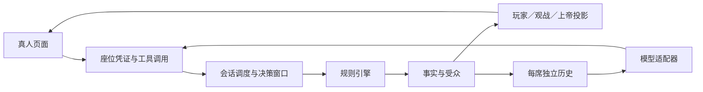

# 架构评估与后续演进

更新：2026-11-01。基于真人接入、镜隐迷踪、警上自爆延期、多来源朗读、自动化验证和真实服务实测。建议与已实现内容分开记录。

## 本次实际落点

真人候场和连接管理放在 session，网页只提交当前授权工具；镜隐迷踪的查验、模仿、资源、刀权和死亡技能放在 engine。没有把新规则放进模型适配器，也没有让网页持有全知状态后再隐藏身份。

新角色复用了公共夜间攻击／保护、死亡职责、胜负、警徽和投影。模型仍按开局选择的 Chat Completions、Responses 或 Anthropic Messages 协议工作；复制能力通过私密事件通知，固定工具目录保持稳定。

## 优点

| 结构 | 本次提供的价值 | 证据 |
| --- | --- | --- |
| 独立确定性引擎 | 新规则可用合成局验证，不依赖模型网络；同种子和行动可重放。 | mirror.test.ts、fuzz.test.ts |
| 角色注册与规则预设 | 新增 mirror12 与两个角色，普通版型继续使用原流程。 | builtin.ts、presets.ts、RoleModule |
| 事实与受众分离 | 隐狼模仿、查验和密谈按接收者发送；真人和模型拿相同权限的投影。 | projection.ts、visibility.test.ts、human.test.ts |
| 固定目录与当轮菜单分离 | 隐狼整局目录不变，复制只影响许可和资源，模型接口无需新增身份分支。 | catalog.ts、awakened-wolf.ts |
| 统一提交边界 | 真人与模型均进入 engine.submit，非法、过期和重复操作使用同一套规则。 | manager.ts、human-http.test.ts |
| 存储与网络端口 | 可用 MemoryStore 和替身适配器回归；旧房间字段可增量兼容。 | store.ts、protocol-session.test.ts |

## 暴露的问题

1. **会话管理集中。** RoomManager 同时处理配置、密钥、候场、投影、持久化、超时、流式思考和模型调度。本次加候场又增加了职责，后续任何小改动都可能触碰计时和通知。SSE 订阅建立时若立即通知新订阅者，还会抢在 HTTP 响应头之前写正文；本次已经修复并增加真实 HTTP 回归。
2. **被动旁听调用成本高。** 现有逐事件、逐席网络旁听保持来源与上下文顺序，但等待一个并发波次的全部请求才推进。真实 token-plan qwen3.8-flash 整局有 798 次请求，其中 676 次旁听，占约 85%；出现 3 次约 90 秒的超时。其余已完成请求也需等待同波次最慢者，不能仅看单次 ping 判断整桌体验。
3. **复制能力还不是完整的通用组件体系。** 查验与猎枪已有复用点，毒药、增强守护和额外刀仍由隐狼模块装配。类型联合能保护本版资源，但未来增加多种复制者或可叠加能力时，角色内的映射会继续增长。
4. **角色私有数据的全局类型较弱。** PlayerState.data 仍是 Record<string, any>；本次在隐狼内部收窄类型，其他角色仍可能出现拼写或迁移错误。读取投影时也必须避免顺手初始化私有字段。
5. **整局状态与历史复制偏重。** 每次行动克隆游戏状态，文件保存与签名计算反复遍历历史；长局和多观看者会放大 CPU、磁盘和序列化成本。当前测试覆盖正确性，尚无多房间负载基线。
6. **HTTP 服务与启动绑定。** main.ts 顶层创建存储和管理器，接口回归目前通过独立进程启动。拆出服务器工厂后可更容易测试错误处理、连接关闭和请求体边界。
7. **真人体验以前按模型工具展示。** 通用表单有扩展优势，但工具说明含参数示例，行动区在大圆桌下方。此次加入「轮到你了」、提交回执、草稿恢复与公开发言朗读，去掉表单中的模型调用说明。实测还发现两栏记录共享页面高度的问题，已将调用记录和发言记录改成独立滚动；语音输入、席位转交和跨设备草稿仍未实现。
8. **完成与提交缺少收口。** 本次开始时界面、消息修复和视频程序混在未提交工作区，导致隔离目录从旧界面起步。已经分批补交并验证；后续应把提交和检查清单作为每项完成条件。
9. **音频职责已有拆分，仍需测量。** 本次已将通用 Qwen、音频和缓存工具从制作脚本提取到 session 的 speech 目录，视频路径保留兼容重导出。浏览器原生和服务端音频共用 SpeechOutput 生命周期，服务端提供方通过 SpeechProvider 接入，支持 Token Plan、HTTP 原始音频及自定义模块。缓存、权限和并发预算统一，新增厂商不必修改游戏流程；首音频耗时、取消计费语义和每席音色仍需进一步测量与设计。
10. **配置可选不等于完整实现。** 审视已有延期竞选发现：旧分支已存在，但默认首次自爆流徽，开启延期后又重新安排发言并重置退水。新 postpone_vote 模式保留报名、退水与 PK 轮次，复用猎枪和遗言职责；旧模式保持历史语义。今后规则变更应先核对已有职责和完整流程，再增加分支，不能仅凭选项名称宣称已支持。

## 后续优先级

| 优先级 | 更新建议 | 可验收结果 |
| --- | --- | --- |
| P0 | 拆出候场／凭证、运行调度、视图通知三个服务，先保持现有 RoomManager 外部接口。 | 现有回归全部通过；暂停、恢复、断线和自爆竞态有独立测试。 |
| P0 | 记录每个提供方的排队时间、首包、总耗时、旁听／行动数量，做两桌以内的合成压力测试。 | 有可复现耗时报告；能区分提供方等待和程序阻塞。 |
| P1 | 设计可配置的被动消息策略与提供方并发预算，保持每席消息顺序、行动问话边界及协议原生续接。 | 先用假服务证明无越权或倒序，再经明确授权实测；不静默改变现有旁听或缓存策略。 |
| P1 | 抽出带独立库存和生命周期的 Ability 实例，角色负责装配，查验表现与阵营继续独立。 | 两种复制者共用能力时不共享资源；首夜启用与死亡连锁判例通过。 |
| P1 | 为角色 data 建立带版本的类型与迁移函数，引入规则版本判例集。 | 旧房间回放结果保持一致；不重写历史事实。 |
| P1 | 从全量文件保存逐步转向事件追加与定期快照，保留导出格式。 | 崩溃重启无丢失或重复行动；长局保存延时有测量。 |
| P2 | 为远程部署增加服务管理认证、凭证轮换与席位交接；为真人表单补充独立的人类说明。 | 管理接口、玩家接口和观战权限有完整 HTTP 测试。 |
| P2 | 在已有播放／提供方接口上增加每席音色与首音频测量；语音输入确认后仍提交 speak，不让转写补写观点。 | 来源与音色可核对，网络失败不吞稿，不挤占决策时间。 |

优先做职责拆分、测量和判例，不把这次需求扩展成全面重写。

## 语音功能现状与后续建议

已实现当前授权视角的发言朗读，详见 [发言朗读](发言朗读.md)。最初测试的浏览器实例不提供原生接口；现在已加入明确的来源选择，支持浏览器 [SpeechSynthesis](https://developer.mozilla.org/en-US/docs/Web/API/SpeechSynthesis)、Token Plan，以及 HTTP／模块接入的其他提供方。队列、暂停、语速、重连去重、缓存和权限独立于提供方，来源切换停止当前播放并清空积压。Terra 的本次浏览器实例提供中文音色，并通过了启动、结束回调验收；不能把一个浏览器实例的能力当成全部环境的能力。

真人语音先采用「按住说话 → 转为发言草稿 → 本人确认 → speak」。浏览器 [SpeechRecognition](https://developer.mozilla.org/en-US/docs/Web/API/SpeechRecognition) 的支持程度有限，部分实现使用在线识别服务；可选择云端 ASR，或自行部署 [whisper.cpp](https://github.com/ggml-org/whisper.cpp) 等本地识别。转写不自动补写观点，误识别座位号由玩家确认修正。

是否额外付费取决于提供方、套餐与调用入口。[Token Plan 价目页](https://platform.qianwenai.com/pricing/token-plan)列有语音权益，但文字模型、语音模型与 MCP 权益不能自行视为同一个额度。当前仅使用已有 Token Plan 入口，失败不会自动切换计费线路；未采购新服务。语音识别仍是后续方案。

## 验证与实测记录

- 自动化：本次完整回归 31 个文件、300 项测试通过，TypeScript 检查与生产构建通过。覆盖引擎各身份／夜间结算／死亡职责、随机完整对局与重放；真人候场、权限、重连、旧存档、HTTP/SSE；三种模型协议及原生续接；当前视角朗读权限、多提供方、队列与音频处理、真实阵营目标，以及警上延期与公告信息边界。
- 新界面：已在内置浏览器检查真人准备、取消准备、改名、自动进入对局、上警、竞选与白天发言、放逐投票和刷新恢复草稿。正常提交显示法官接受回执，公开记录保留提交文本；投票后才显示完整公开票型与出局结果。
- 真实服务：11 个 AI 席使用用户指定的 token-plan qwen3.8-flash，1 号真人席由 Codex／Terra 经浏览器操作。镜隐迷踪完整进行到第 4 天，好人获胜；四轮放逐票为 6、3、8、10，均获接受。覆盖隐狼第 2 夜模仿魔镜少女、第 3 夜使用复制查验、第 4 夜继承普通狼刀。真人存活，未真实操作遗言或技能表单；这些分支按自动化覆盖说明。
- 请求观测：共 798 次调用，正式行动 122 次、旁听 676 次；总耗时中位数 5.210 秒、P95 16.297 秒、最大 90.017 秒。13 次未采纳包括 3 次超时、2 次警长阶段工具错误、7 次旁听误调用、1 次守护目标非法；引擎均未接受非法行动。这是单局样本，不能作为模型能力或服务性能基准。本局配置为 thinkingMode=off，质量问题需与提示词、历史来源和思考配置分别对照验证。
- 播放与布局：真实 Token Plan 音频在内置浏览器成功播放，暂停／继续与 1.5 倍速生效；1440×900 双栏下左侧调用记录停在开头时，右侧可独立滚动，展开长调用记录仍限制在自身高度内。390×844 真人终局页面未见明显横向溢出。
- 数据：独立测试房间和审计保留在忽略的数据目录，不把密钥、房间凭证、完整真实对话或缓存提交到 Git。
- 验证范围随实际操作继续补充；未操作的技能分支只按自动化覆盖说明，不标为逐项真实模型或真人界面验收。

本轮追加的 [警上自爆与延期竞选](警上自爆与延期竞选.md) 和多来源朗读，由 Terra 在独立合成房间通过网页验收。实际完成首次自爆、猎枪／毒杀禁枪、遗言顺序、直接续投八票当选、第二次自爆流徽，以及新发言自动播放、暂停／继续、停止、切换、刷新不重读和原生中文音色的启动／结束流程。没有调用其他厂商真实 TTS 或声称主观听到硬件声音。移动视口设置未生效，本轮不把手机宽度计为实测通过；前文 390×844 的记录属于上一批真人终局界面。

## 模型发言质量与目标提示

这局出现狼人遗言认狼、守卫虚报自己的首夜守护记录，以及把竞选时尚未公布死亡名单误当成已经存活等问题。复查守卫首轮公开发言的请求，上下文已经包含「空守」结果，它仍报守了 5 号，因此不能把问题全归因于漏发自身行动信息。具体错误需要区分规则理解、对自己历史的记忆、对其他玩家陈述的信任和阵营决策。

原系统提示词给了身份、规则、时限与工具要求，没有单独明确玩家应争取本阵营胜利。现已在身份之后增加通用目标：帮助真实身份所属阵营获胜，每次发言和行动围绕此目标自主决策，出局但整局未结束时目标不变。目标取自本人投影的真实阵营，隐狼模仿不会将其改成好人。没有添加狼队打法、守护推荐、固定发言范文或强制身份声称。

当前外层原文、默认镜隐迷踪规则卡、各身份说明、风格和工具说明见 [系统提示词审阅稿](系统提示词审阅稿.md)。风格中已有「明确站边」「带节奏」「尽量不暴露自己」等行为倾向，时限也有重复催促；这些原文保留供审阅，不能把整个现有模板描述成只有规则、完全没有玩法倾向。

本局使用 thinkingMode=off；保存的开局 system 也没有当前源码已有的「消息来源与可信边界」段。网页构建更新不会回写已经建立的座位历史，因此这局不是最新提示词的能力对照样本。新增目标在新建座位上下文中生效，旧对局和审计保持原样。后续应固定同一局面与可见信息，分别对照原提示词／新增目标、关闭思考／开启支持的思考档位，观察自身行动记忆、事实与声称区分、工具合法性及阵营行为。当前只验证目标生成与信息边界，尚未声称真实对局质量已经提高。
