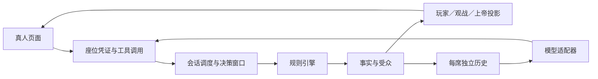

# 架构评估与后续演进

更新：2026-11-01。基于真人接入、镜隐迷踪实现、自动化验证和真实服务实测。建议与已实现内容分开记录。

## 本次实际落点

真人候场和连接管理放在 session，网页只提交当前授权工具；镜隐迷踪的查验、模仿、资源、刀权和死亡技能放在 engine。没有把新规则放进模型适配器，也没有让网页持有全知状态后再隐藏身份。

新角色复用了公共夜间攻击／保护、死亡职责、胜负、警徽和投影。模型仍按开局选择的 Chat Completions、Responses 或 Anthropic Messages 协议工作；复制能力通过私密事件通知，固定工具目录保持稳定。

## 优点

| 结构 | 本次提供的价值 | 证据 |
| --- | --- | --- |
| 独立确定性引擎 | 新规则可用合成局验证，不依赖模型网络；同种子和行动可重放。 | mirror.test.ts、fuzz.test.ts |
| 角色注册与规则预设 | 新增 mirror12 与两个角色，普通版型继续使用原流程。 | builtin.ts、presets.ts、RoleModule |
| 事实与受众分离 | 隐狼模仿、查验和密谈按接收者发送；真人和模型拿相同权限的投影。 | projection.ts、visibility.test.ts、human.test.ts |
| 固定目录与当轮菜单分离 | 隐狼整局目录不变，复制只影响许可和资源，模型接口无需新增身份分支。 | catalog.ts、awakened-wolf.ts |
| 统一提交边界 | 真人与模型均进入 engine.submit，非法、过期和重复操作使用同一套规则。 | manager.ts、human-http.test.ts |
| 存储与网络端口 | 可用 MemoryStore 和替身适配器回归；旧房间字段可增量兼容。 | store.ts、protocol-session.test.ts |

## 暴露的问题

1. **会话管理集中。** RoomManager 同时处理配置、密钥、候场、投影、持久化、超时、流式思考和模型调度。本次加候场又增加了职责，后续任何小改动都可能触碰计时和通知。SSE 订阅建立时若立即通知新订阅者，还会抢在 HTTP 响应头之前写正文；本次已经修复并增加真实 HTTP 回归。
2. **被动旁听调用成本高。** 现有逐事件、逐席网络旁听保持来源与上下文顺序，但等待一个并发波次的全部请求才推进。真实 token-plan qwen3.8-flash 测试已出现一次旁听耗满 90 秒，其余已完成请求也需等待；不能仅看单次 ping 判断整桌体验。
3. **复制能力还不是完整的通用组件体系。** 查验与猎枪已有复用点，毒药、增强守护和额外刀仍由隐狼模块装配。类型联合能保护本版资源，但未来增加多种复制者或可叠加能力时，角色内的映射会继续增长。
4. **角色私有数据的全局类型较弱。** PlayerState.data 仍是 Record<string, any>；本次在隐狼内部收窄类型，其他角色仍可能出现拼写或迁移错误。读取投影时也必须避免顺手初始化私有字段。
5. **整局状态与历史复制偏重。** 每次行动克隆游戏状态，文件保存与签名计算反复遍历历史；长局和多观看者会放大 CPU、磁盘和序列化成本。当前测试覆盖正确性，尚无多房间负载基线。
6. **HTTP 服务与启动绑定。** main.ts 顶层创建存储和管理器，接口回归目前通过独立进程启动。拆出服务器工厂后可更容易测试错误处理、连接关闭和请求体边界。
7. **真人体验以前按模型工具展示。** 通用表单有扩展优势，但工具说明含参数示例，行动区在大圆桌下方。此次加入「轮到你了」、提交回执和草稿恢复，并去掉表单中的模型调用说明；语音、席位转交和跨设备草稿还没有实现。
8. **完成与提交缺少收口。** 本次开始时界面、消息修复和视频程序混在未提交工作区，导致隔离目录从旧界面起步。已经分批补交并验证；后续应把提交和检查清单作为每项完成条件。

## 后续优先级

| 优先级 | 更新建议 | 可验收结果 |
| --- | --- | --- |
| P0 | 拆出候场／凭证、运行调度、视图通知三个服务，先保持现有 RoomManager 外部接口。 | 现有回归全部通过；暂停、恢复、断线和自爆竞态有独立测试。 |
| P0 | 记录每个提供方的排队时间、首包、总耗时、旁听／行动数量，做两桌以内的合成压力测试。 | 有可复现耗时报告；能区分提供方等待和程序阻塞。 |
| P1 | 设计可配置的被动消息策略与提供方并发预算，保持每席消息顺序、行动问话边界及协议原生续接。 | 先用假服务证明无越权或倒序，再经明确授权实测；不静默改变现有旁听或缓存策略。 |
| P1 | 抽出带独立库存和生命周期的 Ability 实例，角色负责装配，查验表现与阵营继续独立。 | 两种复制者共用能力时不共享资源；首夜启用与死亡连锁判例通过。 |
| P1 | 为角色 data 建立带版本的类型与迁移函数，引入规则版本判例集。 | 旧房间回放结果保持一致；不重写历史事实。 |
| P1 | 从全量文件保存逐步转向事件追加与定期快照，保留导出格式。 | 崩溃重启无丢失或重复行动；长局保存延时有测量。 |
| P2 | 为远程部署增加服务管理认证、凭证轮换与席位交接；为真人表单补充独立的人类说明。 | 管理接口、玩家接口和观战权限有完整 HTTP 测试。 |
| P2 | 语音作为输入／播放适配器，确认后的文字继续提交 speak，不让转写补写观点。 | 文字与音频来源可核对，网络失败不吞稿，不挤占决策时间。 |

优先做职责拆分、测量和判例，不把这次需求扩展成全面重写。

## 验证与实测记录

- 自动化：引擎各身份／夜间结算／死亡职责、随机完整对局与重放；真人候场、权限、重连、旧存档、HTTP/SSE；三种模型协议及原生续接回归。
- 新界面：已在内置浏览器检查真人准备、取消准备、改名、自动进入对局、上警、竞选与白天发言、放逐投票和刷新恢复草稿。正常提交显示法官接受回执，公开记录保留提交文本；投票后才显示完整公开票型与出局结果。
- 真实服务：AI 席使用用户指定的 token-plan qwen3.8-flash，真人席由浏览器操作。连通性 ping 成功。Windows 桌面通道最初无法确认 Edge 地址，随后使用内置浏览器继续；这不是模型接口故障。
- 数据：独立测试房间和审计保留在忽略的数据目录，不把密钥、房间凭证、完整真实对话或缓存提交到 Git。
- 验证范围随实际操作继续补充；未操作的技能分支只按自动化覆盖说明，不标为逐项真实模型或真人界面验收。
