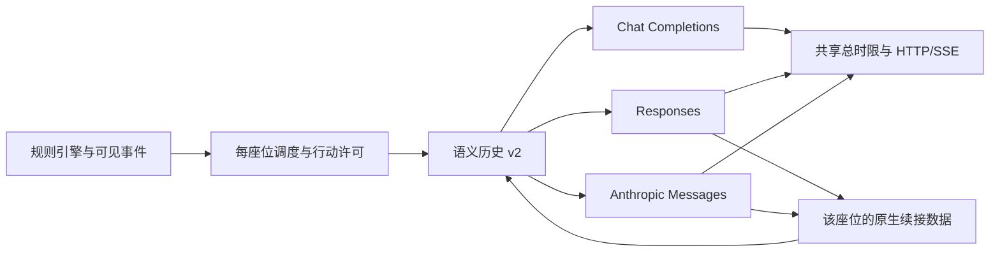

# 模块化、版型扩展与多协议实现

> 更新：2026-10-31。按本轮确认，先完成模块化底座与三种协议；镜隐迷踪、动态复制技能与对局中热切换保留为后续工作。

## 已实现与边界

| 范围 | 当前状态 |
| --- | --- |
| 角色固定工具注册 | ✅ `RoleModule.tools` 与角色规则放在一起；公共目录不再按身份 switch。 |
| 明确动作与工具说明 | ✅ 新局采用 24 种显式单动作工具（同夜双药规则下 25 种），旧局保留 v1；当前法官菜单和纠错反馈列出实际合法动作。详见[工具说明审计](工具说明审计.md)。 |
| Chat Completions | ✅ 保留原协议、工具/JSON 模式、兼容降级和旧存档。 |
| Responses | ✅ 完整 output items、reasoning、phase、工具回执、流式、原生强度与缓存路由键。 |
| Anthropic Messages | ✅ system/content blocks、工具结果顺序、thinking/signature、流式；不主动请求显式缓存写入。 |
| 座位历史 | ✅ v2 语义结构＋受模型绑定约束的原生数据；旧 Chat 消息读入时转换。 |
| 配置与审计 | ✅ 模型和座位可选协议、按所选协议测通、缓存 token 统计、实际编码后的工具 Schema。 |
| 运行中更换协议 | 暂不开放，配置继续限定开局前；可复制房间重新配置。 |
| 镜隐迷踪与能力复制 | 未实现，不改变现有版型规则。 |

## 层次与职责



`engine` 不依赖模型协议；`session` 决定何时旁听和行动；`llm` 在协议边界转换历史、参数与流式结果；`protocol` 定义共享配置和工具 Schema。三个协议最终都向同一引擎提交 `ToolCall`，不解析思考文字来替模型改目标。

### 角色工具扩展点

```ts
const role: RoleModule = {
  // 身份元数据、规则、setup、steps 等照常声明
  tools: ({ seats, rules, seat }) => [/* 本身份整局可能使用的 ToolSpec */],
};
```

目录构建参数只有座位与开局规则，不提供阶段、存活和剩余药品。角色文件自行提供固定工具，`catalog.ts` 只装配发言、投票、警长工具与注册角色的工具。`Ctx.ask` 取这份说明，再保留当前轮次的合法目标和参数限制；重复工具名、重复流程名会明确报错。

已有角色仍使用原有夜间、死亡、查验与结算钩子。这个扩展点解决的是固定工具发现与集中分支，并不等于已经实现可动态复制的技能实例。女巫、守卫、猎人的规则执行仍需在未来能力层中提取，不能只把身份 ID 改成被模仿者。

### 明确动作与历史兼容

`protocol/src/action-tools.ts` 为现有 v1 内置工具提供确定性升级映射：救/毒/不用药、移交/撕徽、开枪/放弃、投票/弃票等分成不同工具，目标使用 `targetSeat`、`recipientSeat`、`candidateSeat`。内部 `ToolSpec.operation` 转回既有引擎结算，不进入模型 Schema；新角色可直接声明明确动作，不需要增加公共目录的身份分支。

`rules.toolsetVersion` 随对局保存，新局默认 2，缺省或显式 1 为历史接口。动作工具版本与 `SeatThread.formatVersion:2` 是不同概念，升级语义历史不会替换旧局的工具。旧上下文前缀不改写，清晰的当前菜单追加到末尾；固定工具定义保持整局稳定以保留缓存条件。

三种适配器通过 `onRequest` 向审计保存最终实际编码的工具配置和 tool choice；JSON 模式保存实际格式说明，不保存认证头。原有审计缺失的工具 Schema 不会事后猜造。当前普通警上许可同时列出 `speak` 与 `sheriff_withdraw`，并清除 v2 警徽问话中的旧 `target/null` 指令。

## 配置三种协议

模型条目与座位保存 `apiProtocol`：

| 配置值 | 请求端点 | 认证 |
| --- | --- | --- |
| `chat_completions` | `/chat/completions` | Bearer |
| `responses` | `/responses` | Bearer |
| `anthropic_messages` | `/messages` | `x-api-key`，`anthropic-version: 2023-06-01` |

缺省仍为 Chat Completions，旧模型条目 ID 与旧设置兼容。模型选中后把地址、模型、协议和加密凭证复制到座位，运行时使用该快照，避免名单变化悄悄切换正在运行的绑定。

地址可填 API 根或相应完整端点。裸域名自动补 `/v1`；明确选择 Responses 后填入 `/chat/completions` 会被拒绝，而不是静默重写。百炼的两个协议入口路径不同，例如已配置域名下：

```text
Chat / Responses： https://<已配置域名>/compatible-mode/v1
Anthropic：        https://<已配置域名>/apps/anthropic
```

Anthropic 最终请求为 `/apps/anthropic/v1/messages`。使用自己的服务商地址与配套凭证，不自动迁移域名、协议或密钥。[百炼 Messages 文档](https://help.aliyun.com/zh/model-studio/anthropic-api-messages)

网页的模型面板、座位设置和测通均支持协议选择。`toolMode=json` 依然只是行动输出方式，三种协议都可使用；优先选择原生工具调用，JSON 备用模式的消息与工具集合可能不同，不保证同样的缓存复用。

Qwen Code 配置可导入 `modelProviders.openai`、`modelProviders.responses`、`modelProviders.anthropic`；也接受条目上的显式 `apiProtocol`。按协议去重，原 Chat 条目的 ID 不改变。未知或错误协议不会偷偷当成另一个协议。

## 座位历史、工具往返与原生数据

每个座位的 `data/rooms/<room>/sN.json` 保存 `formatVersion=2`，保留同一个 `messages` 文件入口，但内容不再绑定 Chat 的字段：

```json
[
  {"role":"user","name":"3","content":"第1天3号发言：……"},
  {"role":"assistant","content":null,"calls":[{"id":"call_1","name":"vote","arguments":"{\"target\":5}"}]},
  {"role":"tool","callId":"call_1","content":"vote：5号"}
]
```

- 其他玩家的发言仍是带座位标识的 user 数据，不会变成本座位的 assistant 回复。
- 上帝投影与其他座位的私密历史不参与拼接；逐条旁听和行动许可保持原有控制。
- 工具错误包括多个工具调用时，为全部调用编号写入错误回执，不挑一个执行。
- 旧 `tool_calls` / `tool_call_id` 只在迁移入口读取，转成 `calls` / `callId`；转回 Chat 请求时保留原有文本与编号，不重演历史行动。

| 协议 | 助手调用 | 下一轮结果 |
| --- | --- | --- |
| Chat Completions | `assistant.tool_calls` | `role=tool` + `tool_call_id` |
| Responses | `function_call` item | `function_call_output` + `call_id` |
| Anthropic | `tool_use` block | user 中的 `tool_result` + `tool_use_id` |

Responses 使用本地完整历史，`store=false`，不共享或依赖 `previous_response_id`。同一绑定的完整 output items 原样回传，包含 reasoning、加密内容、phase 和调用字段；不是只保留 `output_text`。[OpenAI 工具调用文档](https://developers.openai.com/api/docs/guides/function-calling)

Anthropic 保留完整 thinking、redacted thinking 与签名块；工具结果紧接对应 assistant 调用，多个结果放在同一个 user 数组的新增文本之前。合并相邻同角色消息仅发生在协议编码时，不改本地历史。[Anthropic 工具回执](https://platform.claude.com/docs/en/agents-and-tools/tool-use/handle-tool-calls)、[思考续接](https://platform.claude.com/docs/en/build-with-claude/thinking)

原生数据保存在 assistant 的 `native` 字段，由协议、规范化端点、模型、凭证的 SHA-256 绑定指纹约束。它只在本座位、相同绑定中回传。更换凭证、模型或协议后，只重新编码有权看到的语义内容与已完成的工具往返，不携带旧签名和加密推理；可移植调用的编号在编码时确定性映射，避免旧存档重复编号冲突。

展示思考与原生续接数据分开：展示文本不变成法官事实，原生块也不公开到对局记录或视频素材。协议转换不会执行任何工具；只有本次模型产生且被引擎采纳的调用才会改变对局。

## 缓存与价格

| 协议 | 当前实现 |
| --- | --- |
| Chat Completions | 稳定系统提示、固定工具和持续追加消息；读取接口上报的 cached token。 |
| Responses | 同一座位和绑定使用稳定 `prompt_cache_key` 作为匹配路由提示，不创建缓存或要求写入；完整回传原生 output，读取 `input_tokens_details.cached_tokens`。 |
| Anthropic | 不发送 `cache_control` 或显式缓存断点。保持稳定前缀，是否支持隐式匹配由提供方决定；不保证必须显式声明缓存的入口仍有命中。 |

审计统一记录输入、输出、缓存读取与缓存写入 token。Anthropic 标准输入计数不含缓存读写，归一化时加回；保留原始回复供核查。缓存取决于服务商、型号、长度门槛、前缀、强度配置和有效期，命中 token 数不等于账单折扣，也不承诺所有兼容网关都支持缓存。[Anthropic 缓存文档](https://platform.claude.com/docs/en/build-with-claude/prompt-caching)

2026-10-31，用已配置的 **qwen3.8-flash** 与合成背景做了每入口两次真实工具往返，没有读取或改写真实对局。下表 Anthropic 结果来自随后取消的显式断点配置，不能用于承诺当前隐式模式的命中：

| 入口 | 协议 | 第1轮 | 第2轮 | 第2轮缓存读取 / 总输入 |
| --- | --- | ---: | ---: | ---: |
| Token Plan | Responses | 6.09秒 | 4.63秒 | 4096 / 4190 |
| Token Plan | Anthropic | 4.72秒 | 3.79秒 | 4070 / 4161 |
| 千问按量入口 | Responses | 6.27秒 | 3.68秒 | 4096 / 4184 |
| 千问按量入口 | Anthropic | 3.96秒 | 7.32秒 | 4070 / 4161 |

四组各两轮均返回合法 `ping({"ok":true})`，第二轮确实携带第一轮原生回复及工具结果。它们验证了当前入口的格式、续接与缓存可用性，不代表长期稳定率或所有型号的兼容性。统计报告只保存在忽略的 `data/diagnostics/protocol-probe-*.json`。

```bash
node --import tsx packages/session/scripts/probe-protocols.ts --live --model=MODEL_ENTRY_ID --protocol=responses
# 同一已配置域名下覆盖为服务商明确提供的 Anthropic 根地址
node --import tsx packages/session/scripts/probe-protocols.ts --live --model=MODEL_ENTRY_ID --protocol=anthropic_messages --api-base=https://YOUR_CONFIGURED_HOST/apps/anthropic
```

测试脚本只允许覆盖同一 origin，不输出密钥、请求原文或模型原生内容。真实调用必须显式 `--live`。

## 强度与失败处理

强度根据协议、入口和型号分别映射：Responses 使用 `reasoning.effort`；Anthropic 原生 Claude 按已确认型号使用 adaptive/effort 或 budget；百炼 Anthropic 使用其 enabled/effort 或 budget 映射。没有独立轻度档时不伪装成轻度；未知型号仅跟随默认，未确认的档位禁选。未配置且支持真实轻度的座位继续默认轻度。

百炼 Responses 多工具时不支持强制 required，适配器用 auto 并在本地严格要求正式行动恰好一个工具。Anthropic 始终用 auto，兼容思考并稳定旁听与行动之间的 tool_choice；无调用或多调用仍进入原有纠错与托管流程。

`transport.ts` 统一总超时、取消、有限网络/HTTP重试、UTF-8 SSE 分片与错误脱敏。读取流后不重新发送一次可能已经生成的调用；原生协议必须收到完整结束事件才接受工具。超时和残缺流仅保留已到达的展示文本，不写入可执行的残缺原生工具链。新接口默认输出上限 32768，可在座位设置调整，按供应商定义计数；原 Chat 调用不自动增加上限。

## 验收

- 原有规则、上下文和协议边界回归，加上显式单动作工具、严格字段校验、v1/v2 重放和实际工具 Schema 审计；最新测试数量见工具审计文档。
- TypeScript 检查与生产构建通过；使用隔离数据目录检查了 Responses、Anthropic 的设置页与默认轻度状态。
- 三种协议分别通过本地 HTTP 整局测试，包括逐条旁听、正式行动、暂停保存、重启恢复、无重复行动与座位私有内容隔离。
- 专项覆盖 JSON 备用输出、多工具错误回执、流式提前断开、总超时、取消、缓存计数、旧存档转换和原生签名文件恢复。
- 已配置 GLM 与 Token Plan Qwen 完成 43 次动作请求验证；原女巫现场副本只发给原 GLM 服务，其他入口使用合成场景，没有执行真实对局动作。样本和耗时见[工具说明审计](工具说明审计.md)。
- 协议配置仅在开局前开放；未接入镜隐迷踪、动态能力复制或服务器 conversation 链。

## 增加十二人镜隐迷踪，需要改哪些文件

如果只调整已有身份的人数和组合，主要改 `packages/engine/src/presets.ts`，并增加人数、角色限制和模拟对局测试。不要覆盖旧 `standard12` 的含义，应增加新的版型 ID，保留旧房间与复盘的规则含义。

镜隐迷踪需要两个新角色。官方介绍的配置是三名普通狼人、一名觉醒隐狼、四名平民，以及魔镜少女、女巫、猎人、守卫；魔镜少女查具体身份且不能重复查验，觉醒隐狼涉及模仿与延迟获得技能。[官方版型与角色介绍](https://langrensha.com/news/official/20231113/26904_1119726.html)

下面是按当前代码定位的改动范围，新增文件名为建议命名：

| 文件 | 所需工作 |
| --- | --- |
| `packages/engine/src/roles/mirror-maiden.ts`（新增） | 具体身份查验、查验记录、重复目标校验、私密结果与身份说明。 |
| `packages/engine/src/roles/awakened-hidden-wolf.ts`（新增） | 模仿选择、获得技能的时点、刀权继承、私有资源与对应决策。 |
| `packages/engine/src/builtin.ts` | 导入并注册两个角色。 |
| `packages/engine/src/presets.ts` | 增加独立版型 ID、人数配置和规则覆盖。 |
| `packages/engine/src/types.ts`、`context.ts` | 增加技能实例与查验身份等扩展点，区分真实角色、阵营、可见身份、获得的能力和刀权。 |
| `packages/engine/src/catalog.ts` | 接入新角色固定工具；通过已实现的 `RoleModule.tools` 接入，公共目录无需再加身份分支。 |
| `packages/engine/src/roles/werewolf.ts` | 按规则处理普通狼与隐狼的互认、密谈、带刀资格和继承。 |
| `packages/engine/src/roles/{witch,guard,hunter}.ts` | 将需要被复制的技能提取为可复用能力，原身份模块负责装配。 |
| `packages/engine/src/flow/night.ts`、`deaths.ts` | 接入技能启用时点、攻击与保护来源、复制后的死亡技能；已有结算钩子能覆盖的部分不必重写公共流程。 |
| `packages/session/src/agent.ts`、`packages/llm/src/mock.ts` | 补充新工具的行动提示和模拟玩家策略；通用回退只能保证参数合法，不能证明新规则正确。 |
| `packages/engine/test/`、`packages/session/test/` | 覆盖查验表现、模仿各身份、启用时点、狼队信息隔离、刀权继承、死亡连锁、存档恢复与完整对局。 |

规则卡与网页角色名称大多来自角色目录和投影，通常不用为每个新角色增加页面分支。`rulecard.ts`、`flow/win.ts`、`flow/sheriff.ts`、投影与协议类型需要按规则差异检查；只有新字段或判定确实需要时才修改。

不能把隐狼的 `player.role` 直接改成被模仿者。否则会同时改变它的胜负阵营、屠边统计和可能的私密信息权限。建议保留真实角色与阵营，另外存储 `appearance`、`abilities`、`activeFromNight` 和独立的刀权状态。查验经统一函数计算结果，而不是直接读取底牌；具体对哪个观察者呈现什么身份，由所选规则版本决定。

为保持每个座位整局工具 Schema 稳定，隐狼开局就获得本版型所有潜在技能的固定工具定义。获得哪个技能、何时可用、药品是否耗尽，均由引擎校验，并通过追加私密事件告知本人。不会因模仿结果改写系统提示、工具顺序，也不会将结果通知目标或其他座位。

实际实现前需要固定一份完整规则卡，尤其是模仿的具体效果、技能启用、继承刀权、死亡技能以及警徽相关细则。官方介绍没有覆盖所有边界，不能仅根据版型名称推断完整判定。
