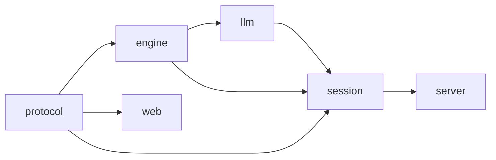

# AI 狼人杀项目分析报告

> 评估日期：2026-11-17 · 基线提交：`0239c0d`（main，与 github/main 一致，工作区干净）
> 评估方式：全量结构统计 ＋ 核心代码抽样阅读 ＋ 本机实际运行检查 ＋ Git 历史考证。
> 本报告中所有数字均为评估当日实测或从 Git 跟踪文件直接统计，不沿用历史文档中的记录值；历史值仅作对比并标注出处。

---

## 1. 摘要

**AI 狼人杀**是一个让真人与多个大模型同桌博弈的狼人杀平台：规则引擎负责事实与裁决，模型只负责表达与决策，信息按受众严格分发，并配套观战、复盘、三语界面与离线视频制作流水线。

**总体结论：这是一个架构成熟度与工程过程成熟度显著高于其规模（约 4.2 万行源码、19 天提交历史）的项目，可作为「AI 辅助小型团队工程治理」的范本。** 其最突出的三项特质是：

1. **信息边界即架构**——事实由引擎产生、事件带受众、投影按视角生成、每席独立上下文，保密不依赖前端隐藏，而是数据结构上不可见；
2. **确定性与可重放**——同规则＋同种子＋同行动序列可逐事件重放，规则演进全部版本化并兼容旧存档；
3. **验证诚实文化**——文档严格区分「已实现／测试通过／真实环境验证」，问题清单唯一入口、解决即归档，模型表达质量实验采用冻结盲评分且未达门槛的候选明确不采用。

**主要风险**集中在测试体系：2026-11-04 的一次大精简（`059a562`，−16,025 行）将回归套件从历史记录的数百项压缩为当前 **133 项端到端工作流测试**，随机模糊对局、可见性专项等不再处于默认测试路径；网页 UI 自动化仅 2 项；性能无负载基线。这些是「当前绿灯」之下最值得优先补强的部分。

### 评分卡

| 维度 | 评分（5 分制） | 一句话依据 |
| :--- | :---: | :--- |
| 架构与模块边界 | ★★★★★ | 无环依赖、引擎可离线运行、事实/受众/投影三层分离 |
| 代码质量 | ★★★★☆ | 严格类型、防御式校验、注释克制；个别千行文件职责偏重 |
| 测试与回归 | ★★★☆☆ | 全绿但粒度粗；精简后专项覆盖与模糊测试缺位 |
| 安全与数据治理 | ★★★★☆ | AES-256-GCM、本机管理面三重校验、密钥不入库；公网场景明确未支持 |
| 文档与工程过程 | ★★★★★ | 58 篇文档、唯一问题清单、外部审计与署名追溯成体系 |
| 国际化 | ★★★★☆ | 三语 1,898 条模板零缺项并有自动检查；英语视频配音验收未闭环 |
| 性能与可扩展性 | ★★★☆☆ | 正确性优先，全量克隆与单bundle有实测警告，无负载基线 |
| 可持续协作 | ★★★★☆ | 多 AI 治理规范完善；单一维护者、项目年轻是客观约束 |

**综合：约 4.2 / 5。** 定位判断：面向本地与可信局域网的成熟可玩产品 ＋ 视频内容生产工具；不是公网多租户服务，后者在清单中有明确边界（`ACCESS-REMOTE`）。

---

## 2. 评估方法与证据基线

### 2.1 实际执行的检查（2026-11-17，全部通过）

| 检查 | 命令 | 实测结果 |
| :--- | :--- | :--- |
| 类型检查 | `pnpm typecheck` | 通过，无错误 |
| 单元/集成测试 | `pnpm test` | **32 个文件、133 项测试全部通过**，23.06s（Vitest 5.0.5） |
| 国际化完整性 | `pnpm i18n:check` | zh-CN / en / ja 各 **1,467 条对局模板 ＋ 431 条 UI 模板，0 缺项** |
| 生产构建 | `pnpm build` | 通过，275ms；JS 829.50 kB（gzip 254.59 kB），CSS 54.46 kB；**有 >500 kB 单 chunk 警告** |
| 引擎模拟 | `pnpm simulate standard12 report-eval` | 完整跑至终局：141 次行动、204 条事件，狼人屠边获胜，复盘与夜间结算一致 |
| 工作区状态 | `git status` | 干净，main 与 github/main 同步 |

### 2.2 统计口径

- 源码统计仅计 Git 跟踪的 `.ts/.tsx/.mjs/.js/.py` 文件（不含 CSS、JSON、Markdown），按工作区包归组；测试用例数以 Vitest 实际运行为准。
- 代码抽样阅读覆盖：`engine/game.ts`、`engine/projection.ts`、`session/room-runtime.ts`、`server/http-server.ts`、`session/secret.ts`（加密段）、全部测试用例清单、架构与问题文档。
- 历史考证：`git log` 全量 170 次提交、`059a562` 变更明细、共同作者署名统计。
- 统计脚本留存于 `.qwen/tmp/project_stats.py`（不入库），复现命令见附录。

---

## 3. 项目概览

### 3.1 产品能力

- **四种版型**：classic9、standard12（默认）、idiot12、mirror12（镜隐迷踪，含觉醒隐狼的动态技能复制）。
- **三种席位**：真人（邀请链接＋候场准备）、真实模型（逐席模型/风格/思考档位）、模拟玩家（无 Key 可全流程体验）。
- **三种视角**：房主/上帝、座位玩家、旁观者，各自独立投影与权限。
- **三种模型协议**：Chat Completions、Responses、Anthropic Messages；原生工具续接、思考档位按真实能力启用、失败不静默换协议。
- **对局控制**：暂停/单步/继续/终结、超时托管、同配置再来一局、公开/上帝记录导出。
- **内容生产**：上帝或单玩家视角剪辑稿导出 → 配音（多 TTS 提供方）→ 字幕对齐（ASR 词级时间戳）→ 离线渲染 → 竖屏看点版 → 成片码率验收，形成完整视频流水线。
- **三语**：界面语言（浏览器级）与对局语言（房间级）分离。

### 3.2 规模统计（实测）

| 模块 | 源码文件 | 行数 | 职责 |
| :--- | ---: | ---: | :--- |
| `packages/protocol` | 24 | 3,637 | 共享类型、工具 Schema、三语模板、思考配置 |
| `packages/engine` | 44 | 5,596 | 角色、版型、阶段推进、结算、胜负、投影 |
| `packages/llm` | 17 | 1,737 | 提示词、模拟玩家、三协议适配器 |
| `packages/session` | 110 | 11,109 | 房间、调度、持久化、密钥、审计、观测、语音 |
| `apps/server` | 8 | 477 | HTTP API、SSE、静态托管、收尾 |
| `apps/web` | 47 | 4,182 | React 配置/对局/观战/模型库页面 |
| `scripts` | 87 | 8,554 | 视频流水线、ASR 服务、客户端打包、维护脚本 |
| `skills` | 71 | 6,731 | 视频制作/幻觉检查技能与分发模板 |
| **合计** | **410** | **42,131** | 另有 58 篇 docs、20 篇 skills 文档 |

Git 跟踪文件共 551 个。最大三个源码文件：`protocol/locales/messages.ts`（1,150 行，三语模板）、`session/room-runtime.ts`（1,076 行，运行协调器）、`web/pages/Setup.tsx`（779 行，建房配置页）。

### 3.3 技术栈与依赖

运行时依赖极简：**React 19 ＋ react-dom ＋ qrcode.react**（网页），服务端用 **Node 原生 http/crypto/fetch**，无 Web 框架、无 ORM、无 HTTP 客户端库。开发依赖 TypeScript 7、Vite 8、Vitest 5、tsx、@napi-rs/canvas（视频渲染）。存储为本地 JSON/JSONL。

依赖图无环、方向单一：



（箭头表示「被依赖」；`llm` 对 `engine` 仅 devDependency，用于测试。）

### 3.4 提交历史画像

- **170 次提交，2026-10-30 → 2026-11-17（19 天）**，日均约 9 次，迭代强度极高。
- 作者均为维护者 ZhiqiangBao；**153 次含 Codex 共同作者署名、8 次含 Cursor 署名**，AI 协作贡献可追溯，符合 AGENTS.md 约定。
- 前缀分布：fix 71、docs 40、feat 36、refactor 6、perf 3、test 3、其他 11。**fix 占比 42%**，与「快速迭代＋真实模型/真实环境暴露问题＋及时修复」的节奏一致；docs 占比 24% 反映文档与实现同步维护的习惯。

---

## 4. 架构评估

### 4.1 核心不变式：事实、受众、校验三分

项目把狼人杀最难的「信息不对称」做成了数据结构问题而非 UI 问题，抽样证实以下机制真实存在：

- **事件带受众**：引擎事件 `audience` 为 `public` 或座位数组；`projection.ts` 中 `visibleTo` 按受众过滤，网页与模型拿到的是同一套投影逻辑的不同输入，不存在「前端拿全量再隐藏」。
- **防序号侧信道**：投影对可见事件**重新编号**（源码注释：保留全局序号会让人从序号空档数出隐藏事件条数）。这是多数同类项目不会想到的细节，属于范本级设计。
- **统一提交边界**：真人与模型都进入 `engine.submit`；非法工具、过期决策（`STALE_DECISION`）、重复提交（`ALREADY_ACTED`）、越权（`NOT_YOUR_TURN`）用同一套错误码拒绝，且拒绝说明**只发给行动者**（`ctx.priv`）。
- **深拷贝提交**：`submit` 在 `structuredClone(prev)` 上执行，被拒绝时不污染原状态；配合种子 RNG 与 `replay()`，同输入可逐事件重放（引擎测试中每个工作流都断言 `expectReplay`）。
- **议程驱动推进**：`runAgenda` 以步骤队列推进阶段，带 100,000 步收敛护栏；死亡批次前重查胜负，致胜一枪可取消已排队的后续技能——规则细节（如「最后神职出局立即判胜」与旧版差异）由 `deathResolutionVersion` 门控。

### 4.2 版本化演进与旧存档兼容

规则变更不重写历史，而是加版本门：`toolsetVersion`（严格参数校验）、`deathResolutionVersion`、`electionVersion`（警上自爆延期语义）、`night:awakened` v3（觉醒轮次）、角色私有数据 `RoleDataMap` 版本迁移。遇到**不支持的未来版本**时房间暂停但保留历史查看（`UnsupportedRoleDataVersion`），迁移不重跑 setup、不重算历史事实。测试中有「旧版存档恢复后继续到终局」「缺省版本旧存档仍可开枪反胜」等直接断言。这套做法满足 AGENTS.md「不重写历史对局事实来适配新实现」的硬约束。

### 4.3 角色与技能的可扩展性

`RoleModule` 注册制（`builtin.ts` ＋ `roles/` 10 个角色模块），固定工具目录与当轮许可菜单分离；镜隐迷踪的复制技能用 Ability definition ＋ 持有者实例状态承载，实例库存不改工具 Schema。新增角色不需要改公共身份分支，扩展点清晰。

### 4.4 模型协议层

三适配器（`openai.ts`/`responses.ts`/`anthropic.ts`）共享语义历史（v2）＋各席原生续接数据；换模型/协议只迁移可移植语义，不携带旧签名或加密推理。思考档位按模型真实能力映射（测试逐一覆盖 Qwen4、DeepSeek、MiMo、GLM-5 系列的真实档位，明确「不把等效参数伪装成三档」）。隐式缓存策略保持不主动写显式缓存。协议失败不静默降级。

### 4.5 架构层面的保留意见

- **session 包偏重**（11,109 行，占源码 26%）：`room-runtime.ts` 单文件 1,076 行，集中了超时、重试（MAX_ATTEMPTS=5）、托管、旁听、观测埋点。RoomManager 已按历史审计拆分出 lobby/runtime/model/failure 等模块，方向正确，但运行协调器仍是改动热点。
- **每行动全量克隆**：正确性优先的代价是长局 CPU/序列化成本随历史线性放大；架构文档已如实记录「尚无多房间负载基线」，该风险目前**不在唯一问题清单中**（见 §9 建议）。

---

## 5. 代码质量

抽样结论（基于 §2.2 所列文件）：

- **类型安全**：全工作区 `tsc --noEmit` 通过；共享类型集中在 protocol，跨包 import 均为类型或显式 API，未见 `any` 滥用迹象（抽样范围内）。
- **防御式边界**：HTTP 层请求体 1 MB 上限、JSON 对象强校验、静态路径 normalize＋前缀检查防穿越、SSE/下载凭证回退 `?token=` 有明确注释说明原因；`clampTexts` 对模型超长输出截断文本参数而非整次失败，是对真实模型行为的务实处理。
- **错误语义**：`ApiFailure`（HTTP）与 `RuleError`（规则）分层；错误消息走三语 `gameText`/`LocalizedError`，行动错误沿用本局语言且先鉴权后取语言，不向无权者泄露房间数据。
- **注释风格**：只在「为什么」处注释（如投影重编号、托管原因只发行动者、不信任转发头），符合仓库约定，无叙事性注释。
- **可改进点**：`Setup.tsx` 779 行、`room-runtime.ts` 1,076 行属于可再拆分的热点；`http-server.ts` 的 `api()` 用 switch 字符串路由，规模尚可控，若继续加接口建议提取路由表。

---

## 6. 测试与验证体系（本次评估的重点发现）

### 6.1 当前状态（实测）

- Vitest 默认路径覆盖 `packages/*/test` 与 `apps/*/test`：**32 文件 133 项，全绿，23s**。
- 结构：引擎 2 文件（core-workflows 7 项＋awakened-night-v3 7 项）、协议 2 文件、llm 1 文件（5 项）、session 24 文件（其中约 20 个为视频流水线专项）、web 2 文件（2 项）、server 无独立用例（HTTP 回归并入 session core-workflows）。
- 测试风格已从「大量细粒度单测」转为**少量端到端工作流断言**：每项测试覆盖一条完整链路（如「从 HTTP 建房和候场到真人夜间行动，按凭证隔离投影、订阅和房主接口」），并普遍附加重放断言、篡改拒绝断言。
- 视频子系统测试密度最高：TTS 路由迁移、词级时间戳防伪、英文字幕所有格、竖屏渲染、缓存身份绑定等均有专项，且大量「拒绝篡改/拒绝非法输入」负向用例。

### 6.2 关键发现：测试套件曾大幅精简

`059a562`（2026-11-04，"refactor: streamline game workflows and role feedback"）：**161 个文件，+1,119 / −16,025 行**，删除了数十个专项测试文件，包括（节选）：

```
session/test/session.test.ts            −753 行
session/test/room-disposal.test.ts      −226 行
session/test/room-compatibility.test.ts −191 行
session/test/runtime-races.test.ts      −144 行
session/test/speech-cancel.test.ts      −124 行
session/test/store.test.ts              −59 行
（以及 passive-*、protocol-*、video-* 等数十个文件）
```

历史文档记录的回归规模为「89 文件 749 项」（P2 审计报告）与「31 文件 305 项」（架构评估），**当前为 32 文件 133 项**。需要说明：

- 精简后的工作流测试**仍覆盖**信息隔离、旧存档恢复、损坏存档拒绝、三协议续接等核心不变式，且本次全绿；不能据此断言核心能力失去验证。
- 但以下覆盖**确认已不在默认测试路径**：随机模糊完整对局（`engine/test/random.ts` 现仅被手动 `simulate` 脚本与 event-store 夹具引用）、独立的可见性专项、房间销毁/竞态/语音取消的细粒度回归。历史文档引用的 `fuzz.test.ts`、`visibility.test.ts`、`mirror.test.ts` 等文件已不存在（文档按约定属历史记录，但读者需知悉现状）。
- **粒度代价**：一条工作流测试失败时定位范围大；对「死亡连锁×版本门控」这类组合爆炸的规则空间，少量固定剧本的穷尽性弱于种子模糊。

### 6.3 其他缺口

1. `scripts/test/` 的 2 个 `.mjs` 测试（客户端夹具生命周期、agent 打包）**不在 `pnpm test` 内**，需经 `scripts/p1-rework-verify.mjs` 以 `node --test` 触发，日常回归容易漏跑。
2. 网页 UI 自动化仅 2 项（视角投影、刷新恢复）；真人候场/竞选/投票等交互历史上有内置浏览器人工验收记录，但无自动化兜底。
3. 无覆盖率度量（未见 coverage 配置），「精简是否等价」目前无法量化证明。

### 6.4 验证文化的突出优点

- `pnpm simulate` 提供不调真实模型的确定性整局验证（本次实测 141 行动/204 事件正常终局）。
- 幻觉检查技能（`skills/werewolf-hallucination`）配套 7 项测试：冻结消息与工具、盲评分、随机执行顺序可复现、凭据不序列化——把「模型质量争议」做成了可审计实验。
- 观测子系统（`session/observability`，14 文件）有合成基线/报告/验收三个脚本入口。
- `MODEL-UNSUPPORTED-CERTAINTY` 条目如实记录「候选未达主指标，不采用」，48 次逻辑调用全保留、无补样——**拒绝把评估写成已完成**，这是范本级的科研纪律。

---

## 7. 安全与数据治理

| 项 | 实测/抽样结论 |
| :--- | :--- |
| 密钥存储 | AES-256-GCM（`secret.ts`），主密钥来自 `WEREWOLF_SECRET` 或 `data/secret.key`；模型库直填 Key 与席位密钥快照均加密 |
| 管理面 | 模型库/TTS 共享库/环境变量名单仅本机同源可管理：socket 远端地址 ＋ Host 严格正则 ＋ Origin 校验，**明确不信任转发头**；有 8 项模型管理测试含「只接受本机同源请求」 |
| 访问凭证 | 房间/座位/观战三级凭证，Bearer 头优先，SSE/下载回退 query token（有注释说明）；凭证即权限，文档反复提示按席分发 |
| 请求边界 | 1 MB 请求体上限、JSON 对象校验、静态路径穿越防护、未构建时 503 明确提示 |
| 数据入库 | `.gitignore` 排除 `data/`、`.env*`、日志、配音缓存；Git 跟踪文件中无密钥/真实对话（抽样核对） |
| 已知边界 | 无账号体系、无凭证轮换/撤销、无 HTTPS/限流——**公网部署明确未支持**，`ACCESS-REMOTE` 在清单中待确认需求 |

评价：对「本地与可信局域网」这一定位，安全设计是充分且克制的；没有为了虚构的公网场景过度设计，也没有把局域网便利误标成多租户安全。token 进 URL 是 SSE 场景的务实折衷，已被文档化。

---

## 8. 国际化与用户体验

- **三语零缺项**（实测）：对局模板 1,467 × 3 ＋ UI 模板 431 × 3，`pnpm i18n:check` 自动守护；规则卡、法官消息、工具说明、错误码全部走模板，占位符有检查。
- 界面语言与对局语言分离的设计正确：浏览器各选各的，房间开局固定对局语言并作为模型语言要求（文档如实说明「模型不一定遵守」）。
- 真人体验有候场、回执、草稿刷新恢复、发言朗读（多 TTS 提供方、队列/暂停/语速）；**语音输入、跨设备草稿、手机真机验收未实现/未验证**，清单中如实待办。
- 视频字幕做了英文所有格、词边界、否定短语粘连等细致处理并有专项测试，内容生产质量意识强。

---

## 9. 工程过程与文档治理（范本价值最高的部分）

1. **多 AI 协作宪法**：`AGENTS.md` 为唯一通用指南，Claude/Gemini/Qwen/Cursor/Copilot 入口只做导入，避免多份指南分叉；明确文件范围划分、浏览器限制、署名规则、数据边界。
2. **问题唯一入口**：`待解决问题.md` 当前 **8 项（P2×7、P3×1）**，每项有稳定编号、状态、事实依据、验收标准；解决即迁入 `已解决问题与已实现改进.md`（434 行归档）并从活动清单删除。旧待办文件仅留兼容指针，无分叉。
3. **外部审计链**：docs 中保存 P1/P2 实施与独立审计、返工复审、观测验收、RoomManager 拆分审计等成对文档，形成「实施→独立审计→返工→闭环」的可追溯链条。
4. **署名诚实**：153 次 Codex、8 次 Cursor 共同作者署名，不冒署、不隐藏。
5. **文档时效纪律**：AGENTS.md 明文「文档中的测试数量、耗时、样本是当时记录，说明当前状态时重新核对」——本报告即按此执行；`需求说明书.md` 明确标废。
6. **README 质量**：三语快速开始、无 Key 体验路径、局域网联机排障、模型迁移与备份说明完整，可直接作为同类项目 README 范本。

当前唯一问题清单的 8 项（均非阻塞）：`SERVICE-DEV-SHUTDOWN`（收尾超时两次复现、根因未确认）、`ACCESS-REMOTE`、`MODEL-UNSUPPORTED-CERTAINTY`、`VOICE-ASR`、`MOBILE-CROSS-DEVICE`、`DRAFT-CROSS-DEVICE`、`INVITE-SHORTLINK`、`MEDIA-REAL-TTS`。

---

## 10. 风险清单与建议

### 10.1 本次评估新发现（尚未进入唯一问题清单）

| 编号建议 | 风险 | 等级 | 建议动作 |
| :--- | :--- | :---: | :--- |
| TEST-REGRESSION-GRANULARITY | 测试精简后专项覆盖与种子模糊不在默认路径；无覆盖率度量，等价性无法量化 | **P1** | 在 `pnpm test` 中加入多种子模糊整局冒烟（复用 `random.ts`，固定种子列表）；为可见性/死亡连锁补少量定向断言；引入 coverage 报告作为精简等价性证据 |
| TEST-SCRIPTS-ORPHAN | `scripts/test/*.mjs` 不在 `pnpm test`，日常易漏 | P2 | 并入 vitest include 或在 `pnpm test` 后串接 `node --test` |
| WEB-UI-THIN | React 应用仅 2 项自动化，交互回归依赖人工 | P2 | 为候场/竞选/投票/托管提示补组件级测试（Testing Library 或现有投影断言扩展） |
| PERF-BASELINE | 每行动全量克隆＋历史反复遍历；无多房间负载基线（架构文档已记录但未入清单） | P2 | 先建基线（长局×多观看者），再决定是否增量化；不预先优化 |
| BUNDLE-SINGLE-CHUNK | 生产 JS 829.5 kB 单 chunk，构建警告 | P3 | 按页面/模型库/视频导出做动态 import 拆分 |

### 10.2 已在清单、维持原判断的事项

- `SERVICE-DEV-SHUTDOWN`：两次真实复现、根因未确认，建议按清单验收标准在隔离环境分阶段定位（HTTP/SSE/升级连接/前端），**不宜在无复现证据时宣布修复**。
- `MODEL-UNSUPPORTED-CERTAINTY`：继续坚持「独立留出变体＋冻结盲评分＋主指标门槛」的既定方法，不因新增提示文字本身宣称改善。
- 移动端/跨设备、英语 TTS 验收：按清单补齐真实设备与字时门禁核验，不把窄视口检查等同于真机验收。

### 10.3 路线图建议

- **短期（1–2 周）**：TEST-REGRESSION-GRANULARITY 的模糊冒烟＋覆盖率基线；TEST-SCRIPTS-ORPHAN 并入默认测试；把 PERF-BASELINE 登记入唯一清单。
- **中期（1–2 月）**：手机真机与第二设备验收（MOBILE-CROSS-DEVICE）；英语 TTS 字时门禁闭环（MEDIA-REAL-TTS）；网页交互自动化；bundle 拆分。
- **长期（按需）**：公网部署前先做 ACCESS-REMOTE 的威胁建模与凭证轮换；存储/克隆增量化以实测基线为依据；语音输入按 VOICE-ASR 验收标准实施。

---

## 11. 结论

这个项目在 19 天内达到了多数同类项目难以企及的工程完成度：**架构上把「信息不对称」做成了可证明的数据边界，过程上把「AI 协作」做成了可追溯的署名与审计链条，验证上把「模型质量」做成了可复现的盲评分实验**。本次评估的四项本机检查（类型、133 项测试、三语完整性、生产构建）与引擎模拟全部通过，当前版本处于可交付状态。

它距离「范本」只差一步：**让测试体系的粒度重新匹配规则的复杂度**——把种子模糊与关键专项请回默认回归路径，并用覆盖率与负载基线把「精简等价」「性能够用」从判断变成证据。完成这一步后，本仓库完全可以作为「AI 辅助小型团队如何治理一个规则密集、信息敏感、多协议集成的实时系统」的公开教学案例。

---

## 附录 A：复现命令

```bash
pnpm install
pnpm typecheck          # 类型
pnpm test               # 32 文件 / 133 项
pnpm i18n:check         # 三语模板完整性
pnpm build              # 生产构建（注意 chunk 警告）
pnpm simulate standard12 report-eval   # 确定性整局
python .qwen/tmp/project_stats.py      # 结构统计（脚本不入库）
```

## 附录 B：主要证据索引

| 结论 | 证据位置 |
| :--- | :--- |
| 受众过滤与重编号 | `packages/engine/src/projection.ts` |
| 统一提交/深拷贝/重放/托管 | `packages/engine/src/game.ts` |
| 版本门控与迁移 | `engine/src/role-data.ts`、`flow/`、`awakened-night.ts`；`engine/test/awakened-night-v3.test.ts` |
| 本机管理面三重校验 | `apps/server/src/http-server.ts` `isLocalManagementRequest` |
| AES-256-GCM | `packages/session/src/secret.ts` |
| 运行协调器与超时/重试 | `packages/session/src/room-runtime.ts` |
| 测试精简 | `git show 059a562 --stat`（161 文件，−16,025 行） |
| 问题清单与归档 | `docs/待解决问题.md`、`docs/已解决问题与已实现改进.md` |
| 历史回归规模对比 | `docs/P2三项实施与独立审计报告.md`（749 项）、`docs/架构评估与后续演进.md`（305 项）——均为历史记录 |
